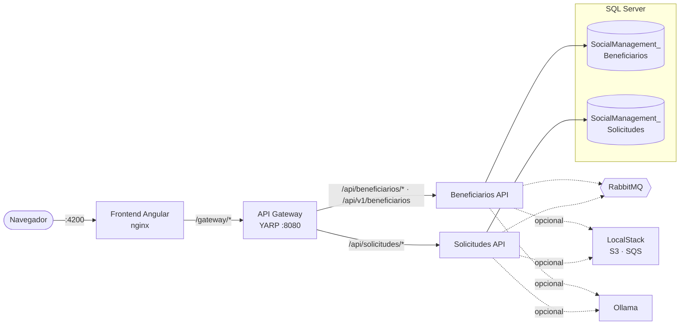

# SocialManagement

**Sistema de Gestión de Beneficiarios y Solicitudes Sociales**: proyecto del curso de
*Especialización en Arquitectura de Microservicios con .NET 10, Angular, IA Generativa y DevOps*.

Sobre la **Fase 0 (Foundation)** (esqueleto arquitectónico e infraestructura local) se construyen, sesión
a sesión, los seis módulos del curso. Estado actual: **sesión 03**, CRUD de beneficiarios con EF Core 10 y
SQL Server (`/api/v1/beneficiarios`). Ver la [tabla de sesiones](#sesiones-del-curso).



## Inicio rápido

Requisitos: **Windows 10/11**, **Docker Desktop**, **.NET SDK 10**, **Node.js 24 LTS** (o 22.12+) y **Git**.

```powershell
git clone <url-del-repositorio> C:\dev\social-management
cd C:\dev\social-management

# Solo la primera vez, si Windows bloquea los scripts:
Set-ExecutionPolicy -Scope CurrentUser RemoteSigned

.\scripts\setup.ps1        # valida requisitos, crea .env, configura user-secrets
.\scripts\start.ps1        # construye e inicia los servicios obligatorios
.\scripts\check.ps1        # verifica contenedores, endpoints y bases de datos
```

Abre <http://localhost:4200> y entra en **Estado del sistema**.

| Servicio            | URL                                           |
|---------------------|-----------------------------------------------|
| Frontend Angular    | <http://localhost:4200>                       |
| API Gateway         | <http://localhost:8080/health/ready>          |
| Beneficiarios API   | <http://localhost:8081/version> · [Swagger](http://localhost:8081/swagger) · [OpenAPI](http://localhost:8081/openapi/v1.json) · [demo](http://localhost:8081/api/demo/status) · [CRUD](http://localhost:8081/api/v1/beneficiarios) |
| CRUD vía Gateway    | <http://localhost:8080/api/v1/beneficiarios>  |
| Solicitudes API     | <http://localhost:8082/version> · [Swagger](http://localhost:8082/swagger) · [OpenAPI](http://localhost:8082/openapi/v1.json) |
| Swagger vía Gateway | <http://localhost:8080/api/beneficiarios/swagger> · <http://localhost:8080/api/solicitudes/swagger> |
| RabbitMQ (consola)  | <http://localhost:15672> (usuario y clave en `.env`) |
| SQL Server          | `localhost,14333` · usuario `sa` (clave en `.env`) |
| LocalStack (opcional) | <http://localhost:4566/_localstack/health>  |
| Ollama (opcional)   | <http://localhost:11434/api/version>          |

## Scripts

| Script                    | Qué hace                                                                    |
|---------------------------|-----------------------------------------------------------------------------|
| `scripts\setup.ps1`       | Valida requisitos, crea `.env`, guarda user-secrets e instala dependencias. |
| `scripts\start.ps1`       | Inicia los servicios obligatorios y espera a que estén sanos.               |
| `scripts\start-full.ps1`  | Además inicia LocalStack (si hay token) y Ollama.                           |
| `scripts\stop.ps1`        | Detiene todo. **Conserva** los datos.                                       |
| `scripts\restart.ps1`     | `stop` + `start` (`-Full` para incluir los perfiles opcionales).            |
| `scripts\check.ps1`       | Verifica servicios y endpoints (`-RunTests` ejecuta las pruebas de entorno). |
| `scripts\reset.ps1`       | **Borra** contenedores y volúmenes de datos, con confirmación explícita.    |

## Compilar y probar

```powershell
dotnet build SocialManagement.slnx
dotnet test --solution SocialManagement.slnx

cd src\frontend
npm run build
npx ng test --watch=false
```

## Estructura

```text
social-management/
├── src/
│   ├── backend/
│   │   ├── services/
│   │   │   ├── beneficiarios/   # Domain · Application · Infrastructure · Api  (+ .slnx propio)
│   │   │   └── solicitudes/     # Domain · Application · Infrastructure · Api  (+ .slnx propio)
│   │   └── gateway/             # SocialManagement.Gateway (YARP)
│   └── frontend/                # Angular 22 (standalone, zoneless)
├── tests/
│   ├── unit/                    # Reglas de Clean Architecture y pruebas unitarias de la API
│   ├── integration/             # APIs y Gateway en memoria
│   └── environment/             # docker-compose.yml (estático) + contenedores en vivo
├── infra/
│   ├── docker/                  # docker-compose.yml, Dockerfiles, plantilla nginx
│   ├── sqlserver/               # Script idempotente de creación de bases
│   ├── rabbitmq/                # rabbitmq.conf
│   └── localstack/              # Hook de aprovisionamiento S3/SQS
├── scripts/                     # PowerShell para gestionar el entorno
├── docs/                        # Documentación técnica
└── .github/workflows/ci.yml     # Compilación, pruebas y entorno Docker en CI
```

## Sesiones del curso

| Sesión | Tema | Entregable |
|--------|------|------------|
| Fase 0 | Foundation | Clean Architecture, Gateway, Angular e infraestructura local |
| [01](docs/sessions/session-01.md) | Primera API con .NET 10 | `GET /api/demo/status` en Beneficiarios, pruebas, OpenAPI y prompts de IA |
| [02](docs/sessions/session-02.md) | Clean Architecture | Entidad `Beneficiario`, value object `DocumentoIdentidad`, `IBeneficiarioRepository`, casos de uso registrar/consultar y SOLID |
| [03](docs/sessions/session-03.md) | CRUD de beneficiarios | EF Core 10 + SQL Server, migración `InicialBeneficiarios`, `/api/v1/beneficiarios` (201/200/400/404/409), pruebas de integración con SQL Server real |

## Documentación

- [Arquitectura y reglas de dependencia](docs/architecture.md)
- [Documentación de las APIs: Swagger UI y OpenAPI](docs/api-documentation.md)
- [Infraestructura: Docker, SQL Server, RabbitMQ, LocalStack y Ollama](docs/infrastructure.md)
- [Desarrollo local: instalación y comandos](docs/local-development.md)
- [Solución de problemas](docs/troubleshooting.md)
- [Hoja de ruta de los módulos](docs/roadmap.md)

## Seguridad

- `.env` **no se versiona**. Todos los valores de `.env.example` son exclusivos para desarrollo local.
- Las credenciales de AWS son ficticias y solo funcionan contra LocalStack. Este proyecto **no** despliega en AWS real.
- Los puertos se publican únicamente en `127.0.0.1`.
