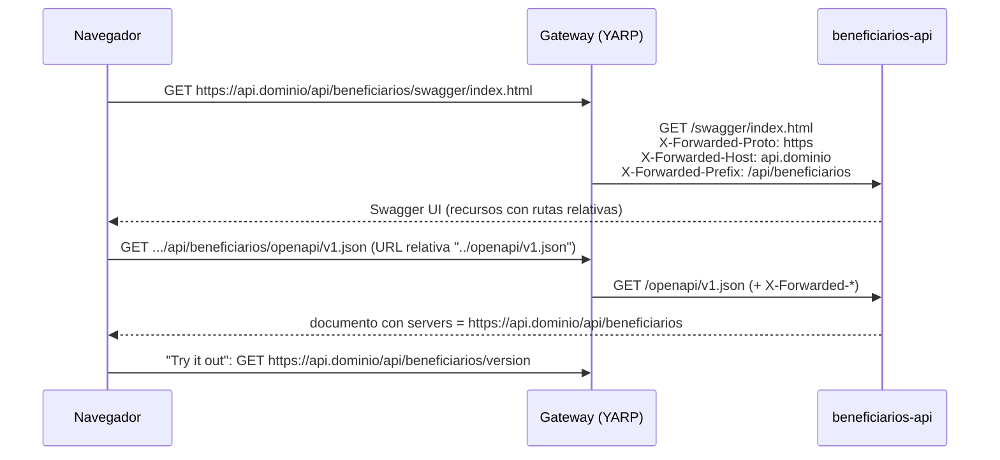

# Documentación de las APIs: Swagger UI y OpenAPI

Cada microservicio publica **su propia** documentación:

| Pieza | Tecnología | Ruta en el servicio |
|-------|------------|---------------------|
| Documento OpenAPI 3.1 (JSON) | `Microsoft.AspNetCore.OpenApi` 10.0.15 (incluido en .NET) | `/openapi/v1.json` |
| Interfaz navegable | `Swashbuckle.AspNetCore.SwaggerUI` 11.0.1 (**solo la UI**, sin el generador de Swashbuckle) | `/swagger` |

La configuración vive solo en la capa **Api** de cada servicio. Domain, Application e Infrastructure no conocen
OpenAPI ni Swagger (lo verifican las pruebas de arquitectura).

## Rutas

| Microservicio | Acceso directo (local) | A través del Gateway (local) | A través del Gateway (desplegado) |
|---------------|------------------------|------------------------------|-----------------------------------|
| Beneficiarios | <http://localhost:8081/swagger> · [JSON](http://localhost:8081/openapi/v1.json) | <http://localhost:8080/api/beneficiarios/swagger> · [JSON](http://localhost:8080/api/beneficiarios/openapi/v1.json) | `https://<dominio-del-gateway>/api/beneficiarios/swagger` |
| Solicitudes | <http://localhost:8082/swagger> · [JSON](http://localhost:8082/openapi/v1.json) | <http://localhost:8080/api/solicitudes/swagger> · [JSON](http://localhost:8080/api/solicitudes/openapi/v1.json) | `https://<dominio-del-gateway>/api/solicitudes/swagger` |

El **Gateway** (YARP) no tiene endpoints de negocio propios: solo enruta. Por eso no publica un Swagger propio; la
documentación de cada servicio se consulta a través de su prefijo.

> Todavía no existe un ambiente desplegado. Las URL "desplegadas" son el patrón esperado: se confirmarán con el job
> manual `deployed-docs` de GitHub Actions cuando exista el ambiente (ver más abajo).

### Qué incluye cada documento

- Nombre, descripción y versión del servicio (`ServiceInfo` en `appsettings.json` + `<Version>` del proyecto).
- Endpoints agrupados por controller (tags), con método HTTP, parámetros, esquemas de request/response y códigos HTTP
  (`[ProducesResponseType]`).
- Resúmenes y descripciones de los **comentarios XML** (`///`) de los controllers (`GenerateDocumentationFile`).
- El campo `servers` con la **URL pública real** (esquema, dominio y prefijo del Gateway).
- Esquema de seguridad **Bearer (JWT)** y botón **Authorize** en Swagger UI, **solo cuando el servicio registre
  autenticación Bearer** (módulo de seguridad). Las operaciones con `[Authorize]` mostrarán el candado y la respuesta 401;
  las públicas no. Hoy no hay autenticación, así que el documento no anuncia ningún esquema.

## Funcionamiento detrás del Gateway, ingress o balanceador



Tres piezas lo hacen posible:

1. **Swagger UI usa URLs relativas**: la redirección `/swagger → swagger/index.html` y el documento `../openapi/v1.json`
   funcionan con cualquier prefijo. Nunca se asume `localhost`.
2. **El Gateway envía `X-Forwarded-Prefix`** con el prefijo que elimina (`src/backend/gateway/.../appsettings.json`).
3. **Las APIs aceptan `X-Forwarded-*` solo de proxies de confianza** (`ForwardedHeaders`): loopback siempre, más las
   redes o IPs configuradas. Una petición directa de un cliente no puede falsear la URL pública (hay una prueba para eso).

Si el ingress o el balanceador agregan otro prefijo, deben enviar `X-Forwarded-Prefix` con la ruta completa y estar en
`ForwardedHeaders:KnownNetworks`/`KnownProxies`. HTTPS lo termina el Gateway o el ingress; la API lo detecta por
`X-Forwarded-Proto`.

## Configuración por ambiente

| Ambiente (`ASPNETCORE_ENVIRONMENT`) | Documentación | Acceso |
|-------------------------------------|---------------|--------|
| `Development` | Habilitada (`appsettings.Development.json`) | Libre (o Basic si se configuran credenciales) |
| `Staging` (QA) | Habilitada (`appsettings.Staging.json`) | Libre o, recomendado, HTTP Basic con credenciales |
| `Production` | **Deshabilitada** por defecto | Solo puede habilitarse **con credenciales**; si no, el servicio **no arranca** |

### Variables de entorno

| Variable | Valor por defecto | Descripción |
|----------|-------------------|-------------|
| `ApiDocumentation__Enabled` | `false` (`true` en Development y Staging) | Publica `/swagger` y `/openapi/v1.json` |
| `ApiDocumentation__RoutePrefix` | `swagger` | Ruta de Swagger UI (minúsculas, números, `-` y `/`; no puede ser `openapi`) |
| `ApiDocumentation__Access__UserName` | vacío | Usuario HTTP Basic para la documentación |
| `ApiDocumentation__Access__Password` | vacío | Clave HTTP Basic (mínimo 12 caracteres). Desde un gestor de secretos, nunca en `appsettings` |
| `ForwardedHeaders__Enabled` | `true` | Aplica `X-Forwarded-For/Proto/Host/Prefix` de proxies de confianza |
| `ForwardedHeaders__KnownProxies__0..n` | — | IPs del Gateway/ingress, p. ej. `10.0.0.5` |
| `ForwardedHeaders__KnownNetworks__0..n` | — | Redes CIDR del Gateway/ingress, p. ej. `10.0.0.0/8` |

En Docker Compose se controlan desde `.env`: `API_DOCS_ENABLED`, `API_DOCS_USER` y `API_DOCS_PASSWORD`. Compose
declara como redes de confianza los rangos privados donde Docker crea la red del Gateway (`172.16.0.0/12`,
`192.168.0.0/16`, `10.0.0.0/8`). **En producción usa la IP o red exacta del Gateway.**

Ejemplo de producción autorizada:

```bash
ASPNETCORE_ENVIRONMENT=Production
ApiDocumentation__Enabled=true
ApiDocumentation__Access__UserName=docs-reader
ApiDocumentation__Access__Password=<desde el gestor de secretos>
ForwardedHeaders__KnownNetworks__0=10.20.0.0/16
```

### Seguridad

- La documentación no expone secretos: solo describe endpoints y esquemas públicos. La configuración (cadenas de
  conexión, credenciales) nunca forma parte del documento.
- Con credenciales configuradas, `/swagger/*` y `/openapi/*` exigen **HTTP Basic** (comparación en tiempo constante).
  El resto de endpoints no cambia. HTTP Basic solo es seguro con **HTTPS** extremo a extremo hasta el Gateway.
- Los intentos con credenciales inválidas se registran en el log con la IP de origen.
- Cuando llegue JWT (módulo de seguridad), esta protección podrá reemplazarse por una política de autorización
  (`RequireAuthorization`) sobre las rutas de documentación.

## Integración continua (GitHub Actions)

Todo está en el workflow existente [`.github/workflows/ci.yml`](../.github/workflows/ci.yml):

| Job | Qué verifica |
|-----|--------------|
| `backend` | Compila (advertencias = errores) y ejecuta las pruebas, incluidas `ApiDocumentationTests` de cada API. Luego **publica cada API con `dotnet publish`**, la ejecuta en *Staging* y comprueba Swagger UI, sus recursos estáticos y el documento. Lo valida con **Redocly CLI** (`scripts/ci/redocly.yaml`) y lo sube como artefacto `openapi-documents`. |
| `environment` | Con Docker Compose levantado, verifica Swagger y el documento **a través del Gateway** y que `servers` anuncie `http://localhost:8080/api/<servicio>`. |
| `deployed-docs` | **Manual** (*Run workflow* con `docs_base_url`). Verifica un ambiente desplegado autorizado: `<url>/api/<servicio>/swagger` y `/openapi/v1.json`, HTTPS y prefijos. Usa los secrets `API_DOCS_USER` y `API_DOCS_PASSWORD` si la documentación está protegida. |

El mismo script se puede ejecutar localmente (Git Bash o Linux):

```bash
bash scripts/ci/verify-api-docs.sh published artifacts/openapi            # publica y verifica cada API
bash scripts/ci/verify-api-docs.sh remote http://localhost:8080 artifacts/openapi-gateway
API_DOCS_USER=... API_DOCS_PASSWORD=... bash scripts/ci/verify-api-docs.sh remote https://api.midominio.com artifacts/openapi-qa
SKIP_OPENAPI_LINT=1 bash scripts/ci/verify-api-docs.sh published artifacts/openapi   # sin acceso a npm
```

## Pruebas automáticas

| Prueba | Proyecto |
|--------|----------|
| Swagger UI publicado, redirección y URL **relativa** del documento | `*.Api.IntegrationTests/ApiDocumentationTests` |
| Documento válido (leído con `Microsoft.OpenApi`), título, descripción, versión, tags, esquemas y comentarios XML | ídem |
| Detrás del Gateway: `servers = https://dominio/api/<servicio>`; un proxy **no confiable** no puede falsearlo | ídem |
| Bearer: esquema y botón Authorize solo si existe autenticación; seguridad solo en operaciones `[Authorize]` | ídem |
| Deshabilitada, Staging, Production por defecto y Production sin credenciales (no arranca) | ídem |
| HTTP Basic: 401 sin credenciales o con credenciales incorrectas, 200 con las correctas; el resto de endpoints sin cambios | ídem |
| El Gateway envía `X-Forwarded-Prefix`, `Host` y `Proto` | `SocialManagement.Gateway.IntegrationTests` |
| Compose: documentación configurable y redes de confianza declaradas | `LocalEnvironment.Tests` (estática) |
| Swagger de cada servicio a través del Gateway en Docker | `LocalEnvironment.Tests` (en vivo) |
