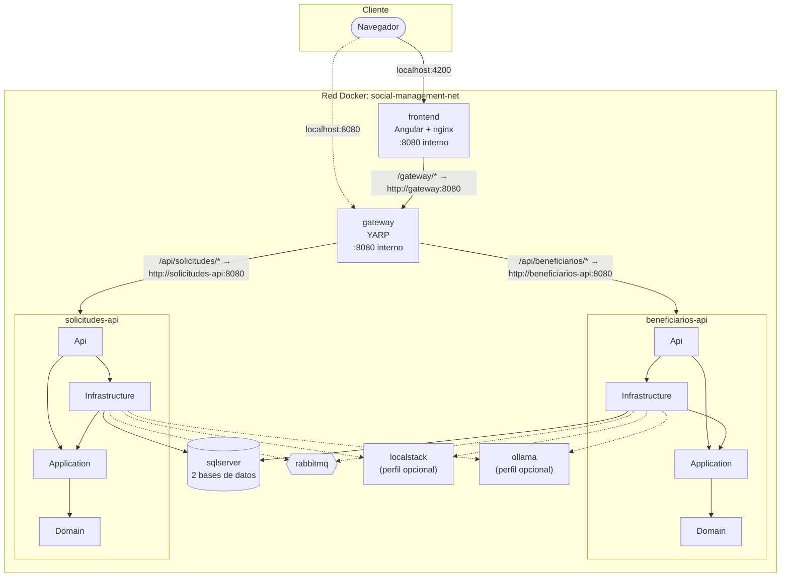
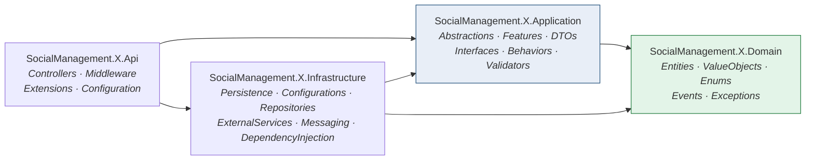

# Arquitectura

## Visión general

SocialManagement es un sistema de **microservicios**. Cada microservicio:

- se organiza internamente con **Clean Architecture** (cuatro proyectos);
- tiene **su propia base de datos** (*Database per Service*) y su propio `DbContext`;
- se publica hacia el exterior **solo a través del API Gateway**;
- se comunica con otros servicios mediante **mensajes** (RabbitMQ), nunca accediendo a su base de datos.



## Clean Architecture

Cada microservicio tiene cuatro proyectos. Las flechas indican **"depende de"**:



| Capa            | Responsabilidad                                                       | Puede depender de          | No puede depender de                     |
|-----------------|-----------------------------------------------------------------------|----------------------------|------------------------------------------|
| Domain          | Modelo y reglas del negocio.                                          | Nada (solo la BCL de .NET) | EF Core, ASP.NET Core, SDKs, otras capas |
| Application     | Casos de uso; define *interfaces* que otros implementan.              | Domain                     | Infrastructure, Api, frameworks          |
| Infrastructure  | Detalles técnicos: EF Core, RabbitMQ, AWS, Ollama.                    | Application, Domain        | Api                                      |
| Api             | HTTP: recibe peticiones, delega en Application, devuelve respuestas.  | Application, Infrastructure | —                                       |

### Inversión de dependencias en la práctica

`Application` define el contrato y `Infrastructure` lo implementa. Ejemplo ya presente en el código:

```text
Application/Abstractions/Messaging/IIntegrationEventPublisher.cs   ← contrato (Fase 0)
Infrastructure/Messaging/RabbitMqIntegrationEventPublisher.cs       ← implementación (módulo de mensajería)
```

### Composición (Dependency Injection)

Cada capa expone **un único método** de registro y `Program.cs` solo los encadena:

```csharp
builder.Services
    .AddApplication()        // Application/DependencyInjection.cs
    .AddInfrastructure()     // Infrastructure/DependencyInjection/InfrastructureServiceCollectionExtensions.cs
    .AddApiPresentation();   // Api/Extensions/ApiServiceCollectionExtensions.cs
```

`Program.cs` activa `ValidateOnBuild` y `ValidateScopes`: si falta un registro, la aplicación no arranca.

### Reglas verificadas automáticamente

El proyecto `tests/unit/SocialManagement.Architecture.Tests` comprueba en cada compilación de CI:

| Verificación                                                    | Cómo                                     |
|-----------------------------------------------------------------|------------------------------------------|
| Referencias permitidas entre capas                              | Lee los `<ProjectReference>` de cada `.csproj` |
| Domain sin paquetes NuGet                                       | Lee los `<PackageReference>`             |
| Domain solo usa la biblioteca base de .NET                      | `Assembly.GetReferencedAssemblies()`     |
| Application no usa EF Core, ASP.NET Core, RabbitMQ, AWS ni YARP | `Assembly.GetReferencedAssemblies()`     |
| Un microservicio no referencia proyectos de otro                | `.csproj` y ensamblados                  |
| No existe una biblioteca "Shared/Common" de dominio             | Busca proyectos con esos nombres         |

> Prueba a agregar `<ProjectReference>` de `Application` a `Infrastructure`: las pruebas fallarán
> y te dirán qué regla se rompió.

## Decisiones de diseño

| Decisión | Motivo |
|----------|--------|
| **Una solución por microservicio** (`SocialManagement.Beneficiarios.slnx`, `SocialManagement.Solicitudes.slnx`) y una solución raíz (`SocialManagement.slnx`) que agrupa todo. | Cada equipo puede abrir solo su servicio; CI compila todo junto. |
| **Sin biblioteca compartida** entre servicios. Las piezas técnicas pequeñas (manejo de errores, health checks, opciones) están **duplicadas a propósito**. | Evita el acoplamiento entre servicios. Si en el futuro se necesita compartir algo técnico, se publicará como paquete NuGet versionado, nunca con entidades de dominio. |
| **Esquema SQL propio** por servicio (`beneficiarios`, `solicitudes`) además de bases separadas. | Deja explícito el dueño de cada tabla y de su historial de migraciones. |
| **Conexiones perezosas** a RabbitMQ y clientes AWS. | El servicio arranca aunque la dependencia no esté lista; su estado se ve en `/health/ready`. |
| **Gateway con `PathRemovePrefix`**: `/api/beneficiarios/version` → `/version`. | Cada servicio expone rutas desde su raíz y no conoce su prefijo público. |
| **El frontend llama a `/gateway/*` en su propio origen** (proxy de desarrollo o nginx). | Sin CORS y sin URLs del Gateway escritas en el código Angular. |

## Endpoints técnicos

| Componente  | Endpoint          | Significado                                                   |
|-------------|-------------------|---------------------------------------------------------------|
| APIs        | `GET /health`     | *Liveness*: el proceso responde. No consulta dependencias. Lo usa Docker. |
| APIs        | `GET /health/ready` | *Readiness*: SQL Server (`DbContext.CanConnect`) y RabbitMQ (conexión AMQP). |
| APIs        | `GET /version`    | Nombre, versión, entorno y framework.                         |
| APIs        | `GET /openapi/v1.json` | Documento OpenAPI (según `ApiDocumentation:Enabled`; ver [api-documentation.md](api-documentation.md)). |
| APIs        | `GET /swagger`    | Swagger UI (misma configuración por ambiente).                |
| Gateway     | `GET /health`     | El Gateway responde.                                          |
| Gateway     | `GET /health/ready` | El Gateway alcanza el `/health` de cada microservicio.      |

Los errores se devuelven como **ProblemDetails** (`application/problem+json`, RFC 9457):

| Excepción                       | HTTP | `detail`                       |
|---------------------------------|------|--------------------------------|
| Hereda de `DomainException`     | 422  | Mensaje de la excepción        |
| Cualquier otra                  | 500  | Vacío (no se exponen detalles internos) |

Todas las respuestas de error incluyen `traceId` para correlacionarlas con los logs.

## Configuración

Se usa el **Options Pattern** con validación al inicio (`ValidateOnStart`). Si falta un valor, el servicio
no arranca y el log indica la clave y la variable de entorno equivalente:

```text
Falta la configuración obligatoria 'RabbitMq:Password'. Defínela en appsettings, en user-secrets
(ejecuta scripts/setup.ps1) o con la variable de entorno 'RabbitMq__Password'.
```

| Sección             | Clase                | Capa           | Origen en Docker            | Origen con `dotnet run`         |
|---------------------|----------------------|----------------|-----------------------------|---------------------------------|
| `ConnectionStrings` | `SqlServerOptions`   | Infrastructure | Variable de entorno         | user-secrets (`setup.ps1`)      |
| `RabbitMq`          | `RabbitMqOptions`    | Infrastructure | Variables de entorno        | appsettings.Development + user-secrets |
| `Aws`               | `AwsOptions`         | Infrastructure | Variables de entorno        | appsettings.json + user-secrets |
| `Ollama`            | `OllamaOptions`      | Infrastructure | Variables de entorno        | appsettings.json                |
| `ServiceInfo`       | `ServiceInfoOptions` | Api            | appsettings.json            | appsettings.json                |
| `ReverseProxy`      | (YARP)               | Gateway        | appsettings + variables     | appsettings.json                |

## Logging

Se usa `ILogger<T>` con **mensajes estructurados** (plantillas con `{Propiedad}`, nunca concatenación):

```csharp
logger.LogInformation("Conexión con RabbitMQ establecida en {Host}:{Port}", host, port);
```

Dentro de Docker, `Logging__Console__FormatterName=json` escribe cada evento como un objeto JSON,
listo para una futura plataforma de observabilidad.
