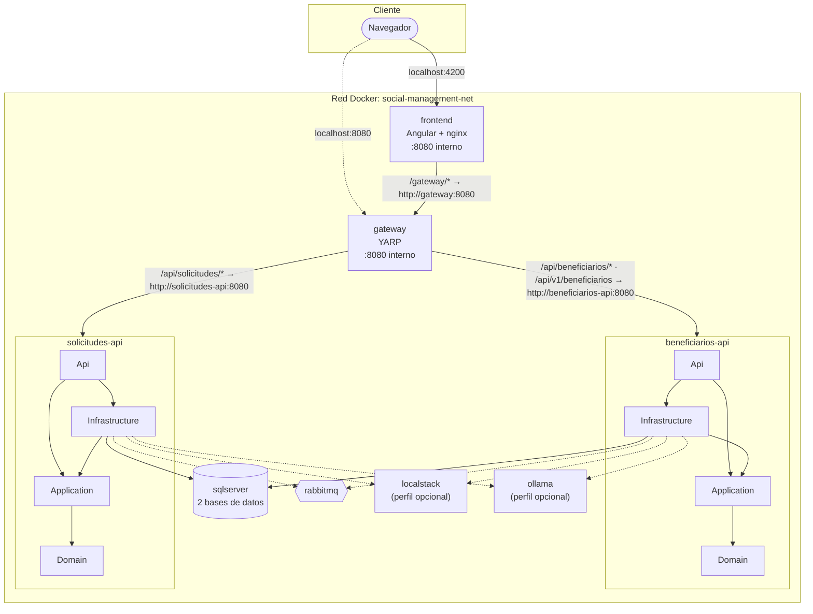
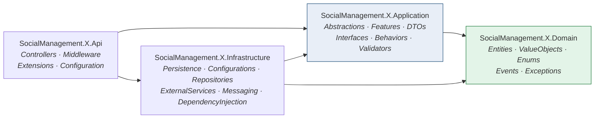
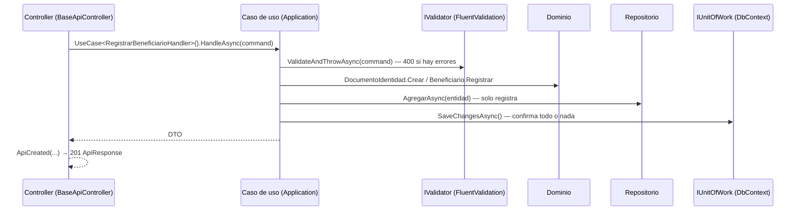

# Arquitectura

## Visión general

SocialManagement es un sistema de **microservicios**. Cada microservicio:

- se organiza internamente con **Clean Architecture** (cuatro proyectos);
- tiene **su propia base de datos** (*Database per Service*) y su propio `DbContext`;
- se publica hacia el exterior **solo a través del API Gateway**;
- se comunica con otros servicios mediante **eventos** (RabbitMQ) y, solo cuando necesita una respuesta inmediata,
  por **HTTP a la API pública** del otro servicio; nunca accede a su base de datos;
- valida por sí mismo el **token JWT** de cada petición (el Gateway lo reenvía sin validarlo).

Contextos, contratos entre servicios y propiedad de datos: [microservices-design.md](microservices-design.md).
Autenticación y autorización: [security.md](security.md).



## Clean Architecture

Cada microservicio tiene cuatro proyectos. Las flechas indican **"depende de"**:



| Capa            | Responsabilidad                                                       | Puede depender de          | No puede depender de                     |
|-----------------|-----------------------------------------------------------------------|----------------------------|------------------------------------------|
| Domain          | Modelo y reglas del negocio.                                          | Nada (solo la BCL de .NET) | EF Core, ASP.NET Core, SDKs, otras capas |
| Application     | Casos de uso; define *interfaces* que otros implementan.              | Domain                     | Infrastructure, Api, frameworks          |
| Infrastructure  | Detalles técnicos: EF Core, RabbitMQ, AWS, Ollama.                    | Application, Domain        | Api                                      |
| Api             | HTTP: recibe peticiones, delega en Application, devuelve respuestas.  | Application, Infrastructure | —                                       |

### Inversión de dependencias en la práctica

`Application` define el contrato y `Infrastructure` lo implementa. Ejemplo ya presente en el código:

```text
Application/Abstractions/Messaging/IIntegrationEventPublisher.cs   ← contrato (Fase 0)
Infrastructure/Messaging/RabbitMqIntegrationEventPublisher.cs       ← implementación (módulo de mensajería)
```

### Composición (Dependency Injection)

Cada capa expone **un único método** de registro y `Program.cs` solo los encadena:

```csharp
builder.Services
    .AddApplication()        // Application/DependencyInjection.cs
    .AddInfrastructure()     // Infrastructure/DependencyInjection/InfrastructureServiceCollectionExtensions.cs
    .AddApiPresentation();   // Api/Extensions/ApiServiceCollectionExtensions.cs
```

`Program.cs` activa `ValidateOnBuild` y `ValidateScopes`: si falta un registro, la aplicación no arranca.

### Reglas verificadas automáticamente

El proyecto `tests/unit/SocialManagement.Architecture.Tests` comprueba en cada compilación de CI:

| Verificación                                                    | Cómo                                     |
|-----------------------------------------------------------------|------------------------------------------|
| Referencias permitidas entre capas                              | Lee los `<ProjectReference>` de cada `.csproj` |
| Domain sin paquetes NuGet                                       | Lee los `<PackageReference>`             |
| Domain solo usa la biblioteca base de .NET                      | `Assembly.GetReferencedAssemblies()`     |
| Application no usa EF Core, ASP.NET Core, RabbitMQ, AWS ni YARP | `Assembly.GetReferencedAssemblies()`     |
| Un microservicio no referencia proyectos de otro                | `.csproj` y ensamblados                  |
| No existe una biblioteca "Shared/Common" de dominio             | Busca proyectos con esos nombres         |
| Entidades y value objects sin setters ni constructores públicos | Reflexión sobre `Domain.Entities` y `Domain.ValueObjects` |
| Entidades sin atributos de persistencia (`[Key]`, `[Required]`...) | Reflexión: el mapeo va en `Infrastructure/Persistence/Configurations` |
| Un tipo por archivo, con el nombre del tipo                      | `SourceFileConventionsTests` sobre `src` y `tests` |
| Entidades con `Id` entero (`int`) y ningún uso del tipo `Guid`   | `IdentifierRulesTests`: reflexión sobre `Domain.Entities` y búsqueda en `src` y `tests` |
| Toda ruta de negocio `/api/v{n}/...` declara su política de autorización | `AuthorizationTests` (integración): recorre los endpoints registrados |

> Prueba a agregar `<ProjectReference>` de `Application` a `Infrastructure`: las pruebas fallarán
> y te dirán qué regla se rompió.

## Decisiones de diseño

| Decisión | Motivo |
|----------|--------|
| **Una solución por microservicio** (`SocialManagement.Beneficiarios.slnx`, `SocialManagement.Solicitudes.slnx`) y una solución raíz (`SocialManagement.slnx`) que agrupa todo. | Cada equipo puede abrir solo su servicio; CI compila todo junto. |
| **Sin biblioteca compartida** entre servicios. Las piezas técnicas pequeñas (manejo de errores, health checks, opciones) están **duplicadas a propósito**. | Evita el acoplamiento entre servicios. Si en el futuro se necesita compartir algo técnico, se publicará como paquete NuGet versionado, nunca con entidades de dominio. |
| **Identificadores enteros, sin GUID** (desde el 14/11/2026): las entidades usan `int Id` generado por SQL Server (`IDENTITY(1,1)`); el dominio no lo asigna (vale 0 hasta guardar). Los eventos de integración usan `long EventId` asignado por el emisor (p. ej. tabla outbox). | Ids legibles y fáciles de usar en URLs (`/api/v1/beneficiarios/25`), en soporte y en clase; claves primarias compactas. Regla del proyecto verificada por `IdentifierRulesTests`. |
| **Esquema SQL propio** por servicio (`beneficiarios`, `solicitudes`) además de bases separadas. | Deja explícito el dueño de cada tabla y de su historial de migraciones. |
| **Conexiones perezosas** a RabbitMQ y clientes AWS. | El servicio arranca aunque la dependencia no esté lista; su estado se ve en `/health/ready`. |
| **Gateway con `PathRemovePrefix`** para los endpoints técnicos y la documentación: `/api/beneficiarios/version` → `/version`. | Cada servicio expone rutas desde su raíz y no conoce su prefijo público. |
| **Gateway sin reescritura** para los recursos versionados: `/api/v1/beneficiarios/...` → igual en el servicio (ruta `beneficiarios-versioned-route`, restricción `v<número>`). | La URL pública del recurso es la misma que documenta el OpenAPI del servicio. |
| **Migraciones aplicadas al iniciar solo en Docker Compose** (`Persistence__ApplyMigrationsAtStartup=true`); en otros ambientes, `dotnet ef database update` o un script SQL idempotente revisado. | Comodidad en desarrollo sin arriesgar cambios de esquema automáticos en producción. |
| **El frontend llama a `/gateway/*` en su propio origen** (proxy de desarrollo o nginx). | Sin CORS y sin URLs del Gateway escritas en el código Angular. |
| **Cada servicio valida el JWT** (`AddJwtBearer`); el Gateway solo reenvía `Authorization`. | Ningún servicio confía en que "alguien antes" validó: si se accede al servicio sin pasar por el Gateway, sigue protegido. |
| **Políticas por tipo de operación** (`Beneficiarios.Lectura`, `.Escritura`, `.Desactivacion`) declaradas en cada acción, también en las de lectura. | Quién puede hacer qué se cambia en un solo archivo (`AuthorizationPolicies.cs`); los datos personales nunca quedan públicos por omisión. |
| **Emisión de tokens solo en Development** (`/api/auth/dev-token`), con usuarios demo en user-secrets o variables de entorno. | Permite probar sin un proveedor de identidad; en producción los tokens los emitirá un proveedor OAuth 2.0 / OIDC (módulo 4). |
| **`ICurrentUser` en Application**; la API lo implementa con el usuario del token. | La auditoría (`CreatedBy`/`UpdatedBy`) conoce al usuario sin que Infrastructure dependa de ASP.NET Core. |

## Endpoints técnicos

| Componente  | Endpoint          | Significado                                                   |
|-------------|-------------------|---------------------------------------------------------------|
| APIs        | `GET /health`     | *Liveness*: el proceso responde. No consulta dependencias. Lo usa Docker. |
| APIs        | `GET /health/ready` | *Readiness*: SQL Server (`DbContext.CanConnect`) y RabbitMQ (conexión AMQP). |
| APIs        | `GET /version`    | Nombre, versión, entorno y framework.                         |
| APIs        | `GET /openapi/v1.json` | Documento OpenAPI (según `ApiDocumentation:Enabled`; ver [api-documentation.md](api-documentation.md)). |
| APIs        | `GET /swagger`    | Swagger UI (misma configuración por ambiente).                |
| Gateway     | `GET /health`     | El Gateway responde.                                          |
| Gateway     | `GET /health/ready` | El Gateway alcanza el `/health` de cada microservicio.      |

Los endpoints técnicos son **Minimal APIs** y sus errores se devuelven como **ProblemDetails**
(`application/problem+json`, RFC 9457). Los controllers de recursos usan `ApiResponse<T>` (ver la sección siguiente).

| Excepción                       | HTTP | Mensaje al cliente             |
|---------------------------------|------|--------------------------------|
| Hereda de `DomainException`     | 422  | Mensaje de la excepción        |
| Cualquier otra                  | 500  | Ninguno (no se exponen detalles internos) |

Todas las respuestas de error incluyen `traceId` para correlacionarlas con los logs.

## Convenciones de la capa API

| Tipo de endpoint | Cómo se escribe | Dónde | Formato de respuesta |
|------------------|-----------------|-------|----------------------|
| Puntual o técnico (`/version`, `/api/demo/status`) | **Minimal API**: `app.MapGet` en `Program.cs` + función estática | `Api/Endpoints/` | DTO directo; errores en ProblemDetails |
| Recurso con varias operaciones (CRUD de beneficiarios...) | **Controller** que hereda de `BaseApiController` | `Api/Controllers/` | `ApiResponse<T>` en éxitos y errores |
| Modelos HTTP | `record` en su propio archivo | `Api/Contracts/` | — |

### `BaseApiController`

Todos los controllers heredan de `Controllers/BaseApiController.cs`, que concentra la configuración común para no
repetirla en cada uno:

- `[ApiController]`, `[Route("api/v{version:apiVersion}/[controller]")]` (versión en la URL y rutas en minúsculas:
  `BeneficiariosController` → `/api/v1/beneficiarios`) y `[Produces("application/json")]`.
- Respuestas de error 400, 422 y 500 documentadas en OpenAPI para todas las acciones.
- Métodos que devuelven `ApiResponse<T>`: `ApiOk`, `ApiCreated`, `ApiNotFound`, `ApiOkOrNotFound`.
- Dependencias comunes **sin inyección por constructor**, resueltas solo cuando se usan: `UseCase<T>()` (casos de uso
  de Application), `Logger` y `TraceId`.

```json
// ApiResponse<T>: éxito (200/201)
{ "success": true, "data": { "id": 25 }, "message": null, "errors": [], "traceId": "00-..." }

// ApiResponse<T>: error (400/404/422/500)
{ "success": false, "data": null, "message": "La solicitud contiene datos no válidos.",
  "errors": [ { "field": "Nombres", "message": "Los nombres son obligatorios." } ], "traceId": "00-..." }
```

| Error en un controller | Quién lo produce | HTTP |
|------------------------|------------------|------|
| Modelo inválido (tipos, JSON mal formado, `[Required]`) | `InvalidModelStateResponseFactory` (`AddApiPresentation`) | 400 |
| Datos de entrada inválidos (FluentValidation) | El caso de uso lanza `ValidationException` → `GlobalExceptionHandler` | 400 |
| Sin token o token inválido (sesión 04) | JwtBearer + `ApiResponseAuthorizationResultHandler` | 401 |
| Token válido sin el rol de la política | `ApiResponseAuthorizationResultHandler` | 403 |
| Recurso inexistente | `ApiNotFound` / `ApiOkOrNotFound` | 404 |
| `DomainException` | `GlobalExceptionHandler` | 422 |
| Excepción inesperada | `GlobalExceptionHandler` (sin detalles internos) | 500 |

Fuera de los controllers (Minimal APIs), los mismos errores usan ProblemDetails; los de validación, el formato estándar
`ValidationProblemDetails` (`{ "errors": { "Campo": ["mensaje"] } }`).

### Versionado de la API

| Elemento | Detalle |
|----------|---------|
| Ruta | `api/v{version:apiVersion}/[controller]` en `BaseApiController` → `/api/v1/beneficiarios` |
| Versión por defecto | 1.0: un controller sin `[ApiVersion]` pertenece a la v1 |
| Nueva versión | `[ApiVersion("2.0")]` en el controller o la acción que cambia; ambas versiones conviven |
| Cabecera de respuesta | `api-supported-versions: 1.0` |
| Versión inexistente o ausente | La petición no llega al controller (400/404) |
| OpenAPI | Un documento por versión (`/openapi/v1.json`), con rutas ya resueltas (`/api/v1/...`) |
| Paquete | `Asp.Versioning.OpenApi` (registro en `Extensions/ApiVersioningExtensions.cs`) |

Los Minimal APIs técnicos (`/version`, `/health`, `/api/demo/status`) no se versionan.

### Validación de los datos de entrada (FluentValidation)

Los datos llegan como comandos o consultas (DTOs de entrada de Application) y se validan **antes** de convertirse en
objetos de dominio:

| Nivel | Dónde | Para qué |
|-------|-------|----------|
| 1. Entrada | `Application/Validators/*Validator.cs` (FluentValidation) | Informar **todos** los errores a la vez, por campo, para mostrarlos en el formulario |
| 2. Invariantes | Entidades y value objects del dominio | Última barrera: un objeto de dominio nunca existe en estado inválido |

- Los validadores se registran solos (`AddValidatorsFromAssembly` en `AddApplication`) y cada caso de uso recibe su
  `IValidator<T>` y llama a `ValidateAndThrowAsync` como primer paso.
- Para no duplicar reglas, el validador **reutiliza las del dominio** (`Beneficiario.LongitudMaximaNombre`,
  `NormalizarNombre`, `TieneCaracteresPermitidos`, `DocumentoIdentidad.EsValido`). La prueba
  `El_validador_y_el_dominio_coinciden` comprueba que ambos niveles aceptan y rechazan los mismos datos.
- FluentValidation es el único paquete permitido en Application además de la abstracción de DI (lo verifican las
  pruebas de arquitectura): no es infraestructura ni HTTP.

### Flujo completo con validación y Unit of Work



- El **controller no conoce la persistencia**: solo obtiene y ejecuta casos de uso.
- El **caso de uso** coordina repositorios y confirma con `IUnitOfWork` (definido en `Application/Interfaces`).
- `IUnitOfWork` lo implementa el **`DbContext`** del servicio y se registra como la misma instancia *scoped* que usarán
  los repositorios: todo lo registrado durante la petición se guarda en una sola transacción.
- Al confirmar, el interceptor `AuditableEntityInterceptor` completa la **auditoría** (`CreatedAtUtc`, `CreatedBy`,
  `UpdatedAtUtc`, `UpdatedBy`) de las entidades que heredan de `AuditableEntity`, llamando a `MarkCreated` /
  `MarkUpdated`. Ni el controller ni el caso de uso escriben esos campos.

## Configuración

Se usa el **Options Pattern** con validación al inicio (`ValidateOnStart`). Si falta un valor, el servicio
no arranca y el log indica la clave y la variable de entorno equivalente:

```text
Falta la configuración obligatoria 'RabbitMq:Password'. Defínela en appsettings, en user-secrets
(ejecuta scripts/setup.ps1) o con la variable de entorno 'RabbitMq__Password'.
```

| Sección             | Clase                | Capa           | Origen en Docker            | Origen con `dotnet run`         |
|---------------------|----------------------|----------------|-----------------------------|---------------------------------|
| `ConnectionStrings` | `SqlServerOptions`   | Infrastructure | Variable de entorno         | user-secrets (`setup.ps1`)      |
| `RabbitMq`          | `RabbitMqOptions`    | Infrastructure | Variables de entorno        | appsettings.Development + user-secrets |
| `Aws`               | `AwsOptions`         | Infrastructure | Variables de entorno        | appsettings.json + user-secrets |
| `Ollama`            | `OllamaOptions`      | Infrastructure | Variables de entorno        | appsettings.json                |
| `ServiceInfo`       | `ServiceInfoOptions` | Api            | appsettings.json            | appsettings.json                |
| `ReverseProxy`      | (YARP)               | Gateway        | appsettings + variables     | appsettings.json                |

## Logging

Se usa `ILogger<T>` con **mensajes estructurados** (plantillas con `{Propiedad}`, nunca concatenación):

```csharp
logger.LogInformation("Conexión con RabbitMQ establecida en {Host}:{Port}", host, port);
```

Dentro de Docker, `Logging__Console__FormatterName=json` escribe cada evento como un objeto JSON,
listo para una futura plataforma de observabilidad.
