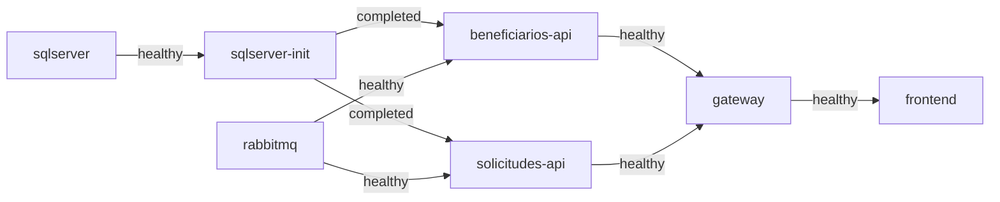

# Infraestructura local

Todo el entorno se define en [`infra/docker/docker-compose.yml`](../infra/docker/docker-compose.yml).
Los valores variables (puertos, credenciales, nombres de recursos) se leen de `.env`.

## Versiones seleccionadas

| Componente | Versión | Notas |
|------------|---------|-------|
| .NET SDK | 10.0.400 (`global.json`, `rollForward: latestFeature`) | LTS |
| Imágenes .NET | `mcr.microsoft.com/dotnet/sdk:10.0` y `aspnet:10.0` | Reciben parches de seguridad de la rama 10.0 |
| ASP.NET Core, EF Core, OpenAPI, Health Checks | 10.0.15 | Rama 10.0 (no 11.x) para mantener .NET 10 LTS |
| Microsoft.Data.SqlClient | 6.1.7 | La misma que usa EF Core 10.0.15 |
| YARP (`Yarp.ReverseProxy`) | 2.3.0 | |
| Swagger UI (`Swashbuckle.AspNetCore.SwaggerUI`) | 11.0.1 | Solo la interfaz; el documento lo genera `Microsoft.AspNetCore.OpenApi` ([detalle](api-documentation.md)) |
| RabbitMQ.Client | 7.2.2 | API asíncrona |
| AWS SDK for .NET (`AWSSDK.S3` / `AWSSDK.SQS`) | 4.0.104.12 / 4.0.100.26 | |
| xUnit v3 | 4.0.3 | Sobre Microsoft.Testing.Platform (`global.json` → `test.runner`) |
| Angular | 22.2 (CLI 22.2.6) | Standalone, zoneless, Vitest 5 |
| TypeScript | 6.0 | |
| Node.js | 24 LTS (`node:24-alpine` en Docker) | Mínimo 22.12 |
| SQL Server | `mcr.microsoft.com/mssql/server:2022-CU27-ubuntu-22.04` | Edición Developer (configurable con `MSSQL_PID`) |
| RabbitMQ | `rabbitmq:4.3.7-management-alpine` | Incluye la consola de administración |
| LocalStack | `localstack/localstack:2026.10.6` | Requiere `LOCALSTACK_AUTH_TOKEN` |
| Ollama | `ollama/ollama:0.40.16` | Sin modelos preinstalados |
| nginx | `nginxinc/nginx-unprivileged:1.30-alpine` | Sirve el frontend sin ejecutarse como root |

Las versiones de los paquetes NuGet se centralizan en [`Directory.Packages.props`](../Directory.Packages.props).

## Servicios de Docker Compose

| Servicio | Perfil | Puerto host → contenedor | Depende de | Health check |
|----------|--------|---------------------------|------------|--------------|
| `sqlserver` | — | `14333 → 1433` | — | `sqlcmd SELECT 1` |
| `sqlserver-init` | — | — | `sqlserver` sano | Tarea única: termina con código 0 |
| `rabbitmq` | — | `5672 → 5672`, `15672 → 15672` | — | `rabbitmq-diagnostics ping` + `check_port_connectivity` |
| `beneficiarios-api` | — | `8081 → 8080` | `sqlserver-init` completado, `rabbitmq` sano | `GET /health` |
| `solicitudes-api` | — | `8082 → 8080` | `sqlserver-init` completado, `rabbitmq` sano | `GET /health` |
| `gateway` | — | `8080 → 8080` | ambas APIs sanas | `GET /health` |
| `frontend` | — | `4200 → 8080` | `gateway` sano | `GET /` |
| `localstack` | `localstack` | `4566 → 4566` | — | Hook `ready` completado |
| `ollama` | `ollama` | `11434 → 11434` | — | `ollama list` |



### Reglas importantes

- **Dentro de un contenedor, `localhost` es el propio contenedor.** Los servicios se llaman por su nombre
  en la red de Compose: `sqlserver`, `rabbitmq`, `gateway`, `beneficiarios-api`... y por su puerto
  **interno** (p. ej. `http://beneficiarios-api:8080`, no `8081`).
- Los puertos del host se publican solo en `127.0.0.1` y se cambian en `.env`.
- Red dedicada: `social-management-net`.
- Volúmenes persistentes: `social-management-sqlserver-data`, `-rabbitmq-data`, `-localstack-data`, `-ollama-data`.

### Endurecimiento de contenedores

| Medida | Dónde |
|--------|-------|
| Usuario sin privilegios (`$APP_UID`) | Imágenes .NET |
| Sistema de archivos de solo lectura + `/tmp` en memoria | APIs y Gateway (`read_only: true`) |
| `no-new-privileges` y `cap_drop: ALL` | APIs, Gateway y frontend |
| nginx sin root (puerto 8080) | Frontend |
| SQL Server se ejecuta como usuario `mssql` | Imagen oficial |

### Dockerfiles multi-stage

- [`dotnet-api.Dockerfile`](../infra/docker/dotnet-api.Dockerfile): una sola definición para las tres aplicaciones .NET,
  parametrizada con `PROJECT_DIR` y `PROJECT_NAME`. Etapa `build` (SDK) → etapa `runtime` (ASP.NET, sin SDK).
- [`frontend.Dockerfile`](../infra/docker/frontend.Dockerfile): etapa `build` (Node) → etapa `runtime` (nginx).

El contexto de construcción es la raíz del repositorio; [`.dockerignore`](../.dockerignore) excluye `bin/`, `obj/`,
`node_modules/`, pruebas y documentación.

### Comandos útiles

```powershell
$compose = "docker compose -f infra/docker/docker-compose.yml --env-file .env"

Invoke-Expression "$compose ps"                       # estado
Invoke-Expression "$compose logs -f gateway"          # logs de un servicio
Invoke-Expression "$compose up -d --build gateway"    # reconstruir un servicio
Invoke-Expression "$compose config"                   # ver el compose con las variables resueltas
```

## SQL Server

- Dos bases de datos **independientes**: `SocialManagement_Beneficiarios` y `SocialManagement_Solicitudes`.
- Las crea el servicio `sqlserver-init` ejecutando
  [`infra/sqlserver/init/01-create-databases.sql`](../infra/sqlserver/init/01-create-databases.sql),
  que es **idempotente** (`IF DB_ID(...) IS NULL`). Se ejecuta en cada `start`.
- **No se crean tablas**: las crearán las migraciones de EF Core.
- La contraseña de `sa` viene de `MSSQL_SA_PASSWORD` (`.env`).

Conexión desde SSMS o Azure Data Studio: servidor `localhost,14333`, usuario `sa`, "Trust server certificate".

### Migraciones de EF Core (cuando existan entidades)

Cada servicio tiene su propio `DbContext` y su propio historial de migraciones (`<esquema>.__EFMigrationsHistory`).

```powershell
# 1. Herramienta (una vez)
dotnet tool install --global dotnet-ef

# 2. Crear una migración en el proyecto Infrastructure, usando la API como proyecto de inicio
dotnet ef migrations add InitialCreate `
  --project src/backend/services/beneficiarios/SocialManagement.Beneficiarios.Infrastructure `
  --startup-project src/backend/services/beneficiarios/SocialManagement.Beneficiarios.Api `
  --output-dir Persistence/Migrations

# 3. Aplicarla a la base local (usa la cadena de conexión de user-secrets)
dotnet ef database update `
  --project src/backend/services/beneficiarios/SocialManagement.Beneficiarios.Infrastructure `
  --startup-project src/backend/services/beneficiarios/SocialManagement.Beneficiarios.Api
```

Antes de la primera migración: agrega el `DbSet` al `DbContext`, crea la clase `IEntityTypeConfiguration<T>`
en `Persistence/EntityConfigurations` y descomenta `ApplyConfigurationsFromAssembly` en el `DbContext`.

## RabbitMQ

- Imagen con la consola de administración: <http://localhost:15672>.
- Usuario, contraseña y *virtual host* (`social-management`) vienen de `.env`
  (`RABBITMQ_USER`, `RABBITMQ_PASSWORD`, `RABBITMQ_VHOST`).
- Configuración adicional: [`infra/rabbitmq/rabbitmq.conf`](../infra/rabbitmq/rabbitmq.conf) (montada en `conf.d`).
- Datos persistentes en el volumen `social-management-rabbitmq-data`.

En cada microservicio:

| Pieza | Ubicación | Estado en Fase 0 |
|-------|-----------|------------------|
| `RabbitMqOptions` | `Infrastructure/Configurations` | Validada al inicio |
| `IRabbitMqConnectionProvider` | `Infrastructure/Messaging` | Conexión única, perezosa, con reconexión automática |
| `RabbitMqHealthCheck` | `Infrastructure/Messaging` | Incluido en `/health/ready` |
| `IIntegrationEvent`, `IIntegrationEventPublisher`, `IIntegrationEventHandler<T>` | `Application/Abstractions/Messaging` | Solo contratos |

No se crean colas, *exchanges* ni mensajes de ejemplo.

## LocalStack (perfil opcional `localstack`)

LocalStack emula servicios de AWS en local. **No reemplaza** a SQL Server ni a RabbitMQ: se usará en laboratorios
específicos de AWS.

### Requisito: token de autenticación

Desde 2026 la imagen `localstack/localstack` **exige** `LOCALSTACK_AUTH_TOKEN` para iniciar.
El plan **Hobby** es gratuito para uso no comercial (como este curso).

1. Crea una cuenta en <https://app.localstack.cloud>.
2. Copia tu token en **Settings → Auth Tokens**.
3. Pégalo en `.env`: `LOCALSTACK_AUTH_TOKEN=ls-...` (`.env` no se versiona).
4. Ejecuta `.\scripts\start-full.ps1`.

Si el token falta o no es válido, `start-full.ps1` lo indica y **el resto del entorno sigue funcionando**:
ningún servicio obligatorio depende de LocalStack. La disponibilidad de servicios puede variar según el plan:
consulta <https://docs.localstack.cloud> si S3 o SQS no aparecen en `/_localstack/health`.

### Recursos aprovisionados

El hook [`infra/localstack/init/ready.d/01-create-resources.sh`](../infra/localstack/init/ready.d/01-create-resources.sh)
se ejecuta cuando LocalStack está listo y crea (de forma idempotente):

| Servicio | Recurso | Variable |
|----------|---------|----------|
| S3  | `social-management-documents-dev` | `AWS_S3_DOCUMENTS_BUCKET` |
| SQS | `social-management-notifications-dev` | `AWS_SQS_NOTIFICATIONS_QUEUE` |

Región `us-east-1` y credenciales ficticias `test`/`test`.

### Verificar con herramientas compatibles con AWS CLI

```powershell
# Dentro del contenedor (awslocal ya incluido)
docker compose -f infra/docker/docker-compose.yml --profile localstack exec localstack awslocal s3 ls
docker compose -f infra/docker/docker-compose.yml --profile localstack exec localstack awslocal sqs list-queues

# Desde el host con AWS CLI v2 instalada
$env:AWS_ACCESS_KEY_ID="test"; $env:AWS_SECRET_ACCESS_KEY="test"; $env:AWS_DEFAULT_REGION="us-east-1"
aws --endpoint-url http://localhost:4566 s3 ls
aws --endpoint-url http://localhost:4566 sqs get-queue-url --queue-name social-management-notifications-dev
```

### Configuración en .NET

`AwsOptions` (sección `Aws`) y `AwsClientFactory` registran `IAmazonS3` e `IAmazonSQS`:

| Clave | Docker | `dotnet run` |
|-------|--------|--------------|
| `Aws:UseLocalStack` | `true` | `true` |
| `Aws:ServiceUrl` | `http://localstack:4566` | `http://localhost:4566` |
| `Aws:Region` | `us-east-1` | `us-east-1` |
| `Aws:AccessKey` / `Aws:SecretKey` | `test` | `test` |

Con `UseLocalStack=false` los clientes usarán AWS real con la cadena estándar de credenciales del SDK
(preparado para una etapa futura; **este proyecto no despliega en AWS ni usa recursos de pago**).

## Ollama (perfil opcional `ollama`)

Servidor local de modelos de lenguaje, para una futura integración mediante Semantic Kernel.

- No se descarga **ningún** modelo automáticamente.
- Los modelos se guardan en el volumen `social-management-ollama-data`.
- El proyecto funciona igual sin Ollama.

### Elegir y descargar un modelo liviano

| RAM libre aproximada | Modelos sugeridos (verifica nombres en <https://ollama.com/library>) |
|----------------------|------------------------------------------------------------------------|
| 4 GB  | `qwen2.5:0.5b`, `gemma3:1b`, `llama3.2:1b` |
| 8 GB  | `llama3.2:3b`, `phi3.5` |
| 16 GB o GPU | modelos de 7–8B (`llama3.1:8b`, `qwen2.5:7b`) |

```powershell
.\scripts\start-full.ps1 -SkipLocalStack
docker compose -f infra/docker/docker-compose.yml --profile ollama exec ollama ollama pull llama3.2:1b
docker compose -f infra/docker/docker-compose.yml --profile ollama exec ollama ollama list
```

Después, en `.env`: `OLLAMA_ENABLED=true` y `OLLAMA_MODEL=llama3.2:1b`. La validación de inicio exige un
`ModelId` cuando `Ollama:Enabled=true`.

> **GPU NVIDIA (opcional):** agrega al servicio `ollama` una sección `deploy.resources.reservations.devices`
> con `driver: nvidia`, `count: all`, `capabilities: [gpu]` y asegúrate de tener WSL2 con soporte CUDA.
