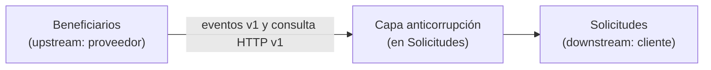
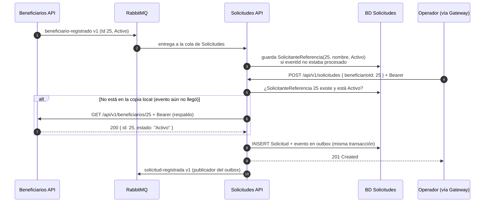
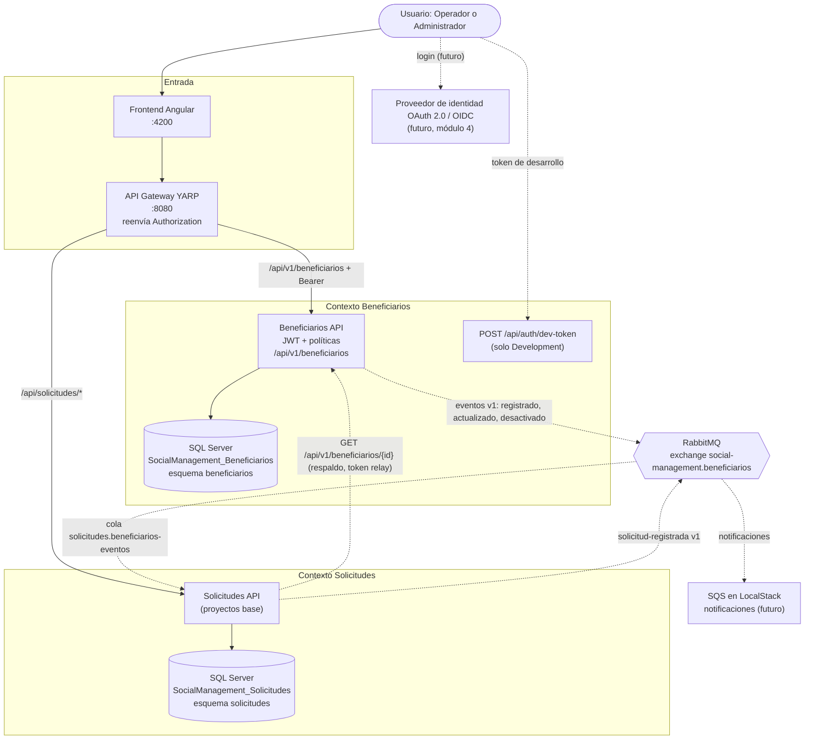

# Diseño de microservicios: Beneficiarios y Solicitudes

Documento de diseño de la [sesión 04](sessions/session-04.md). Usa SocialManagement como caso de estudio para decidir
**qué** separar, **cómo** se comunican las partes y **quién** es dueño de cada dato.

| | |
|---|---|
| **Estado del sistema** | Beneficiarios: CRUD completo con SQL Server y JWT. Solicitudes: proyectos base sin lógica de negocio. |
| **Alcance de este documento** | Análisis, contextos, contratos iniciales, propiedad de datos y diagrama. |
| **Fuera de alcance** | Implementar Solicitudes, la mensajería o los contratos (módulos 2 y 3 de la [hoja de ruta](roadmap.md)). |

Los contratos de este documento son **propuestas versionadas (v1)**: todavía no existe código que los implemente.

---

## 1. La aplicación como caso de estudio

### Qué existe hoy

| Pieza | Estado | Detalle |
|-------|--------|---------|
| **Beneficiarios API** | Implementada | Clean Architecture; CRUD `/api/v1/beneficiarios`; EF Core 10 y SQL Server (`SocialManagement_Beneficiarios`, esquema `beneficiarios`); JWT con roles (sesión 04) |
| **Solicitudes API** | Proyectos base | Las 4 capas compilan y arrancan; `/health`, `/version`, Swagger; `SolicitudesDbContext` sin entidades ni migraciones |
| **Gateway (YARP)** | Implementado | Único punto de entrada: `/api/beneficiarios/*`, `/api/v{n}/beneficiarios/*` y `/api/solicitudes/*` |
| **SQL Server** | Infraestructura lista | Dos bases separadas desde la Fase 0 (*Database per Service*) |
| **RabbitMQ** | Infraestructura lista, sin uso | Conexión y health check; existen las interfaces `IIntegrationEventPublisher` e `IIntegrationEventHandler<T>`, sin implementación |
| **Frontend Angular** | Base | Pantalla de estado del sistema a través del Gateway |

### Verificación de los proyectos base de Solicitudes (punto 7 del bloque B)

Comprobado el 16/11/2026 en este repositorio:

| Comprobación | Resultado |
|--------------|-----------|
| Los 4 proyectos (`Domain`, `Application`, `Infrastructure`, `Api`) están en `SocialManagement.slnx` | ✅ |
| Compilan en modo CI (`-warnaserror`) | ✅ |
| Reglas de dependencia entre capas y sin referencias a Beneficiarios (`Architecture.Tests`) | ✅ |
| `Solicitudes.Api.IntegrationTests` | ✅ 48 de 48 |
| `GET /health` y `GET /version` (directo en `:8082` y por el Gateway en `/api/solicitudes/version`) | ✅ 200 |
| `GET /health/ready` | Requiere SQL Server y RabbitMQ del entorno Docker (`start.ps1`); sin Docker responde *Unhealthy*, como se espera |
| Lógica de negocio | **Ninguna, a propósito**: solo `AuditableEntity` y `DomainException` en el dominio |

### ¿Monolito o microservicios? Una evaluación honesta

SocialManagement nació dividido (Fase 0) porque **el curso enseña microservicios**. Si fuera un producto real con un
solo equipo, el tamaño actual (un recurso CRUD y otro en diseño) justificaría empezar con un **monolito modular**: los
mismos dos módulos con fronteras claras, pero en un solo proceso y una sola base de datos con esquemas separados. Se
dividiría cuando aparecieran estas señales:

- equipos distintos que necesitan desplegar a ritmos diferentes;
- cargas muy distintas (p. ej. una campaña masiva de solicitudes que no debe degradar la consulta de beneficiarios);
- requisitos de disponibilidad o de seguridad diferentes por módulo;
- un módulo que cambia mucho y otro que casi no cambia.

La buena noticia es que el diseño de este documento (contextos, contratos y propiedad de datos) es **el mismo** en ambos
casos. Un monolito modular bien hecho se divide después con poco esfuerzo; un monolito sin fronteras, no.

---

## 2. Ventajas, desventajas y costos de dividir un monolito

| | Ventajas | Desventajas |
|---|----------|-------------|
| **Despliegue** | Cada servicio se publica sin tocar los demás | Más *pipelines*, imágenes y versiones que coordinar |
| **Escalado** | Se escala solo lo que lo necesita | Más instancias y más infraestructura que pagar |
| **Fallos** | Un error en Solicitudes no tumba Beneficiarios | Aparecen fallos de red: *timeouts*, reintentos, servicios caídos a medias |
| **Equipos** | Autonomía: cada equipo es dueño de su servicio de punta a punta | Hay que acordar y versionar contratos entre equipos |
| **Datos** | Cada servicio elige y evoluciona su modelo | Adiós a los JOIN y a las transacciones entre módulos: consistencia **eventual** y *Sagas* |
| **Tecnología** | Cada servicio puede usar la tecnología más adecuada | Más tecnologías significa más conocimiento que mantener |
| **Pruebas** | Cada servicio se prueba aislado | Las pruebas de punta a punta son más lentas y frágiles; hacen falta pruebas de contrato |
| **Diagnóstico** | Logs y métricas por servicio | Seguir una petición entre servicios exige trazas distribuidas (OpenTelemetry, módulo 6) |

### Costos que suelen olvidarse

| Costo | En SocialManagement |
|-------|---------------------|
| **Infraestructura** | 2 bases de datos, RabbitMQ, Gateway y un contenedor por servicio (ya en Docker Compose) |
| **Seguridad** | Cada servicio valida tokens; hay que decidir cómo se autentican los servicios entre sí (sección 4.3) |
| **Consistencia** | Copias locales de datos de otro servicio, eventos duplicados o desordenados, idempotencia, patrón *Outbox* |
| **Operación** | Health checks por servicio, orden de arranque, configuración y secretos por servicio |
| **Carga cognitiva** | Para registrar una solicitud hay que entender dos servicios, un *broker* y un contrato |
| **Latencia** | Una llamada en memoria pasa a ser una llamada HTTP o un mensaje |

**Regla práctica:** divide cuando el beneficio (autonomía, escalado y aislamiento) supere de forma demostrable esos
costos. No dividas por moda.

---

## 3. Contextos delimitados (*bounded contexts*)

Un contexto delimitado es una frontera dentro de la cual cada término tiene **un solo significado**. Aquí, cada
contexto es un microservicio.

| | **Beneficiarios** | **Solicitudes** |
|---|-------------------|-----------------|
| **Pregunta que responde** | ¿**Quién** es la persona? | ¿**Qué** pide y en qué estado está su pedido? |
| **Responsabilidad** | Identidad de la persona, documento de identidad, datos personales y estado (Activo/Inactivo) | Registro de solicitudes de apoyo social, evaluación y ciclo de vida (registrada → en evaluación → aprobada/rechazada) |
| **Lenguaje ubicuo** | Beneficiario, DocumentoIdentidad (DNI, CE, Pasaporte), Registrar, Actualizar datos, Desactivar | Solicitud, Programa social, Evaluación, Aprobar, Rechazar, Anular, Solicitante |
| **Invariantes propias** | Un documento pertenece a un solo beneficiario; nombres válidos; baja solo lógica | Solo un beneficiario **activo** puede registrar solicitudes; transiciones de estado válidas |
| **Datos de los que es dueño** | Tabla `beneficiarios.Beneficiarios` | Tablas futuras del esquema `solicitudes` |
| **Qué sabe del otro** | Nada: no depende de Solicitudes | Solo una **referencia** al beneficiario (Id, nombre para mostrar y estado) |

### Mapa de contextos



- **Cliente-proveedor:** Beneficiarios es el proveedor (*upstream*) y Solicitudes el cliente (*downstream*).
  Beneficiarios publica contratos estables; Solicitudes se adapta a ellos.
- **Capa anticorrupción (ACL):** Solicitudes traduce el contrato de Beneficiarios a su propio concepto
  (`SolicitanteReferencia`) y nunca usa la entidad `Beneficiario` del otro servicio. Si Beneficiarios cambia su modelo
  interno, solo cambia la traducción.
- **Sin núcleo compartido:** no hay una biblioteca común de dominio (regla verificada en `Architecture.Tests`). Cada
  servicio define sus propios DTOs de contrato.

---

## 4. Contratos iniciales de interacción

Hay dos formas de interacción y cada una tiene su uso:

| Forma | Cuándo | Acoplamiento |
|-------|--------|--------------|
| **Eventos (asíncrono, RabbitMQ)** | Avisar que algo **ya ocurrió**: "se registró un beneficiario" | Bajo: el emisor no sabe quién escucha ni espera respuesta |
| **Consulta HTTP (síncrona)** | Necesito un dato **ahora** y la copia local no lo tiene | Alto: si el otro servicio está caído, la operación falla o se degrada |

**Preferencia:** eventos primero. La consulta HTTP queda como respaldo para la ventana de consistencia eventual.

### 4.1 Eventos que publica Beneficiarios (v1)

Sobre común de todos los eventos (*envelope*):

```json
{
  "eventId": 1024,
  "eventType": "beneficiarios.beneficiario-registrado",
  "version": 1,
  "occurredAtUtc": "2026-11-16T15:04:05Z",
  "source": "beneficiarios-api",
  "correlationId": "00-4bf92f3577b34da6a3ce929d0e0e4736-00f067aa0ba902b7-01",
  "data": { }
}
```

| Campo | Regla |
|-------|-------|
| `eventId` | Entero **`long`**, único **por emisor**, asignado al guardar el evento (columna `IDENTITY` de una tabla *outbox*). El proyecto no usa GUID. El consumidor detecta duplicados por (`source`, `eventId`). |
| `eventType` + `version` | Nombre estable del evento y versión del **contrato** de `data`. |
| `occurredAtUtc` | Cuándo ocurrió el hecho en el dominio (UTC). |
| `correlationId` | El `traceparent` W3C de la petición original, para seguirla entre servicios. |

| Evento | Cuándo | `data` |
|--------|--------|--------|
| `beneficiarios.beneficiario-registrado` v1 | Tras `POST /api/v1/beneficiarios` | `{ "beneficiarioId": 25, "nombreCompleto": "Ana María Quispe Rojas", "estado": "Activo" }` |
| `beneficiarios.beneficiario-datos-actualizados` v1 | Tras `PUT /api/v1/beneficiarios/{id}` | `{ "beneficiarioId": 25, "nombreCompleto": "Ana María Quispe Rojas" }` |
| `beneficiarios.beneficiario-desactivado` v1 | Tras `PATCH .../desactivar` (solo si cambió el estado) | `{ "beneficiarioId": 25, "desactivadoAtUtc": "2026-11-16T15:04:05Z" }` |

**Minimización de datos personales:** los eventos **no incluyen el número de documento** ni otros datos que Solicitudes
no necesita. Lo que no viaja no se filtra ni hay que proteger en otra base (principio de minimización de la
Ley N.° 29733 de Protección de Datos Personales).

**Topología RabbitMQ propuesta:** *exchange* `social-management.beneficiarios` de tipo `topic`; *routing key* =
`eventType` + `.v` + versión (p. ej. `beneficiarios.beneficiario-registrado.v1`). Cada consumidor tiene su propia cola
(`solicitudes.beneficiarios-eventos`) con *dead-letter queue* para los mensajes que fallan tras los reintentos.

### 4.2 Eventos que publicará Solicitudes (v1)

| Evento | Cuándo | `data` | Consumidores previstos |
|--------|--------|--------|------------------------|
| `solicitudes.solicitud-registrada` v1 | Al registrar una solicitud | `{ "solicitudId": 310, "beneficiarioId": 25, "programa": "Pension65" }` | Notificaciones (SQS, módulo 3) |
| `solicitudes.solicitud-estado-cambiado` v1 | Al aprobar, rechazar o anular | `{ "solicitudId": 310, "estadoAnterior": "EnEvaluacion", "estadoNuevo": "Aprobada" }` | Notificaciones, reportes |

Beneficiarios **no consume** eventos de Solicitudes: el proveedor no depende de su cliente.

### 4.3 Consulta HTTP de respaldo (v1)

Solicitudes usa el endpoint **público ya existente** de Beneficiarios; no se crea una API "interna" paralela:

```http
GET /api/v1/beneficiarios/25
Authorization: Bearer <token>
```

| Aspecto | Decisión inicial |
|---------|------------------|
| Respuesta usada | Solo `id`, `nombreCompleto` y `estado` del `ApiResponse<BeneficiarioDto>`; el resto se ignora (lector tolerante) |
| 404 | El beneficiario no existe: la solicitud se rechaza con 422 en Solicitudes |
| Servicio caído o *timeout* (2 s) | La solicitud **no** se registra (503 con mensaje claro); nunca se asume que el beneficiario es válido |
| Autenticación | **Propagación del token** del usuario (*token relay*): Solicitudes reenvía el mismo `Authorization` que recibió. Con un proveedor de identidad real (módulo 4) se evaluará *client credentials* de OAuth 2.0 para las llamadas entre servicios. |
| Resiliencia | Reintento corto con *backoff* y *circuit breaker* (`Microsoft.Extensions.Http.Resilience`) cuando se implemente |

### 4.4 API pública inicial de Solicitudes (propuesta)

| Método y ruta | Política | Respuesta |
|---------------|----------|-----------|
| `POST /api/v1/solicitudes` | Escritura (Administrador, Operador) | 201 + `Location`; 422 si el beneficiario no existe o está inactivo |
| `GET /api/v1/solicitudes/{id}` | Lectura (Administrador, Operador) | 200 / 404 |
| `GET /api/v1/solicitudes?beneficiarioId=25&pageNumber=1` | Lectura | 200 paginado |
| `PATCH /api/v1/solicitudes/{id}/aprobar` · `/rechazar` | Evaluación (Administrador) | 200 / 409 si la transición no es válida |

Mismas convenciones que Beneficiarios: `BaseApiController`, `ApiResponse<T>`, `{id:int}`, FluentValidation y JWT con los
mismos roles. El Gateway necesitará una ruta `solicitudes-versioned-route` equivalente a la de Beneficiarios.

### 4.5 Flujo previsto: registrar una solicitud



---

## 5. Principios de propiedad de datos

1. **Un dueño por dato.** Cada tabla pertenece a un solo servicio: su base, su esquema (`beneficiarios`,
   `solicitudes`), sus migraciones y su `__EFMigrationsHistory`. Ningún otro servicio la lee ni la escribe.
2. **Sin acceso directo entre bases.** Prohibidos los JOIN entre bases, las vistas o *linked servers* hacia otra base,
   las credenciales compartidas y las claves foráneas entre servicios.
3. **Referencias por identificador.** Solicitudes guarda `BeneficiarioId` (entero) **sin** clave foránea. La
   integridad se comprueba en el caso de uso, no en la base de datos.
4. **Solo el dueño modifica.** Para cambiar un beneficiario se llama a la API de Beneficiarios. Los demás reaccionan a
   sus eventos.
5. **Copias locales de solo lectura.** Solicitudes puede guardar una proyección mínima (`SolicitanteReferencia`: Id,
   nombre para mostrar y estado), actualizada solo por eventos. Se acepta que esté unos segundos desactualizada
   (consistencia eventual) y nunca se edita a mano.
6. **Mínimo dato personal.** Las copias y los eventos llevan solo lo necesario: el número de documento no sale de
   Beneficiarios.
7. **Contratos versionados y compatibles.** Agregar campos es compatible; quitar o renombrar exige una nueva versión
   (`v2`) que convive con la anterior mientras haya consumidores. Los consumidores ignoran los campos desconocidos.
8. **Publicación confiable e idempotente.** El evento se guarda en una tabla *outbox* en la **misma transacción** que el
   cambio de datos y luego se publica; el consumidor registra los `eventId` procesados para ignorar duplicados.
9. **Identificadores enteros.** Las entidades usan `int` (`IDENTITY`); los eventos, `long`. Sin GUID
   ([architecture.md](architecture.md#decisiones-de-diseño)).

---

## 6. Diagrama del sistema

Líneas continuas: existe hoy. Líneas discontinuas: diseño de este documento, todavía no implementado.



---

## 7. Decisiones abiertas

| Tema | Opciones | Se decide en |
|------|----------|--------------|
| ¿Qué pasa con las solicitudes pendientes cuando se desactiva un beneficiario? | Anularlas automáticamente / marcarlas para revisión manual | Módulo 2 (dominio de Solicitudes) |
| Coreografía u orquestación para flujos de varios pasos | Eventos encadenados / orquestador (*Saga*) | Módulo 3 |
| Autenticación entre servicios | *Token relay* / *client credentials* con un proveedor de identidad | Módulo 4 |
| ¿El Gateway valida tokens además de cada servicio? | Solo los servicios (hoy) / ambos (defensa en profundidad) | Módulo 4 |
