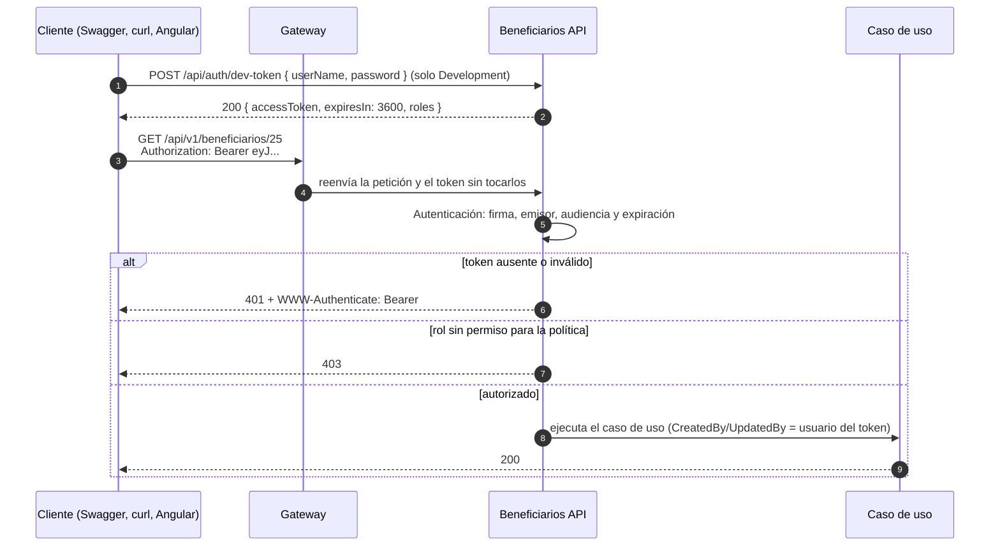

# Seguridad: autenticación JWT y autorización

Referencia de la seguridad de las APIs (desde la [sesión 04](sessions/session-04.md)). Hoy solo la API de
**Beneficiarios** exige tokens; Solicitudes la adoptará cuando tenga endpoints de negocio.

| Pieza | Dónde |
|-------|-------|
| Registro de autenticación, políticas y validación de configuración | `Api/Extensions/SecurityExtensions.cs` |
| Roles y políticas | `Api/Security/Roles.cs`, `Api/Security/AuthorizationPolicies.cs` |
| Emisión de tokens de desarrollo | `Api/Endpoints/IssueDevelopmentTokenEndpoint.cs`, `Api/Security/DevelopmentTokenIssuer.cs` |
| 401/403 en formato `ApiResponse` | `Api/Security/ApiResponseAuthorizationResultHandler.cs` |
| Usuario de auditoría | `Application/Interfaces/ICurrentUser.cs` → `Api/Security/HttpContextCurrentUser.cs` |
| Candado, 401/403 y roles en Swagger | `Api/Configuration/OpenApi/Bearer*Transformer.cs` |

---

## Flujo



El Gateway **no** valida tokens: los reenvía y cada servicio decide (ver decisiones abiertas en
[microservices-design.md](microservices-design.md#7-decisiones-abiertas)).

---

## Roles, políticas y permisos

| Política | Roles | Operaciones |
|----------|-------|-------------|
| `Beneficiarios.Lectura` | Administrador, Operador | `GET /api/v1/beneficiarios`, `GET /api/v1/beneficiarios/{id}` |
| `Beneficiarios.Escritura` | Administrador, Operador | `POST /api/v1/beneficiarios`, `PUT /api/v1/beneficiarios/{id}` |
| `Beneficiarios.Desactivacion` | Administrador | `PATCH /api/v1/beneficiarios/{id}/desactivar` |
| *(pública)* | — | `/health`, `/health/ready`, `/version`, `/api/demo/status`, `/api/auth/dev-token` (solo Development) |

- Cada acción del controller declara **explícitamente** su política con `[Authorize(Policy = ...)]`, también las de
  lectura. La prueba `Toda_ruta_de_negocio_declara_explicitamente_su_politica_de_autorizacion` falla si una ruta
  `/api/v{n}/...` nueva no la declara.
- Cambiar quién puede hacer qué se hace en `AuthorizationPolicies.cs`, sin tocar los controllers.

## Respuestas de error

| Código | Significado | Cuerpo |
|--------|-------------|--------|
| **401** | No hay token, o es inválido (firma, emisor, audiencia, expirado o mal formado). Cabecera `WWW-Authenticate: Bearer error="invalid_token", error_description="..."` | `ApiResponse` con `"message": "Se requiere autenticación: ..."` |
| **403** | El token es válido, pero el usuario no tiene un rol de la política | `ApiResponse` con `"message": "No tienes permisos para realizar esta operación."` |

## Contenido del token

```json
{
  "sub": "admin.demo", "name": "admin.demo", "role": ["Administrador"],
  "iss": "social-management-dev", "aud": "social-management-api",
  "iat": 1794882187, "nbf": 1794882187, "exp": 1794885787
}
```

Firmado con **HS256** (HMAC-SHA256). Un JWT está **firmado, no cifrado**: cualquiera puede leer su contenido en
Base64Url. Nunca pongas datos sensibles en los claims. Los claims usan sus nombres cortos (`MapInboundClaims = false`):
`User.Identity.Name` es `name` y los roles salen de `role`.

---

## Configuración

| Clave | Dónde se define | Valor |
|-------|-----------------|-------|
| `Jwt:Issuer` | `appsettings.json` | `social-management-dev` |
| `Jwt:Audience` | `appsettings.json` | `social-management-api` |
| `Jwt:ExpirationMinutes` | `appsettings.json` | `60` (de 1 a 1440) |
| `Jwt:SigningKey` | **Secreto**: user-secrets o `Jwt__SigningKey` | Mínimo 32 bytes |
| `DevelopmentTokens:Enabled` | `appsettings.Development.json` | `true` solo en Development |
| `DevelopmentTokens:Users:N:UserName` / `Password` / `Roles:0` | **Secreto**: user-secrets o variables de entorno | Clave de 12 o más caracteres; roles `Administrador` y/o `Operador` |

**De dónde salen los secretos:**

| Forma de ejecución | Origen |
|--------------------|--------|
| `dotnet run` | `scripts/setup.ps1` copia `JWT_SIGNING_KEY`, `DEMO_ADMIN_*` y `DEMO_OPERADOR_*` de `.env` a user-secrets. Si `.env` ya existía, el script le agrega las variables nuevas de `.env.example` sin cambiar las que ya tiene. |
| Docker Compose | Variables de entorno de `beneficiarios-api` (`Jwt__SigningKey: ${JWT_SIGNING_KEY:-}`, `DevelopmentTokens__Users__0__...`) |
| Pruebas | `BeneficiariosApiFactory.ValidSettings()` y `SqlServerBeneficiariosApiFactory` con claves exclusivas de prueba |

**La API no arranca** (falla al iniciar con un mensaje claro) si:
- falta `Jwt:SigningKey` o tiene menos de 32 bytes;
- `DevelopmentTokens:Enabled` es `true` fuera del ambiente Development;
- en Development faltan usuarios demo, alguno no tiene nombre, su clave tiene menos de 12 caracteres, tiene un rol que
  no existe o hay nombres repetidos.

---

## Obtener y usar un token

**Swagger** (`http://localhost:8081/swagger`):
1. Abre `POST /api/auth/dev-token` → *Try it out* → `{ "userName": "admin.demo", "password": "<DEMO_ADMIN_PASSWORD de .env>" }`.
2. Copia el valor de `accessToken`.
3. Pulsa **Authorize** (arriba a la derecha), pega **solo el token** y confirma. Las operaciones con candado ya
   envían `Authorization: Bearer ...`. El token se conserva al recargar la página.

**PowerShell:**

```powershell
$body = @{ userName = 'admin.demo'; password = 'Admin-Demo-Dev-Only-2026' } | ConvertTo-Json
$token = (Invoke-RestMethod -Method Post http://localhost:8081/api/auth/dev-token -ContentType 'application/json' -Body $body).accessToken
Invoke-RestMethod http://localhost:8080/api/v1/beneficiarios -Headers @{ Authorization = "Bearer $token" }
```

**curl (Git Bash):**

```bash
TOKEN=$(curl -s -X POST http://localhost:8081/api/auth/dev-token -H 'Content-Type: application/json' \
  -d '{"userName":"operador.demo","password":"Operador-Demo-Dev-Only-2026"}' | grep -o '"accessToken":"[^"]*"' | cut -d'"' -f4)
curl -s http://localhost:8080/api/v1/beneficiarios/1 -H "Authorization: Bearer $TOKEN"
```

A través del Gateway, la emisión de tokens está en `http://localhost:8080/api/beneficiarios/api/auth/dev-token`.
Las claves de los ejemplos son los valores de desarrollo de `.env.example`; si las cambiaste en tu `.env`, usa las tuyas.

---

## Reglas de seguridad aplicadas

- La clave de firma y las claves demo **nunca** están en el código, en `appsettings` ni en el repositorio.
- La emisión de tokens existe **solo** en Development: fuera de ese ambiente la ruta no se publica, y activarla impide el
  arranque.
- Las credenciales se comparan en **tiempo constante** y se recorren todos los usuarios: el tiempo de respuesta no
  revela si un usuario existe. Mismo mensaje para "usuario inexistente" y "clave incorrecta".
- Las claves nunca se escriben en el log; los intentos fallidos se registran con el nombre de usuario.
- Solo se acepta el algoritmo HS256 (`ValidAlgorithms`) y la tolerancia de reloj es de 30 segundos.
- Sin *refresh tokens* ni revocación: un token vale hasta que expira (60 minutos). Por eso la duración es corta.
- En ambientes desplegados, HTTPS es obligatorio: un token interceptado sirve a quien lo tenga (*bearer* = portador).

## Camino a producción (fuera del alcance actual)

| Hoy (desarrollo) | Producción |
|------------------|------------|
| La API emite y valida tokens con una clave simétrica compartida | Un **proveedor de identidad** (Microsoft Entra ID, Keycloak, Auth0, Cognito...) emite los tokens con OAuth 2.0 / OpenID Connect |
| `Jwt:SigningKey` en cada servicio | `JwtBearerOptions.Authority`: la API descarga las **claves públicas** del proveedor (JWKS) y nunca conoce la clave privada |
| Usuarios demo en configuración | Usuarios, MFA y bloqueo de cuentas en el proveedor |
| Sin renovación | *Refresh tokens* gestionados por el proveedor y el frontend |

La diferencia entre JWT y OAuth 2.0 se explica en la [sesión 04](sessions/session-04.md#9-jwt-no-es-oauth-20).
