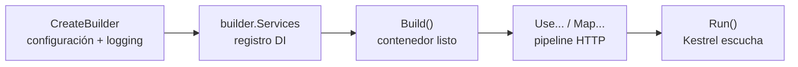
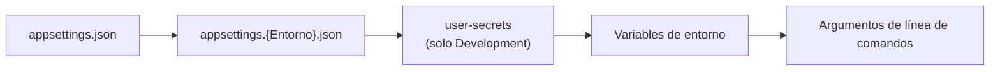
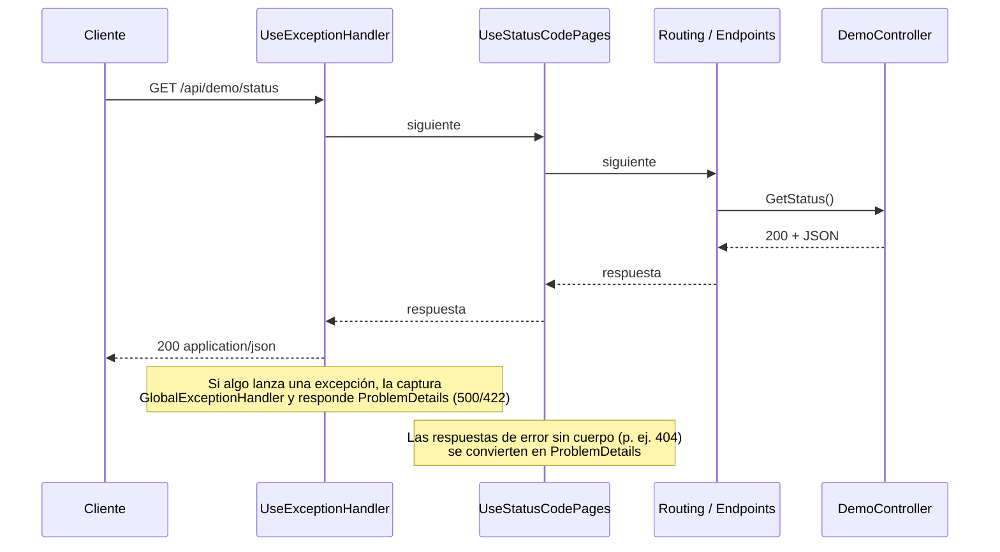

# Sesión 01: Primera API con .NET 10

**Objetivo:** comprender la estructura de una aplicación ASP.NET Core y desarrollar, con ayuda de herramientas
de IA, un primer endpoint de demostración en el microservicio de Beneficiarios.

| | |
|---|---|
| **Punto de partida** | Fase 0 (Foundation) |
| **Resultado** | `GET /api/demo/status` en Beneficiarios API, con pruebas y documentación OpenAPI |
| **Fuera de alcance** | Entidades, reglas de negocio y cambios de infraestructura |

---

## 1. Verificar la solución

Antes de escribir código, comprueba que el punto de partida compila y que las pruebas pasan:

```powershell
dotnet build SocialManagement.slnx
dotnet test --solution SocialManagement.slnx
```

Las pruebas marcadas como *omitidas* son las de entorno Docker: solo se ejecutan con `.\scripts\check.ps1 -RunTests`.

---

## 2. Anatomía de una API ASP.NET Core

Todos los ejemplos pertenecen a `src/backend/services/beneficiarios/SocialManagement.Beneficiarios.Api/`.

### 2.1 `Program.cs`: el punto de entrada

`Program.cs` usa *top-level statements* y sigue siempre el mismo orden: **crear el builder → registrar servicios →
construir la aplicación → configurar el pipeline → ejecutar**.

```csharp
var builder = WebApplication.CreateBuilder(args);          // 1. Lee configuración, logging y entorno

builder.Host.UseDefaultServiceProvider(options =>           //    Valida el contenedor de DI al arrancar
{
    options.ValidateScopes = true;
    options.ValidateOnBuild = true;
});

builder.Services                                            // 2. Registra servicios (DI)
    .AddApplication()
    .AddInfrastructure()
    .AddApiPresentation();

var app = builder.Build();                                  // 3. Construye la aplicación

app.UseApiPipeline();                                       // 4. Middleware y endpoints

app.Run();                                                  // 5. Inicia el servidor Kestrel
```



> **Regla:** todo lo que va **antes** de `Build()` registra servicios. Todo lo que va **después** configura
> cómo se procesan las peticiones. El orden importa en ambos bloques.

Para que `Program.cs` sea legible, el detalle está en métodos de extensión:

| Método | Archivo | Qué registra o configura |
|--------|---------|---------------------------|
| `AddApplication()` | `Application/DependencyInjection.cs` | Casos de uso (todavía ninguno) |
| `AddInfrastructure()` | `Infrastructure/DependencyInjection/InfrastructureServiceCollectionExtensions.cs` | EF Core, RabbitMQ, AWS, Ollama |
| `AddApiPresentation()` | `Api/Extensions/ApiServiceCollectionExtensions.cs` | Controllers, ProblemDetails, OpenAPI, `TimeProvider`, health checks |
| `UseApiPipeline()` | `Api/Extensions/WebApplicationExtensions.cs` | Middleware y mapeo de endpoints |

### 2.2 Controllers

Un controller agrupa endpoints HTTP relacionados. Su única responsabilidad es **traducir HTTP**: leer la petición,
delegar el trabajo y devolver una respuesta. No contiene reglas de negocio.

```csharp
[ApiController]                    // Validación automática (400) y comportamiento de API
[Route("api/demo")]                // Prefijo de ruta del controller
[Produces("application/json")]
public sealed class DemoController(/* dependencias inyectadas */) : ControllerBase
{
    [HttpGet("status")]            // GET /api/demo/status
    public ActionResult<DemoStatusResponse> GetStatus() { ... }
}
```

| Elemento | Para qué sirve |
|----------|----------------|
| `[ApiController]` | Responde 400 con ProblemDetails si el modelo no es válido e infiere el origen de los parámetros. |
| `[Route]` + `[HttpGet]` | Definen el verbo y la ruta (*attribute routing*). |
| `ControllerBase` | Base sin vistas. Ofrece `Ok()`, `NotFound()`, `StatusCode()`, etc. |
| `ActionResult<T>` | Permite devolver un `T` (200) o cualquier otro resultado HTTP. |
| Constructor primario | Recibe las dependencias desde el contenedor de DI. |

Los controllers se activan en `ApiServiceCollectionExtensions` (`services.AddControllers()`) y se exponen en
`WebApplicationExtensions` (`app.MapControllers()`).

### 2.3 `appsettings.json` y la configuración

ASP.NET Core combina varias **fuentes de configuración**. Si una clave se repite, gana la última:



| Fuente | Ejemplo en el proyecto |
|--------|------------------------|
| `appsettings.json` | `"ServiceInfo": { "Name": "beneficiarios-api" }` |
| `appsettings.Development.json` | `"RabbitMq": { "Host": "localhost" }` |
| user-secrets | Cadena de conexión y contraseña de RabbitMQ (`scripts/setup.ps1`) |
| Variables de entorno | `RabbitMq__Host=rabbitmq` en Docker (`__` reemplaza a `:`) |

Las secciones se leen con el **Options Pattern**: una clase con propiedades y `IOptions<T>` inyectado.

```csharp
// Registro (ApiServiceCollectionExtensions.cs)
services.AddOptions<ServiceInfoOptions>()
    .BindConfiguration("ServiceInfo")
    .Validate(o => !string.IsNullOrWhiteSpace(o.Name), "Falta 'ServiceInfo:Name'.")
    .ValidateOnStart();

// Uso (DemoController.cs)
serviceInfo.Value.Name   // "beneficiarios-api"
```

> **Nunca** guardes secretos en `appsettings.json`: ese archivo se sube a Git.

### 2.4 Inyección de dependencias (DI)

Una clase **declara lo que necesita en su constructor** y el contenedor de .NET se lo entrega. La clase no crea sus
dependencias con `new`. Así se pueden reemplazar, por ejemplo por un reloj falso en las pruebas.

| Tiempo de vida | Se crea... | Ejemplo en el proyecto |
|----------------|------------|------------------------|
| `Singleton` | una vez para toda la aplicación | `TimeProvider`, `IRabbitMqConnectionProvider`, `IAmazonS3` |
| `Scoped` | una vez por petición HTTP | `BeneficiariosDbContext` |
| `Transient` | cada vez que se solicita | Controllers (los activa el framework en cada petición) |

```csharp
// Registro: el reloj real del sistema. TryAdd no lo sobrescribe si ya hay otro (p. ej. en pruebas).
services.TryAddSingleton(TimeProvider.System);

// Consumo: el controller no sabe qué implementación recibe.
public sealed class DemoController(IOptions<ServiceInfoOptions> serviceInfo, TimeProvider timeProvider, ...)
```

`ValidateOnBuild = true` en `Program.cs` hace que la aplicación **no arranque** si a algún servicio le falta una
dependencia. El error se ve al iniciar, no en la primera petición.

### 2.5 Middleware: el pipeline HTTP

Cada petición atraviesa una cadena de *middleware* en el orden en que se registraron. Cada uno puede actuar antes y
después del siguiente:



```csharp
// WebApplicationExtensions.UseApiPipeline()
app.UseExceptionHandler();      // 1. Captura excepciones → GlobalExceptionHandler → ProblemDetails
app.UseStatusCodePages();       // 2. 404/405 sin cuerpo → ProblemDetails
app.MapOpenApi();               //    /openapi/v1.json (solo Development)
app.MapControllers();           //    endpoints de los controllers
app.MapHealthChecks("/health", ...);
```

> El **manejo de excepciones va primero** para poder capturar los errores de todo lo que viene después.

---

## 3. El endpoint de demostración

### Contrato

```http
GET /api/demo/status
Accept: application/json
```

```json
{
  "serviceName": "beneficiarios-api",
  "version": "0.1.0",
  "timestampUtc": "2026-11-14T02:43:14.8100211+00:00",
  "status": "Running"
}
```

| Código | Cuándo | `status` |
|--------|--------|----------|
| `200 OK` | El servicio está en ejecución. | `Running` |
| `503 Service Unavailable` | La aplicación se está deteniendo (`IHostApplicationLifetime.ApplicationStopping`). | `Stopping` |

| Campo | Origen |
|-------|--------|
| `serviceName` | `appsettings.json` → `ServiceInfo:Name` (Options Pattern) |
| `version` | `<Version>` de `Directory.Build.props`, leída del ensamblado (`Configuration/ServiceVersion.cs`) |
| `timestampUtc` | `TimeProvider.GetUtcNow()` |
| `status` | `IHostApplicationLifetime` |

### Rutas

| Acceso | URL |
|--------|-----|
| Directo a la API | <http://localhost:8081/api/demo/status> |
| A través del Gateway | <http://localhost:8080/api/beneficiarios/api/demo/status> |

El Gateway elimina el prefijo público `/api/beneficiarios` y reenvía `/api/demo/status` al servicio.

### ¿Por qué `TimeProvider` y no `DateTime.UtcNow`?

`DateTime.UtcNow` es una dependencia oculta: cada ejecución devuelve un valor distinto y una prueba no puede
afirmar *qué* hora debe aparecer. `TimeProvider` (incluido en .NET 8+) es una **abstracción** del reloj:

| Entorno | Implementación |
|---------|----------------|
| Producción | `TimeProvider.System` (reloj real), registrado como singleton |
| Pruebas | `FakeTimeProvider` (paquete `Microsoft.Extensions.TimeProvider.Testing`) con hora fija y `Advance()` |

### Documentación OpenAPI

Los metadatos del endpoint se declaran con atributos y aparecen en `/openapi/v1.json`:

```csharp
[Tags("Demo")]
[EndpointName("GetDemoStatus")]                                       // operationId
[EndpointSummary("Estado de ejecución del servicio (demostración)")]
[EndpointDescription("Endpoint didáctico de la sesión 01. ...")]
[ProducesResponseType<DemoStatusResponse>(StatusCodes.Status200OK)]
[ProducesResponseType<DemoStatusResponse>(StatusCodes.Status503ServiceUnavailable)]
```

El título, la descripción y la versión del documento se toman de `ServiceInfo` mediante un *document transformer*
en `AddOpenApi()`.

### Probarlo

```powershell
dotnet run --project src/backend/services/beneficiarios/SocialManagement.Beneficiarios.Api
Invoke-RestMethod http://localhost:8081/api/demo/status
```

El archivo [`SocialManagement.Beneficiarios.Api.http`](../../src/backend/services/beneficiarios/SocialManagement.Beneficiarios.Api/SocialManagement.Beneficiarios.Api.http)
permite ejecutar las peticiones desde Visual Studio, Rider o VS Code (extensión REST Client).

---

## 4. Pruebas

| Tipo | Proyecto | Qué verifica |
|------|----------|--------------|
| Unitarias | `tests/unit/SocialManagement.Beneficiarios.Api.UnitTests` → `DemoControllerTests` | Se crea el controller con `new`, un reloj falso y un `IHostApplicationLifetime` falso. Verifica 200/`Running`, que la hora viene del `TimeProvider`, 503/`Stopping` y la versión. |
| Endpoint | `tests/integration/SocialManagement.Beneficiarios.Api.IntegrationTests` → `DemoStatusEndpointTests` | Levanta la API en memoria (`WebApplicationFactory`), reemplaza el reloj con `ConfigureTestServices` y verifica la respuesta HTTP, el JSON en camelCase y la documentación OpenAPI. |

```csharp
// Prueba unitaria: Arrange / Act / Assert con un reloj controlado
var clock = new FakeTimeProvider(new DateTimeOffset(2026, 11, 13, 15, 30, 0, TimeSpan.Zero));
var controller = new DemoController(Options.Create(new ServiceInfoOptions { Name = "test" }), clock, lifetime);

clock.Advance(TimeSpan.FromMinutes(90));
var result = controller.GetStatus();
// timestampUtc == 2026-11-13 17:00:00Z
```

```powershell
dotnet test --project tests/unit/SocialManagement.Beneficiarios.Api.UnitTests
dotnet test --project tests/integration/SocialManagement.Beneficiarios.Api.IntegrationTests
```

---

## 5. Desarrollo asistido por IA: prompts de ejemplo

Un buen prompt incluye **contexto** (proyecto, versión, archivos), **tarea**, **restricciones** y **formato de salida**.
La IA propone; tú compilas, ejecutas las pruebas y decides.

### Prompt 1: generar

```text
Contexto: microservicio ASP.NET Core en .NET 10 con Clean Architecture
(proyecto SocialManagement.Beneficiarios.Api). Los controllers usan [ApiController],
constructores primarios y el Options Pattern (ServiceInfoOptions con la propiedad Name).

Tarea: crea un controller DemoController con el endpoint GET /api/demo/status que devuelva
JSON con serviceName, version (versión del ensamblado), timestampUtc y status.

Restricciones:
- Obtén la hora con TimeProvider inyectado; no uses DateTime.UtcNow.
- Devuelve 200 con status "Running"; si IHostApplicationLifetime.ApplicationStopping
  está cancelado, devuelve 503 con status "Stopping".
- Documenta el endpoint para OpenAPI con [EndpointSummary], [EndpointDescription], [Tags]
  y [ProducesResponseType] para 200 y 503.
- No agregues entidades, base de datos ni reglas de negocio.

Salida: el código del controller y del record de respuesta, y la línea de registro de
TimeProvider en el contenedor de DI, cada uno con la ruta de su archivo.
```

### Prompt 2: revisar

```text
Actúa como revisor de código senior de ASP.NET Core. Revisa el siguiente controller
(pego DemoController.cs y ApiServiceCollectionExtensions.cs).

Evalúa y responde en una tabla con columnas Hallazgo | Severidad | Línea | Corrección propuesta:
1. ¿El controller tiene lógica que debería estar en otra capa?
2. ¿Es testeable? ¿Hay dependencias ocultas (DateTime.Now, new, estáticos)?
3. ¿Los códigos HTTP y los metadatos OpenAPI son correctos y completos?
4. ¿El tiempo de vida de cada servicio registrado en DI es el adecuado?
5. ¿Se expone información sensible en la respuesta?

No reescribas todo el archivo: señala solo los problemas concretos. Si algo está bien, dilo.
```

### Prompt 3: refactorizar

```text
Contexto: en SocialManagement.Beneficiarios.Api, VersionController y DemoController calculaban
la versión del servicio con el mismo bloque de reflexión
(AssemblyInformationalVersionAttribute → AssemblyName.Version → "desconocida").

Tarea: refactoriza para eliminar la duplicación extrayendo una clase estática
ServiceVersion (carpeta Configuration) con una propiedad Current calculada una sola vez.

Restricciones:
- No cambies las rutas ni el JSON de /version ni de /api/demo/status.
- Mantén los nombres públicos existentes.
- Indica qué pruebas existentes deberían seguir pasando sin cambios y agrega una que
  verifique que la versión coincide con <Version> de Directory.Build.props.

Salida: un diff por archivo y la lista de comandos para verificar (dotnet build y dotnet test).
```

### Buenas prácticas al usar IA

- **Verifica siempre:** compila, ejecuta las pruebas y prueba el endpoint. La IA puede inventar APIs que no existen.
- **Da contexto real:** versión de .NET, estructura de carpetas y convenciones del proyecto.
- **Pide cambios pequeños** y revisables, no archivos completos reescritos.
- **No pegues secretos** (`.env`, cadenas de conexión, tokens) en una herramienta de IA.
- **Entiende antes de aceptar:** si no puedes explicar una línea, pregunta o investiga.

---

## 6. Ejercicios propuestos

1. Agrega el campo `environment` (por ejemplo, `Development`) a la respuesta. Escribe primero la prueba unitaria.
2. Escribe una prueba que verifique que `GET /api/demo/status` también responde a través del Gateway
   (pista: revisa `tests/integration/SocialManagement.Gateway.IntegrationTests`).
3. Usa el prompt de revisión con tu propio código y compara las sugerencias con las de un compañero.

---

## 7. Cambios de esta sesión

| Archivo | Cambio |
|---------|--------|
| `Api/Controllers/DemoController.cs` | **Nuevo**: endpoint `GET /api/demo/status` y `DemoStatusResponse` |
| `Api/Configuration/ServiceVersion.cs` | **Nuevo**: versión del servicio en un solo lugar |
| `Api/Controllers/VersionController.cs` | Usa `ServiceVersion` (sin duplicar código) |
| `Api/Extensions/ApiServiceCollectionExtensions.cs` | Registra `TimeProvider.System`; título y descripción del documento OpenAPI |
| `Api/SocialManagement.Beneficiarios.Api.http` | **Nuevo**: peticiones de ejemplo |
| `tests/unit/SocialManagement.Beneficiarios.Api.UnitTests/` | **Nuevo**: pruebas unitarias del controller |
| `tests/integration/.../DemoStatusEndpointTests.cs` | **Nuevo**: pruebas del endpoint y de OpenAPI |
| `Directory.Packages.props` | Agrega `Microsoft.Extensions.TimeProvider.Testing` (solo pruebas) |

No se agregaron entidades ni reglas de negocio, y no se modificó la infraestructura (Docker, SQL Server, RabbitMQ,
LocalStack y Gateway).

### Criterios de aceptación

| Criterio | Verificación |
|----------|--------------|
| API compilable y ejecutable | `dotnet build` sin advertencias; `dotnet run` responde en el puerto 8081 |
| Endpoint accesible y documentado | `GET /api/demo/status` → 200; aparece en `/openapi/v1.json` con resumen, tag y respuestas 200/503 |
| Pruebas exitosas | `dotnet test --solution SocialManagement.slnx` |
| Sin entidades ni reglas de negocio | Domain y Application no cambian; las pruebas de arquitectura siguen pasando |
