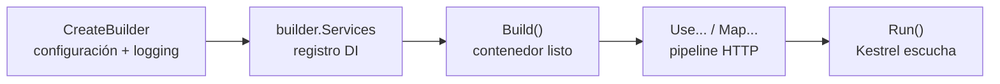
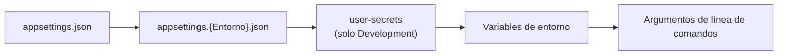
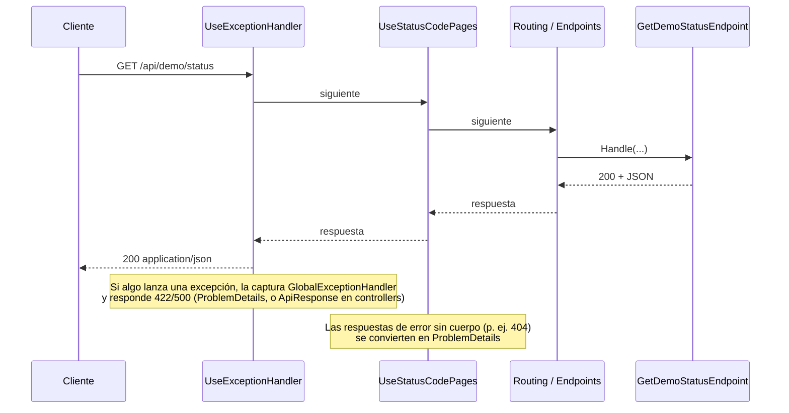

# Sesión 01: Primera API con .NET 10

**Objetivo:** comprender la estructura de una aplicación ASP.NET Core y desarrollar, con ayuda de herramientas
de IA, un primer endpoint de demostración en el microservicio de Beneficiarios.

| | |
|---|---|
| **Punto de partida** | Fase 0 (Foundation) |
| **Resultado** | `GET /api/demo/status` en Beneficiarios API, con pruebas y documentación OpenAPI |
| **Fuera de alcance** | Entidades, reglas de negocio y cambios de infraestructura |

---

## 1. Verificar la solución

Antes de escribir código, comprueba que el punto de partida compila y que las pruebas pasan:

```powershell
dotnet build SocialManagement.slnx
dotnet test --solution SocialManagement.slnx
```

Las pruebas marcadas como *omitidas* son las de entorno Docker: solo se ejecutan con `.\scripts\check.ps1 -RunTests`.

---

## 2. Anatomía de una API ASP.NET Core

Todos los ejemplos pertenecen a `src/backend/services/beneficiarios/SocialManagement.Beneficiarios.Api/`.

### 2.1 `Program.cs`: el punto de entrada

`Program.cs` usa *top-level statements* y sigue siempre el mismo orden: **crear el builder → registrar servicios →
construir la aplicación → configurar el pipeline → ejecutar**.

```csharp
var builder = WebApplication.CreateBuilder(args);          // 1. Lee configuración, logging y entorno

builder.Host.UseDefaultServiceProvider(options =>           //    Valida el contenedor de DI al arrancar
{
    options.ValidateScopes = true;
    options.ValidateOnBuild = true;
});

builder.Services                                            // 2. Registra servicios (DI)
    .AddApplication()
    .AddInfrastructure()
    .AddPresentation();

var app = builder.Build();                                  // 3. Construye la aplicación

app.UseApiPipeline();                                       // 4. Middleware y endpoints

app.Run();                                                  // 5. Inicia el servidor Kestrel
```



> **Regla:** todo lo que va **antes** de `Build()` registra servicios. Todo lo que va **después** configura
> cómo se procesan las peticiones. El orden importa en ambos bloques.

Para que `Program.cs` sea legible, el detalle está en métodos de extensión:

| Método | Archivo | Qué registra o configura |
|--------|---------|---------------------------|
| `AddApplication()` | `Application/DependencyInjection/DependencyInjection.cs` | Casos de uso (todavía ninguno) |
| `AddInfrastructure()` | `Infrastructure/DependencyInjection/DependencyInjection.cs` | EF Core, RabbitMQ, AWS, Ollama |
| `AddPresentation()` | `Api/DependencyInjection/DependencyInjection.cs` | Controllers, ProblemDetails, OpenAPI, `TimeProvider`, health checks |
| `UseApiPipeline()` | `Api/Extensions/WebApplicationExtensions.cs` | Middleware y mapeo de endpoints |

### 2.2 Controllers y Minimal APIs

ASP.NET Core ofrece dos formas de definir endpoints. En ambas, el endpoint solo **traduce HTTP**: lee la petición,
delega el trabajo y devuelve una respuesta. Ninguna contiene reglas de negocio.

**Controller**: una clase que agrupa las operaciones de un recurso (consultar, registrar, actualizar...). En este
proyecto **todos los controllers heredan de `BaseApiController`** (`Controllers/BaseApiController.cs`), que ya define
la ruta, el formato de respuesta y las dependencias comunes. Así un controller nuevo solo contiene sus acciones:

```csharp
// Ejemplo de un controller futuro: GET /api/v1/beneficiarios/{id}
public sealed class BeneficiariosController : BaseApiController
{
    [HttpGet("{id:int}")]
    [ProducesResponseType<ApiResponse<BeneficiarioDto>>(StatusCodes.Status200OK)]
    public async Task<ActionResult<ApiResponse<BeneficiarioDto>>> ObtenerPorId(int id, CancellationToken ct)
    {
        var beneficiario = await UseCase<ConsultarBeneficiarioHandler>().HandleAsync(new(id), ct);
        return ApiOkOrNotFound(beneficiario, $"No existe el beneficiario {id}.");
    }
}
```

| Lo aporta `BaseApiController` | Detalle |
|-------------------------------|---------|
| `[ApiController]` | Validación automática del modelo (400) e inferencia del origen de los parámetros |
| `[Route("api/v{version:apiVersion}/[controller]")]` | Versión en la URL: `BeneficiariosController` → `/api/v1/beneficiarios` (rutas en minúsculas) |
| Formato `ApiResponse<T>` | `ApiOk`, `ApiCreated`, `ApiNotFound`, `ApiOkOrNotFound`. Los errores 400/422/500 también salen en `ApiResponse` |
| OpenAPI | Respuestas 400, 422 y 500 documentadas para todas las acciones |
| Dependencias comunes **sin constructor** | `UseCase<T>()` (casos de uso de Application), `Logger`, `TraceId` |

Los controllers se activan con `services.AddControllers()` y se exponen con `app.MapControllers()`.

**Minimal API**: una función registrada directamente con `app.MapGet`, `MapPost`, etc., normalmente en `Program.cs`.
No necesita clase base, atributos ni enrutamiento por convención. Es lo adecuado para endpoints puntuales como
`GET /version` y `GET /api/demo/status` (ejemplos reales, ver la sección 3).

```csharp
// Program.cs
app.MapGet(GetVersionEndpoint.Route, GetVersionEndpoint.Handle)         // GET /version
    .WithName("GetVersion")
    .WithTags("Version");

app.MapGet(GetDemoStatusEndpoint.Route, GetDemoStatusEndpoint.Handle)   // GET /api/demo/status
    .WithName("GetDemoStatus")
    .WithTags("Demo");
```

| | Controller (`BaseApiController`) | Minimal API |
|---|---|---|
| Definición | Clase + atributos | `app.MapGet(ruta, función)` |
| Dependencias | `UseCase<T>()`, `Logger` de la base | Parámetros de la función (`[FromServices]`) |
| Resultado | `ApiResponse<T>` con `ApiOk(...)`, `ApiCreated(...)` | `TypedResults.Ok(...)`, `Results<T1, T2>` |
| Errores | `ApiResponse` (400/422/500) | ProblemDetails (RFC 9457) |
| Documentación OpenAPI | `[ProducesResponseType]` | `.WithSummary()`, `.Produces<T>()` |
| Cuándo conviene | Recursos con varias operaciones (CRUD) | Endpoints puntuales y técnicos |

> **Organización:** cada tipo vive en **su propio archivo** con el mismo nombre (`DemoStatusResponse.cs`,
> `GetDemoStatusEndpoint.cs`, `BaseApiController.cs`...). Los modelos de respuesta HTTP están en `Contracts/`.
> La prueba `SourceFileConventionsTests` lo verifica en todo `src` y `tests`.

### 2.3 `appsettings.json` y la configuración

ASP.NET Core combina varias **fuentes de configuración**. Si una clave se repite, gana la última:



| Fuente | Ejemplo en el proyecto |
|--------|------------------------|
| `appsettings.json` | `"ServiceInfo": { "Name": "beneficiarios-api" }` |
| `appsettings.Development.json` | `"RabbitMq": { "Host": "localhost" }` |
| user-secrets | Cadena de conexión y contraseña de RabbitMQ (`scripts/setup.ps1`) |
| Variables de entorno | `RabbitMq__Host=rabbitmq` en Docker (`__` reemplaza a `:`) |

Las secciones se leen con el **Options Pattern**: una clase con propiedades y `IOptions<T>` inyectado.

```csharp
// Registro (Api/DependencyInjection/DependencyInjection.cs)
services.AddOptions<ServiceInfoOptions>()
    .BindConfiguration("ServiceInfo")
    .Validate(o => !string.IsNullOrWhiteSpace(o.Name), "Falta 'ServiceInfo:Name'.")
    .ValidateOnStart();

// Uso (Endpoints/GetDemoStatusEndpoint.cs y Endpoints/GetVersionEndpoint.cs)
serviceInfo.Value.Name   // "beneficiarios-api"
```

> **Nunca** guardes secretos en `appsettings.json`: ese archivo se sube a Git.

### 2.4 Inyección de dependencias (DI)

Un componente **declara lo que necesita** (en el constructor de una clase o en los parámetros de un Minimal API) y el
contenedor de .NET se lo entrega. El componente no crea sus dependencias con `new`. Así se pueden reemplazar, por
ejemplo por un reloj falso en las pruebas.

| Tiempo de vida | Se crea... | Ejemplo en el proyecto |
|----------------|------------|------------------------|
| `Singleton` | una vez para toda la aplicación | `TimeProvider`, `IRabbitMqConnectionProvider`, `IAmazonS3` |
| `Scoped` | una vez por petición HTTP | `BeneficiariosDbContext` |
| `Transient` | cada vez que se solicita | Controllers (los activa el framework en cada petición) |

```csharp
// Registro: el reloj real del sistema. TryAdd no lo sobrescribe si ya hay otro (p. ej. en pruebas).
services.TryAddSingleton(TimeProvider.System);

// Consumo: el endpoint no sabe qué implementación recibe (reloj real o falso).
public static Results<Ok<DemoStatusResponse>, JsonHttpResult<DemoStatusResponse>> Handle(
    [FromServices] IOptions<ServiceInfoOptions> serviceInfo,
    [FromServices] TimeProvider timeProvider,
    [FromServices] IHostApplicationLifetime lifetime)
```

`ValidateOnBuild = true` en `Program.cs` hace que la aplicación **no arranque** si a algún servicio le falta una
dependencia. El error se ve al iniciar, no en la primera petición.

### 2.5 Middleware: el pipeline HTTP

Cada petición atraviesa una cadena de *middleware* en el orden en que se registraron. Cada uno puede actuar antes y
después del siguiente:



```csharp
// WebApplicationExtensions.UseApiPipeline()
app.UseTrustedForwardedHeaders(); // 0. URL pública detrás del Gateway (ver docs/api-documentation.md)
app.UseExceptionHandler();      // 1. Captura excepciones → GlobalExceptionHandler → ProblemDetails
app.UseStatusCodePages();       // 2. 404/405 sin cuerpo → ProblemDetails
app.UseApiDocumentation();      //    /openapi/v1.json y /swagger (según el ambiente)
app.MapControllers();           //    endpoints de los controllers
app.MapHealthChecks("/health", ...);

// Program.cs, después de UseApiPipeline(): Minimal APIs
app.MapGet(GetDemoStatusEndpoint.Route, GetDemoStatusEndpoint.Handle) ...
```

Los Minimal APIs y los controllers pasan por **el mismo pipeline**: el manejo de excepciones, ProblemDetails y la
documentación OpenAPI funcionan igual para ambos.

> El **manejo de excepciones va primero** para poder capturar los errores de todo lo que viene después.

---

## 3. El endpoint de demostración

### Contrato

```http
GET /api/demo/status
Accept: application/json
```

```json
{
  "serviceName": "beneficiarios-api",
  "version": "0.1.0",
  "timestampUtc": "2026-11-14T02:43:14.8100211+00:00",
  "status": "Running"
}
```

| Código | Cuándo | `status` |
|--------|--------|----------|
| `200 OK` | El servicio está en ejecución. | `Running` |
| `503 Service Unavailable` | La aplicación se está deteniendo (`IHostApplicationLifetime.ApplicationStopping`). | `Stopping` |

| Campo | Origen |
|-------|--------|
| `serviceName` | `appsettings.json` → `ServiceInfo:Name` (Options Pattern) |
| `version` | `<Version>` de `Directory.Build.props`, leída del ensamblado (`Configuration/ServiceVersion.cs`) |
| `timestampUtc` | `TimeProvider.GetUtcNow()` |
| `status` | `IHostApplicationLifetime` |

### Implementación (Minimal API)

Es un endpoint simple, así que no usa un controller. Se reparte en tres archivos, uno por componente:

| Archivo | Responsabilidad |
|---------|-----------------|
| `Program.cs` | Registra la ruta con `app.MapGet` y su documentación OpenAPI |
| `Endpoints/GetDemoStatusEndpoint.cs` | La función que atiende la petición (`Handle`) y las constantes de ruta y estado |
| `Contracts/Diagnostics/DemoStatusResponse.cs` | El modelo de la respuesta JSON |

```csharp
// Program.cs
app.MapGet(GetDemoStatusEndpoint.Route, GetDemoStatusEndpoint.Handle)
    .WithName("GetDemoStatus")                                            // operationId en OpenAPI
    .WithTags("Demo")
    .WithSummary("Estado de ejecución del servicio (demostración)")
    .WithDescription("Endpoint didáctico de la sesión 01. ...")
    .Produces<DemoStatusResponse>(StatusCodes.Status503ServiceUnavailable);
```

```csharp
// Endpoints/GetDemoStatusEndpoint.cs
public static Results<Ok<DemoStatusResponse>, JsonHttpResult<DemoStatusResponse>> Handle(
    [FromServices] IOptions<ServiceInfoOptions> serviceInfo,
    [FromServices] TimeProvider timeProvider,
    [FromServices] IHostApplicationLifetime lifetime)
{
    var isStopping = lifetime.ApplicationStopping.IsCancellationRequested;
    var response = new DemoStatusResponse(serviceInfo.Value.Name, ServiceVersion.Current,
                                          timeProvider.GetUtcNow(), isStopping ? StoppingStatus : RunningStatus);

    return isStopping
        ? TypedResults.Json(response, statusCode: StatusCodes.Status503ServiceUnavailable)
        : TypedResults.Ok(response);
}
```

- La función está en su **propia clase** (no como lambda dentro de `Program.cs`) para poder probarla de forma unitaria
  y mantener `Program.cs` legible.
- `Results<Ok<T>, JsonHttpResult<T>>` declara los dos resultados posibles. `Ok<T>` documenta el 200 en OpenAPI
  automáticamente; el 503 se declara con `.Produces<T>(503)`.
- `[FromServices]` deja explícito que esos parámetros vienen del contenedor de DI, no de la petición.

### Rutas

| Acceso | URL |
|--------|-----|
| Directo a la API | <http://localhost:8081/api/demo/status> |
| A través del Gateway | <http://localhost:8080/api/beneficiarios/api/demo/status> |

El Gateway elimina el prefijo público `/api/beneficiarios` y reenvía `/api/demo/status` al servicio.

### ¿Por qué `TimeProvider` y no `DateTime.UtcNow`?

`DateTime.UtcNow` es una dependencia oculta: cada ejecución devuelve un valor distinto y una prueba no puede
afirmar *qué* hora debe aparecer. `TimeProvider` (incluido en .NET 8+) es una **abstracción** del reloj:

| Entorno | Implementación |
|---------|----------------|
| Producción | `TimeProvider.System` (reloj real), registrado como singleton |
| Pruebas | `FakeTimeProvider` (paquete `Microsoft.Extensions.TimeProvider.Testing`) con hora fija y `Advance()` |

### Documentación OpenAPI

Los metadatos del endpoint (`WithName`, `WithTags`, `WithSummary`, `WithDescription`, `Produces`) aparecen en
`/openapi/v1.json` y en Swagger UI (<http://localhost:8081/swagger>). En un controller se usan los atributos
equivalentes (`[EndpointName]`, `[Tags]`, `[EndpointSummary]`, `[ProducesResponseType]`).

El título, la descripción y la versión del documento se toman de `ServiceInfo` mediante un *document transformer*
(`Configuration/OpenApi/ServiceInfoDocumentTransformer.cs`).

### Probarlo

```powershell
dotnet run --project src/backend/services/beneficiarios/SocialManagement.Beneficiarios.Api
Invoke-RestMethod http://localhost:8081/api/demo/status
```

El archivo [`SocialManagement.Beneficiarios.Api.http`](../../src/backend/services/beneficiarios/SocialManagement.Beneficiarios.Api/SocialManagement.Beneficiarios.Api.http)
permite ejecutar las peticiones desde Visual Studio, Rider o VS Code (extensión REST Client).

---

## 4. Pruebas

| Tipo | Proyecto | Qué verifica |
|------|----------|--------------|
| Unitarias | `tests/unit/SocialManagement.Beneficiarios.Api.UnitTests` → `GetDemoStatusEndpointTests` | Se invoca `GetDemoStatusEndpoint.Handle(...)` directamente, con un reloj falso y un `IHostApplicationLifetime` falso. Verifica 200/`Running`, que la hora viene del `TimeProvider`, 503/`Stopping` y la versión. |
| Endpoint | `tests/integration/SocialManagement.Beneficiarios.Api.IntegrationTests` → `DemoStatusEndpointTests` | Levanta la API en memoria (`WebApplicationFactory`), reemplaza el reloj con `ConfigureTestServices` y verifica la respuesta HTTP, el JSON en camelCase y la documentación OpenAPI. |

```csharp
// Prueba unitaria: Arrange / Act / Assert con un reloj controlado
var clock = new FakeTimeProvider(new DateTimeOffset(2026, 11, 13, 15, 30, 0, TimeSpan.Zero));
var serviceInfo = Options.Create(new ServiceInfoOptions { Name = "test" });

clock.Advance(TimeSpan.FromMinutes(90));
var result = GetDemoStatusEndpoint.Handle(serviceInfo, clock, lifetime);

var ok = Assert.IsType<Ok<DemoStatusResponse>>(result.Result);
// ok.Value.TimestampUtc == 2026-11-13 17:00:00Z
```

```powershell
dotnet test --project tests/unit/SocialManagement.Beneficiarios.Api.UnitTests
dotnet test --project tests/integration/SocialManagement.Beneficiarios.Api.IntegrationTests
```

---

## 5. Desarrollo asistido por IA: prompts de ejemplo

Un buen prompt incluye **contexto** (proyecto, versión, archivos), **tarea**, **restricciones** y **formato de salida**.
La IA propone; tú compilas, ejecutas las pruebas y decides.

### Prompt 1: generar

```text
Contexto: microservicio ASP.NET Core en .NET 10 con Clean Architecture
(proyecto SocialManagement.Beneficiarios.Api). Se usa el Options Pattern (ServiceInfoOptions
con la propiedad Name) y cada tipo vive en su propio archivo.

Tarea: crea un Minimal API GET /api/demo/status que devuelva JSON con serviceName,
version (versión del ensamblado), timestampUtc y status.

Restricciones:
- Registra la ruta con app.MapGet en Program.cs; la función manejadora va en
  Endpoints/GetDemoStatusEndpoint.cs y el record de respuesta en Contracts/Diagnostics/DemoStatusResponse.cs.
- Obtén la hora con TimeProvider inyectado; no uses DateTime.UtcNow.
- Devuelve 200 con status "Running"; si IHostApplicationLifetime.ApplicationStopping
  está cancelado, devuelve 503 con status "Stopping". Usa TypedResults y Results<T1, T2>.
- Documenta el endpoint para OpenAPI con WithName, WithTags, WithSummary, WithDescription
  y Produces para el 503.
- No agregues entidades, base de datos ni reglas de negocio.

Salida: el código de cada archivo con su ruta, y la línea de registro de TimeProvider en el
contenedor de DI.
```

### Prompt 2: revisar

```text
Actúa como revisor de código senior de ASP.NET Core. Revisa el siguiente endpoint
(pego Program.cs, Endpoints/GetDemoStatusEndpoint.cs y Api/DependencyInjection/DependencyInjection.cs).

Evalúa y responde en una tabla con columnas Hallazgo | Severidad | Línea | Corrección propuesta:
1. ¿El endpoint tiene lógica que debería estar en otra capa?
2. ¿Es testeable? ¿Hay dependencias ocultas (DateTime.Now, new, estáticos)?
3. ¿Los códigos HTTP y los metadatos OpenAPI son correctos y completos?
4. ¿El tiempo de vida de cada servicio registrado en DI es el adecuado?
5. ¿Se expone información sensible en la respuesta?

No reescribas todo el archivo: señala solo los problemas concretos. Si algo está bien, dilo.
```

### Prompt 3: refactorizar

```text
Contexto: en SocialManagement.Beneficiarios.Api, el endpoint GET /api/demo/status está en
DemoController, y el record DemoStatusResponse está declarado en el mismo archivo del controller.

Tarea: refactoriza a Minimal API y separa los componentes:
- Contracts/Diagnostics/DemoStatusResponse.cs: el record de respuesta (un tipo por archivo).
- Endpoints/GetDemoStatusEndpoint.cs: clase estática con la función Handle.
- Program.cs: app.MapGet con la misma ruta y los mismos metadatos OpenAPI.
- Elimina DemoController.cs.

Restricciones:
- No cambies la ruta, el JSON, los códigos HTTP (200/503) ni el operationId "GetDemoStatus".
- Las pruebas de integración existentes (respuesta HTTP y documento OpenAPI) deben pasar sin
  cambios; adapta solo las pruebas unitarias para invocar Handle directamente.

Salida: un diff por archivo y la lista de comandos para verificar (dotnet build y dotnet test).
```

### Buenas prácticas al usar IA

- **Verifica siempre:** compila, ejecuta las pruebas y prueba el endpoint. La IA puede inventar APIs que no existen.
- **Da contexto real:** versión de .NET, estructura de carpetas y convenciones del proyecto.
- **Pide cambios pequeños** y revisables, no archivos completos reescritos.
- **No pegues secretos** (`.env`, cadenas de conexión, tokens) en una herramienta de IA.
- **Entiende antes de aceptar:** si no puedes explicar una línea, pregunta o investiga.

---

## 6. Ejercicios propuestos

1. Agrega el campo `environment` (por ejemplo, `Development`) a la respuesta. Escribe primero la prueba unitaria.
2. Escribe una prueba que verifique que `GET /api/demo/status` también responde a través del Gateway
   (pista: revisa `tests/integration/SocialManagement.Gateway.IntegrationTests`).
3. Usa el prompt de revisión con tu propio código y compara las sugerencias con las de un compañero.

---

## 7. Cambios de esta sesión

| Archivo | Cambio |
|---------|--------|
| `Api/Program.cs` | Registra el Minimal API con `app.MapGet` y sus metadatos OpenAPI |
| `Api/Endpoints/GetDemoStatusEndpoint.cs` | **Nuevo**: función del endpoint `GET /api/demo/status` |
| `Api/Contracts/Diagnostics/DemoStatusResponse.cs` | **Nuevo**: modelo de la respuesta |
| `Api/Configuration/ServiceVersion.cs` | **Nuevo**: versión del servicio en un solo lugar |
| `Api/Endpoints/GetVersionEndpoint.cs` | `GET /version` como Minimal API (antes `VersionController`); usa `ServiceVersion` y `TimeProvider` |
| `Api/Controllers/BaseApiController.cs` | **Nuevo**: base de todos los controllers (ruta, `ApiResponse<T>`, dependencias comunes) |
| `Api/DependencyInjection/DependencyInjection.cs` (antes `Extensions/ApiServiceCollectionExtensions.cs`) | Registra `TimeProvider.System` |
| `Api/SocialManagement.Beneficiarios.Api.http` | **Nuevo**: peticiones de ejemplo |
| `tests/unit/SocialManagement.Beneficiarios.Api.UnitTests/` | **Nuevo**: pruebas unitarias del endpoint |
| `tests/integration/.../DemoStatusEndpointTests.cs` | **Nuevo**: pruebas del endpoint y de OpenAPI |
| `Directory.Packages.props` | Agrega `Microsoft.Extensions.TimeProvider.Testing` (solo pruebas) |

No se agregaron entidades ni reglas de negocio, y no se modificó la infraestructura (Docker, SQL Server, RabbitMQ,
LocalStack y Gateway).

> **Refactorizaciones posteriores:**
> 1. La primera versión implementó el endpoint en un `DemoController` con el record `DemoStatusResponse` en el mismo
>    archivo. Se refactorizó a **Minimal API** (`app.MapGet` en `Program.cs`) y a **un tipo por archivo**
>    (`Contracts/`, `Endpoints/`), sin cambiar la ruta, el JSON, los códigos HTTP ni el documento OpenAPI: las pruebas
>    de integración pasaron sin modificaciones. El prompt 3 describe ese cambio.
> 2. `VersionController` siguió el mismo camino (`Endpoints/GetVersionEndpoint.cs`), y se creó **`BaseApiController`**
>    para los controllers de recursos de las próximas sesiones. Detalle en [architecture.md](../architecture.md#convenciones-de-la-capa-api).

### Criterios de aceptación

| Criterio | Verificación |
|----------|--------------|
| API compilable y ejecutable | `dotnet build` sin advertencias; `dotnet run` responde en el puerto 8081 |
| Endpoint accesible y documentado | `GET /api/demo/status` → 200; aparece en `/openapi/v1.json` con resumen, tag y respuestas 200/503 |
| Pruebas exitosas | `dotnet test --solution SocialManagement.slnx` |
| Sin entidades ni reglas de negocio | Domain y Application no cambian; las pruebas de arquitectura siguen pasando |
