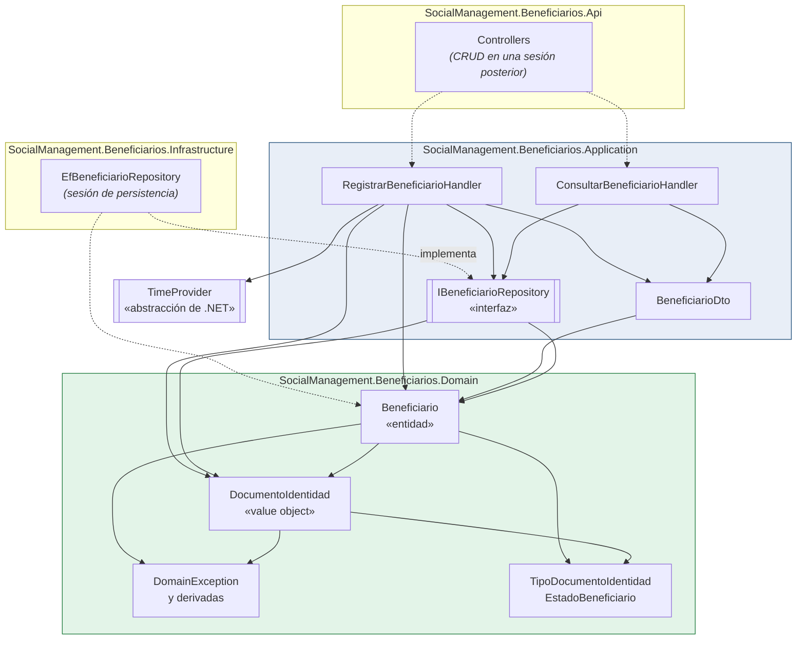
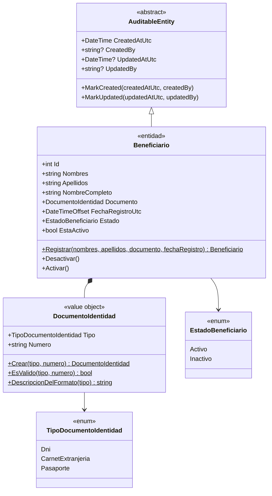
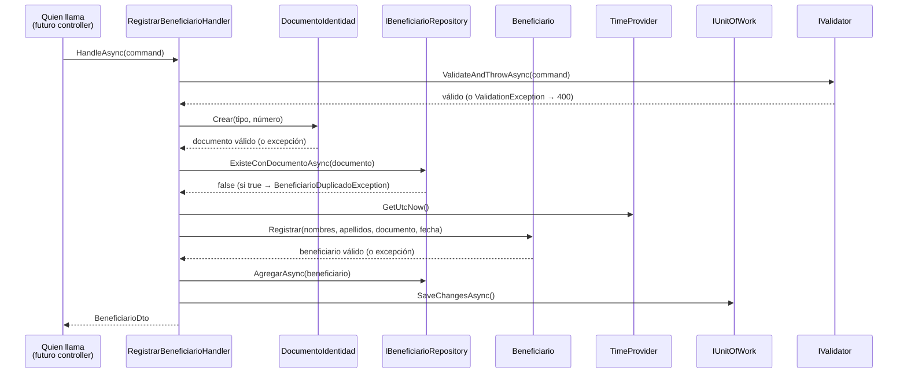
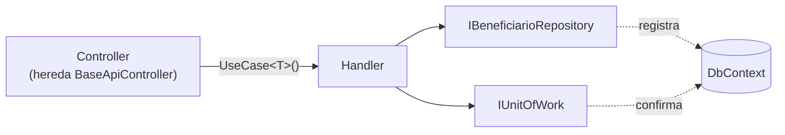

# Sesión 02: Clean Architecture

**Objetivo:** implementar los primeros componentes de dominio del microservicio de Beneficiarios aplicando Clean
Architecture y SOLID, **sin persistencia todavía**.

| | |
|---|---|
| **Punto de partida** | Sesión 01 |
| **Resultado** | Entidad `Beneficiario`, value object `DocumentoIdentidad`, puerto `IBeneficiarioRepository` y casos de uso de registrar y consultar, con pruebas |
| **Fuera de alcance** | Controllers CRUD, EF Core, SQL Server, MediatR, repositorios genéricos |

---

## 1. Diagrama de dependencias

Las flechas significan **"depende de"** (conoce, referencia). Todas apuntan hacia el **dominio**.



Líneas continuas: código de esta sesión. Líneas punteadas: piezas futuras.

- **Domain** no conoce a nadie: ni EF Core, ni ASP.NET Core, ni Application.
- **Application** define `IBeneficiarioRepository`; la **Infrastructure** lo implementará. La dependencia del código
  (Infrastructure → Application) va en sentido contrario al flujo de los datos (handler → base de datos):
  eso es la **inversión de dependencias**.
- No hay ciclos: `Domain ← Application ← Infrastructure ← Api`.

Las pruebas de arquitectura (`tests/unit/SocialManagement.Architecture.Tests`) verifican estas reglas en cada compilación.

---

## 2. Modelo de dominio



### Persistencia: el dominio no sabe cómo se guarda

La entidad **no lleva atributos de persistencia** (`[Key]`, `[Required]`, `[MaxLength]`, `[Table]`...). La clave
primaria, los campos requeridos, las longitudes, los índices y las relaciones se declaran en Infrastructure, con la
Fluent API de EF Core, en `Persistence/Configurations/BeneficiarioConfiguration.cs`:

```csharp
internal sealed class BeneficiarioConfiguration : IEntityTypeConfiguration<Beneficiario>
{
    public void Configure(EntityTypeBuilder<Beneficiario> builder)
    {
        builder.ToTable("Beneficiarios");                                   // esquema "beneficiarios"
        builder.HasKey(b => b.Id);                                          // clave primaria
        builder.Property(b => b.Id).UseIdentityColumn();                    // int IDENTITY(1,1): lo genera SQL Server
        builder.Property(b => b.Nombres).IsRequired().HasMaxLength(Beneficiario.LongitudMaximaNombre);
        builder.Property(b => b.Estado).IsRequired().HasConversion<string>().HasMaxLength(20);
        builder.Ignore(b => b.NombreCompleto);                              // calculada: no es columna

        // Relación con el value object: tipo propio (owned), columnas en la misma tabla e índice único.
        builder.OwnsOne(b => b.Documento, documento =>
        {
            documento.Property(d => d.Numero).HasColumnName("DocumentoNumero").IsRequired().HasMaxLength(12);
            documento.HasIndex(d => new { d.Tipo, d.Numero }).IsUnique();
        });
    }
}
```

Tabla resultante (script generado por EF Core a partir de esa configuración):

```sql
CREATE TABLE [beneficiarios].[Beneficiarios] (
    [Id] int NOT NULL IDENTITY,
    [Nombres] nvarchar(100) NOT NULL,
    [Apellidos] nvarchar(100) NOT NULL,
    [DocumentoTipo] nvarchar(20) NOT NULL,
    [DocumentoNumero] nvarchar(12) NOT NULL,
    [FechaRegistroUtc] datetimeoffset NOT NULL,
    [Estado] nvarchar(20) NOT NULL,
    [CreatedAtUtc] datetime2 NOT NULL,
    [CreatedBy] nvarchar(100) NULL,
    [UpdatedAtUtc] datetime2 NULL,
    [UpdatedBy] nvarchar(100) NULL,
    CONSTRAINT [PK_Beneficiarios] PRIMARY KEY ([Id])
);
CREATE UNIQUE INDEX [UX_Beneficiarios_Documento] ON [beneficiarios].[Beneficiarios] ([DocumentoTipo], [DocumentoNumero]);
```

| Pieza | Capa | Archivo |
|-------|------|---------|
| Reglas e invariantes | Domain | `Entities/Beneficiario.cs` |
| Clave primaria, columnas, índices, relaciones | Infrastructure | `Persistence/Configurations/BeneficiarioConfiguration.cs` |
| `DbSet<Beneficiario>` y registro de configuraciones | Infrastructure | `Persistence/BeneficiariosDbContext.cs` (`ApplyConfigurationsFromAssembly`) |

- Las longitudes usan las **constantes del dominio** (`Beneficiario.LongitudMaximaNombre`,
  `DocumentoIdentidad.LongitudMaximaNumero`): la base de datos y las invariantes no pueden desalinearse.
- El índice único **refuerza en la base de datos** la regla "un documento no puede repetirse" (el caso de uso la
  valida antes; el índice protege ante dos registros simultáneos).
- La única concesión del dominio a EF Core es un **constructor privado sin parámetros** en `Beneficiario`, que EF usa
  para leer filas. Al ser privado, el código de la aplicación sigue sin poder crear un beneficiario sin `Registrar`.
- Reglas verificadas: `Entidades_y_value_objects_no_usan_atributos_de_persistencia` (arquitectura) y
  `BeneficiarioConfigurationTests` (modelo y script SQL, sin conectarse a SQL Server).

### Auditoría: `AuditableEntity`

Las entidades heredan de `Domain/Entities/AuditableEntity.cs` los campos `CreatedAtUtc`, `CreatedBy`, `UpdatedAtUtc`
y `UpdatedBy`. Sus setters son privados: solo cambian con `MarkCreated(...)` y `MarkUpdated(...)`, que convierten
las fechas a UTC.

Nadie tiene que acordarse de llamarlos: el **interceptor de EF Core** `AuditableEntityInterceptor`
(`Infrastructure/Persistence/Interceptors`) los invoca justo antes de cada `SaveChanges`:

| Estado de la entidad | Qué hace el interceptor |
|----------------------|-------------------------|
| Nueva (`Added`) | `MarkCreated(ahora, usuario)` |
| Modificada (`Modified`) | `MarkUpdated(ahora, usuario)` y protege `CreatedAtUtc`/`CreatedBy` para que no se reescriban |

- La hora viene de `TimeProvider` (en pruebas, `FakeTimeProvider`).
- El usuario es `null` hasta que exista autenticación (módulo de seguridad).
- El mapeo de las columnas de auditoría es común: `builder.ConfigureAuditFields()` en cada configuración.
- `FechaRegistroUtc` (dato de negocio: cuándo se registró la persona) y `CreatedAtUtc` (dato técnico: cuándo se
  insertó la fila) son conceptos distintos y se mantienen separados.

### Entidad vs. Value Object

| | `Beneficiario` (entidad) | `DocumentoIdentidad` (value object) |
|---|---|---|
| Identidad | Tiene `Id`: dos beneficiarios con los mismos datos son **personas distintas** | No tiene `Id`: dos documentos `Dni 12345678` son **el mismo** |
| Igualdad | Por identidad | Por valor (`record` la genera) |
| Cambios | Su estado cambia (`Desactivar()`) sin dejar de ser el mismo | Inmutable: para "cambiarlo" se crea otro |
| Creación | `Beneficiario.Registrar(...)` | `DocumentoIdentidad.Crear(...)` |

**¿Por qué `DocumentoIdentidad` es un value object y no dos `string`?** Porque aporta:

1. **Validación en un solo lugar:** el formato depende del tipo (DNI: 8 dígitos; carné: 9 a 12 alfanuméricos; pasaporte: 6 a 12).
2. **Significado:** el compilador impide pasar un nombre donde se espera un documento.
3. **Normalización:** `" ab123456 "` y `"AB123456"` son el mismo pasaporte, y la detección de duplicados funciona sola.

### Invariantes

Una **invariante** es una condición que se cumple siempre para cualquier objeto que exista. Los constructores son
privados: **no se puede crear un objeto inválido**.

| Invariante | Dónde se valida | Prueba |
|------------|-----------------|--------|
| El DNI tiene exactamente 8 dígitos | `DocumentoIdentidad.Crear` | `Rechaza_numeros_con_formato_invalido_para_su_tipo` |
| El número de documento es obligatorio | `DocumentoIdentidad.Crear` | `El_numero_es_obligatorio` |
| El tipo de documento existe | `DocumentoIdentidad.Crear` | `Rechaza_un_tipo_de_documento_inexistente` |
| Nombres y apellidos obligatorios, ≤ 100 caracteres | `Beneficiario.Registrar` | `Rechaza_nombres_invalidos`, `Acepta_hasta_100_caracteres_y_rechaza_101` |
| Nombres solo con letras, espacios, `'`, `-` y `.` | `Beneficiario.Registrar` | `Acepta_nombres_con_tildes_enes_apostrofos_guiones_y_puntos` |
| El documento es obligatorio | `Beneficiario.Registrar` | `El_documento_es_obligatorio` |
| La fecha de registro existe y se guarda en UTC | `Beneficiario.Registrar` | `La_fecha_de_registro_se_guarda_en_UTC` |
| Un beneficiario nuevo está `Activo` | Constructor privado | `Registrar_crea_un_beneficiario_activo_...` |
| No hay dos beneficiarios con el mismo documento | `RegistrarBeneficiarioHandler` (necesita el repositorio) | `Rechaza_un_documento_ya_registrado_...` |

La última regla **no puede vivir en la entidad**: un beneficiario no conoce a los demás. Por eso la aplica el caso
de uso consultando el repositorio.

Todas las excepciones heredan de `DomainException`, y el `GlobalExceptionHandler` de la sesión 01 ya las traduce a
**HTTP 422**: el controller de una sesión futura no necesitará `try/catch`.

### Validación de entrada con FluentValidation

Antes de convertir los datos de entrada (el comando) en objetos de dominio, el caso de uso los valida con
**FluentValidation** (`Application/Validators`). Así el cliente recibe **todos** los errores de una vez, por campo
(HTTP 400), en lugar del primero que encuentre el dominio:

```csharp
public sealed class RegistrarBeneficiarioCommandValidator : AbstractValidator<RegistrarBeneficiarioCommand>
{
    public RegistrarBeneficiarioCommandValidator()
    {
        RuleFor(c => c.Nombres).NombreDePersona("nombres");       // regla reutilizable (NombreDePersonaRules)
        RuleFor(c => c.Apellidos).NombreDePersona("apellidos");
        RuleFor(c => c.TipoDocumento).IsInEnum().WithMessage("El tipo de documento no es válido.");
        RuleFor(c => c.NumeroDocumento)
            .NotEmpty().WithMessage("El número de documento es obligatorio.")
            .Must((c, numero) => DocumentoIdentidad.EsValido(c.TipoDocumento, numero))    // regla del dominio
            .WithMessage(c => DocumentoIdentidad.DescripcionDelFormato(c.TipoDocumento));
    }
}
```

| | Validador (Application) | Invariantes (Domain) |
|---|---|---|
| Cuándo | Primer paso del caso de uso | Al crear o modificar el objeto |
| Errores | Todos a la vez, por campo → **400** | El primero → **422** |
| Propósito | Retroalimentación al usuario | Garantía: nunca existe un objeto inválido |

Las reglas no se duplican: el validador usa `Beneficiario.LongitudMaximaNombre`, `NormalizarNombre`,
`TieneCaracteresPermitidos` y `DocumentoIdentidad.EsValido`. La prueba `El_validador_y_el_dominio_coinciden` pasa los
mismos datos por ambos niveles y exige que coincidan.

---

## 3. Casos de uso

| Caso de uso | Entrada | Salida | Archivo |
|-------------|---------|--------|---------|
| Registrar beneficiario | `RegistrarBeneficiarioCommand` | `BeneficiarioDto` | `Application/Features/RegistrarBeneficiario/` |
| Consultar beneficiario | `ConsultarBeneficiarioQuery(Id)` | `BeneficiarioDto?` (null si no existe) | `Application/Features/ConsultarBeneficiario/` |



El handler **orquesta** y no valida formatos: eso lo hacen el value object y la entidad. Si los datos son inválidos,
la excepción ocurre **antes** de llegar al repositorio, y nunca se confirma nada.

**Unit of Work.** El repositorio solo *registra* los cambios (`AgregarAsync`); el handler los **confirma** con
`IUnitOfWork.SaveChangesAsync()`, todo o nada. `IUnitOfWork` está en `Application/Interfaces` y lo implementa el
`DbContext` del servicio (Infrastructure), la misma instancia que usarán los repositorios en cada petición. Los
controllers nunca usan el Unit of Work: obtienen el caso de uso (`UseCase<T>()` de `BaseApiController`) y lo ejecutan.



### Decisiones de diseño (y lo que NO hicimos)

| Decisión | Motivo |
|----------|--------|
| `IBeneficiarioRepository` **específico**, con 3 métodos | Solo lo que piden los casos de uso. Un `IRepository<T>` genérico con `Update`, `Delete` y `GetAll` expondría operaciones que nadie usa y que el dominio quizá no permite. |
| Handlers como **clases concretas**, sin `IHandler<TIn, TOut>` ni MediatR | Con dos casos de uso, una abstracción genérica no aporta valor y complica la explicación. |
| Sin clase base `Entity` | Solo hay una entidad. Se extraerá cuando haya una segunda y la duplicación sea real. |
| `BeneficiarioDto` en lugar de devolver la entidad | Quien llama no puede modificar la entidad ni saltarse sus invariantes. |
| `Id` **entero** (`int`) generado por SQL Server (`IDENTITY`) | Regla del proyecto: no se usa GUID. El Id es simple de leer, de escribir en una URL (`/api/v1/beneficiarios/25`) y de indexar. El dominio no lo inventa: vale 0 hasta que el beneficiario se guarda. |
| Los handlers **aún no se registran en DI** | No existe implementación de `IBeneficiarioRepository`. Con `ValidateOnBuild = true` (sesión 01) la API no arrancaría. Se registrarán junto con el repositorio de EF Core. |

---

## 4. SOLID en el código de esta sesión

### S: Responsabilidad única

Cada clase tiene **un motivo para cambiar**:

| Clase | Responsabilidad | Cambia si... |
|-------|-----------------|--------------|
| `DocumentoIdentidad` | Formato y normalización de documentos | cambia el formato del DNI |
| `Beneficiario` | Invariantes y estado de un beneficiario | cambian las reglas de un beneficiario |
| `RegistrarBeneficiarioHandler` | Orquestar el registro | cambian los pasos del registro |
| `IBeneficiarioRepository` (implementación) | Guardar y leer | cambia la base de datos |

```csharp
// El handler NO valida el formato del DNI: se lo delega al value object.
var documento = DocumentoIdentidad.Crear(command.TipoDocumento, command.NumeroDocumento);
```

### O: Abierto/cerrado

El código está **abierto a extensión y cerrado a modificación**:

- Un caso de uso nuevo (por ejemplo, `DesactivarBeneficiario`) es una **carpeta nueva** en `Features/`; no se modifican los existentes.
- Pasar de un repositorio en memoria a EF Core es una **clase nueva** en Infrastructure; `RegistrarBeneficiarioHandler` no cambia.

### L: Sustitución de Liskov

Cualquier implementación de `IBeneficiarioRepository` debe poder reemplazar a otra sin romper los casos de uso.
Las pruebas usan `FakeBeneficiarioRepository` (una lista en memoria) y el handler funciona igual que funcionará con
EF Core, siempre que se respete el contrato documentado (por ejemplo, `ObtenerPorIdAsync` devuelve `null` y no lanza
excepción si no existe).

Otro ejemplo: `BeneficiarioInvalidoException`, `DocumentoIdentidadInvalidoException` y
`BeneficiarioDuplicadoException` sustituyen a `DomainException`. El `GlobalExceptionHandler` las trata a todas igual
(HTTP 422) sin conocerlas.

### I: Segregación de interfaces

`IBeneficiarioRepository` tiene **3 métodos**, exactamente los que usan los casos de uso:

```csharp
public interface IBeneficiarioRepository
{
    Task<Beneficiario?> ObtenerPorIdAsync(int id, CancellationToken cancellationToken = default);
    Task<bool> ExisteConDocumentoAsync(DocumentoIdentidad documento, CancellationToken cancellationToken = default);
    Task AgregarAsync(Beneficiario beneficiario, CancellationToken cancellationToken = default);
}
```

`ConsultarBeneficiarioHandler` solo usa `ObtenerPorIdAsync`. Si la interfaz creciera mucho, se podría dividir en
lectura y escritura; hoy no hace falta.

### D: Inversión de dependencias

Los módulos de alto nivel (casos de uso) dependen de **abstracciones**, no de detalles:

```csharp
public sealed class RegistrarBeneficiarioHandler(
    IValidator<RegistrarBeneficiarioCommand> validator,
    IBeneficiarioRepository repository,
    IUnitOfWork unitOfWork,
    TimeProvider timeProvider)
```

- No hay `new SqlConnection(...)` ni `DbContext`: se recibe un `IBeneficiarioRepository` y un `IUnitOfWork`.
- No hay `DateTime.UtcNow`: se recibe un `TimeProvider` (la misma abstracción de la sesión 01).

Gracias a esto, las pruebas reemplazan las dependencias (`FakeBeneficiarioRepository`, `FakeUnitOfWork`,
`FakeTimeProvider`) y se ejecutan en milisegundos, sin base de datos. `FakeUnitOfWork` permite comprobar que los
cambios se confirman una sola vez al registrar y nunca cuando hay un error.

---

## 5. Pruebas

| Proyecto | Qué prueba |
|----------|------------|
| `tests/unit/SocialManagement.Beneficiarios.Domain.UnitTests` | `DocumentoIdentidadTests` y `BeneficiarioTests`: todas las invariantes, la normalización, la igualdad por valor y el estado |
| `tests/unit/SocialManagement.Beneficiarios.Application.UnitTests` | `RegistrarBeneficiarioHandlerTests` y `ConsultarBeneficiarioHandlerTests` (con `FakeBeneficiarioRepository`, `FakeUnitOfWork` y `FakeTimeProvider`); `RegistrarBeneficiarioCommandValidatorTests` (FluentValidation `TestValidate` y coherencia con el dominio) |
| `tests/unit/SocialManagement.Architecture.Tests` → `DomainModelRulesTests` | En todos los servicios: entidades y value objects sin setters ni constructores públicos; excepciones derivadas de `DomainException` |

```powershell
dotnet test --project tests/unit/SocialManagement.Beneficiarios.Domain.UnitTests
dotnet test --project tests/unit/SocialManagement.Beneficiarios.Application.UnitTests
dotnet test --solution SocialManagement.slnx
```

Ejemplo de prueba de invariante (patrón Arrange/Act/Assert):

```csharp
[Theory]
[InlineData(TipoDocumentoIdentidad.Dni, "1234567", "8 dígitos")]   // corto
[InlineData(TipoDocumentoIdentidad.Dni, "1234567A", "8 dígitos")]  // letra
public void Rechaza_numeros_con_formato_invalido_para_su_tipo(TipoDocumentoIdentidad tipo, string numero, string mensaje)
{
    var excepcion = Assert.Throws<DocumentoIdentidadInvalidoException>(() => DocumentoIdentidad.Crear(tipo, numero));
    Assert.Contains(mensaje, excepcion.Message);
}
```

> Todos los datos de prueba son **ficticios** (`12345678`, "Ana María Quispe Mamani"). Nunca uses documentos de
> personas reales en código, pruebas ni prompts de IA.

---

## 6. Desarrollo asistido por IA

Prompt sugerido para ampliar las pruebas de invariantes:

```text
Contexto: .NET 10, xUnit v3. Tengo el value object DocumentoIdentidad (pego el código) con las reglas:
DNI = 8 dígitos ASCII; carné de extranjería = 9 a 12 alfanuméricos; pasaporte = 6 a 12 alfanuméricos;
el número se normaliza con Trim y ToUpperInvariant.

Tarea: propón casos de prueba de frontera que todavía no cubro (pego DocumentoIdentidadTests.cs).
Restricciones: solo datos ficticios; un [Theory] con [InlineData] por regla; no modifiques el código de producción.
Salida: los métodos de prueba nuevos y, para cada caso, una línea explicando qué riesgo cubre.
```

Revisa cada caso propuesto: la IA a veces "inventa" reglas que el dominio no tiene (por ejemplo, un dígito
verificador del DNI). Si una regla no está en el código, la prueba debe fallar o descartarse.

---

## 7. Ejercicios propuestos

1. Agrega el método `Beneficiario.CorregirNombres(nombres, apellidos)` que reutilice las mismas invariantes. Escribe
   primero las pruebas.
2. Crea el caso de uso `DesactivarBeneficiario` en una carpeta nueva de `Features/`. ¿Qué método necesitas agregar a
   `IBeneficiarioRepository`? ¿Por qué no basta con los actuales?
3. Intenta agregar `public set;` a `Beneficiario.Nombres` y ejecuta las pruebas de arquitectura. ¿Qué regla se rompe y por qué existe?

---

## 8. Cambios de esta sesión

| Archivo | Cambio |
|---------|--------|
| `Domain/Entities/Beneficiario.cs` | **Nuevo**: entidad con invariantes |
| `Domain/ValueObjects/DocumentoIdentidad.cs` | **Nuevo**: value object |
| `Domain/Enums/TipoDocumentoIdentidad.cs`, `EstadoBeneficiario.cs` | **Nuevos** |
| `Domain/Exceptions/BeneficiarioInvalidoException.cs`, `DocumentoIdentidadInvalidoException.cs`, `BeneficiarioDuplicadoException.cs` | **Nuevos** |
| `Application/Interfaces/IBeneficiarioRepository.cs` | **Nuevo**: puerto de persistencia |
| `Application/DTOs/BeneficiarioDto.cs` | **Nuevo** |
| `Application/Features/RegistrarBeneficiario/*`, `ConsultarBeneficiario/*` | **Nuevos**: casos de uso |
| `Application/DependencyInjection.cs` | Comentario: por qué los handlers aún no se registran |
| `tests/unit/SocialManagement.Beneficiarios.Domain.UnitTests/` | **Nuevo** |
| `tests/unit/SocialManagement.Beneficiarios.Application.UnitTests/` | **Nuevo** |
| `tests/unit/SocialManagement.Architecture.Tests/DomainModelRulesTests.cs` | **Nuevo**: reglas del modelo de dominio |

Sin cambios en Api, Infrastructure, Gateway, frontend ni Docker.

### Criterios de aceptación

| Criterio | Verificación |
|----------|--------------|
| Solución compilable | `dotnet build SocialManagement.slnx` sin advertencias |
| Pruebas de invariantes exitosas | `Domain.UnitTests` y `Application.UnitTests` en verde |
| Separación de capas verificable | `Architecture.Tests`: Domain sin EF Core ni ASP.NET Core, sin referencias circulares, reglas del modelo |
| Código explicable en clase | 2 casos de uso, 1 entidad, 1 value object, sin abstracciones genéricas |
