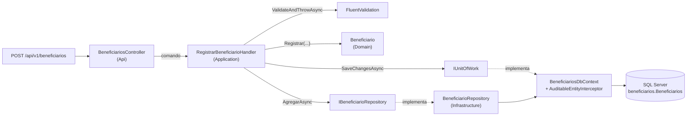

# Sesión 03: CRUD de beneficiarios

**Objetivo:** persistir los beneficiarios en SQL Server con EF Core 10 y exponer un CRUD REST completo en
`/api/v1/beneficiarios`, sin lógica de persistencia en los controllers y con pruebas contra una base de datos real.

| | |
|---|---|
| **Punto de partida** | Sesión 02 (dominio y casos de uso registrar/consultar, sin persistencia) |
| **Resultado** | `BeneficiariosDbContext`, mapeo Fluent API, migración `InicialBeneficiarios`, repositorio, 5 casos de uso, controller con 201/200/400/404/409 y pruebas de integración con SQL Server |
| **Fuera de alcance** | Pantallas Angular, autenticación (usuario de auditoría), concurrencia optimista, Solicitudes |

---

## 1. Recorrido de una petición



- El **controller** traduce HTTP ↔ caso de uso. No conoce EF Core, el `DbContext` ni los repositorios.
- El **caso de uso** valida, aplica las reglas del dominio y confirma con `IUnitOfWork`.
- **Infrastructure** decide *cómo* se guarda: tablas, columnas, índices y migraciones.

---

## 2. Persistencia con EF Core 10

### `BeneficiariosDbContext`

`Infrastructure/Persistence/BeneficiariosDbContext.cs`:

- Esquema propio `beneficiarios` (tablas e historial de migraciones `beneficiarios.__EFMigrationsHistory`).
- `ApplyConfigurationsFromAssembly`: registra todas las clases `IEntityTypeConfiguration<T>`.
- Implementa `IUnitOfWork`. DI registra **la misma instancia scoped** como `IUnitOfWork` y como contexto del
  repositorio: todo lo de una petición se confirma en una sola transacción.

### Mapeo sin contaminar el dominio

La entidad `Beneficiario` no tiene atributos (`[Key]`, `[Required]`, `[MaxLength]`...). Todo el mapeo está en
`Infrastructure/Persistence/Configurations/BeneficiarioConfiguration.cs`:

```csharp
builder.ToTable("Beneficiarios");
builder.HasKey(b => b.Id);
builder.Property(b => b.Id).ValueGeneratedOnAdd().UseIdentityColumn();   // int IDENTITY(1,1): lo genera SQL Server

builder.Property(b => b.Nombres).IsRequired().HasMaxLength(Beneficiario.LongitudMaximaNombre);
builder.Property(b => b.Estado).HasConversion<string>().HasMaxLength(20);   // "Activo" en la tabla, no 0
builder.Ignore(b => b.NombreCompleto);                      // propiedad calculada: no es columna
builder.ConfigureAuditFields();                             // CreatedAtUtc, CreatedBy, UpdatedAtUtc, UpdatedBy

// Value Object → columnas de la misma tabla, con índice único
builder.OwnsOne(b => b.Documento, documento =>
{
    documento.Property(d => d.Tipo).HasColumnName("DocumentoTipo").HasConversion<string>().HasMaxLength(20);
    documento.Property(d => d.Numero).HasColumnName("DocumentoNumero").HasMaxLength(DocumentoIdentidad.LongitudMaximaNumero);
    documento.HasIndex(d => new { d.Tipo, d.Numero }).IsUnique().HasDatabaseName("UX_Beneficiarios_Documento");
});
builder.Navigation(b => b.Documento).IsRequired();         // todo beneficiario tiene documento
```

Lo único que el dominio concede a EF Core es un **constructor privado sin parámetros** (EF lo usa para materializar
las filas; nadie más puede llamarlo) y setters **privados**.

### Tabla generada

| Columna | Tipo SQL | Origen |
|---------|----------|--------|
| `Id` | `int IDENTITY(1,1)` (PK) | `Beneficiario.Id`: lo asigna SQL Server en el INSERT |
| `Nombres`, `Apellidos` | `nvarchar(100)` | Propiedades de la entidad (`nvarchar`: conserva tildes y eñes) |
| `DocumentoTipo`, `DocumentoNumero` | `nvarchar(20)`, `nvarchar(12)` | Value Object `DocumentoIdentidad` (índice único `UX_Beneficiarios_Documento`) |
| `FechaRegistroUtc` | `datetimeoffset` | Fecha de registro del dominio |
| `Estado` | `nvarchar(20)` | Enum guardado como texto |
| `CreatedAtUtc`, `CreatedBy`, `UpdatedAtUtc`, `UpdatedBy` | `datetime2`, `nvarchar(100)` | `AuditableEntity`, completados por `AuditableEntityInterceptor` |

---

## 3. Migraciones

La herramienta `dotnet-ef` está fijada en `dotnet-tools.json` (raíz del repositorio): todo el equipo y CI usan la
misma versión que EF Core (10.0.15).

```powershell
dotnet tool restore     # una vez por clon

# Variables para no repetir rutas
$infra = "src/backend/services/beneficiarios/SocialManagement.Beneficiarios.Infrastructure"
$api   = "src/backend/services/beneficiarios/SocialManagement.Beneficiarios.Api"

# Crear una migración después de cambiar una entidad o una configuración
dotnet ef migrations add <NombreDescriptivo> --project $infra --startup-project $api --output-dir Persistence/Migrations

# ¿El modelo y las migraciones están al día? (lo comprueba CI)
dotnet ef migrations has-pending-model-changes --project $infra --startup-project $api

# Aplicar a la base de datos
dotnet ef database update --project $infra --startup-project $api

# Script SQL idempotente (revisable, para ambientes donde no se migra al iniciar)
dotnet ef migrations script --idempotent --project $infra --startup-project $api --output artifacts/beneficiarios.sql

# Deshacer la última migración (solo si NO se aplicó en ningún ambiente compartido)
dotnet ef migrations remove --project $infra --startup-project $api
```

**¿A qué base se conecta `dotnet ef`?** A la que indica `BeneficiariosDesignTimeDbContextFactory`, no a
user-secrets: la variable de entorno `SM_BENEFICIARIOS_DB` o, si no existe, LocalDB
(`Server=(localdb)\MSSQLLocalDB;Database=SocialManagement_Beneficiarios;...`). Así las migraciones son
**reproducibles**: no dependen de la configuración de cada máquina.

```powershell
# Contra el SQL Server de Docker Compose
$env:SM_BENEFICIARIOS_DB = "Server=localhost,14333;Database=SocialManagement_Beneficiarios;User Id=sa;Password=<clave del .env>;TrustServerCertificate=True"
dotnet ef database update --project $infra --startup-project $api
```

**Al iniciar la API:** si `Persistence:ApplyMigrationsAtStartup` es `true`, `ApplyDatabaseMigrationsAsync` aplica las
migraciones pendientes antes de aceptar peticiones. Está activado **solo en Docker Compose**
(`Persistence__ApplyMigrationsAtStartup: "true"`). En `appsettings.json` es `false`: en producción el esquema se
cambia con un paso explícito y revisado (script idempotente), no como efecto secundario de un despliegue.

La migración `20261114172608_InicialBeneficiarios` crea el esquema `beneficiarios`, la tabla, la clave primaria y el
índice único.

---

## 4. Repositorio y casos de uso

`IBeneficiarioRepository` (Application) gana `ListarAsync(pagina, tamanoPagina)`, que devuelve la página y el total.
`BeneficiarioRepository` (Infrastructure, `internal`) lo implementa con `AsNoTracking`, `CountAsync` y
`OrderBy(Apellidos).ThenBy(Nombres).ThenBy(Id)` + `Skip/Take` (SQL Server: `OFFSET ... FETCH`). El orden por `Id`
al final garantiza páginas estables cuando hay nombres repetidos.

| Caso de uso | Entrada | Salida | Reglas |
|-------------|---------|--------|--------|
| `RegistrarBeneficiarioHandler` | `RegistrarBeneficiarioCommand` | `BeneficiarioDto` | Documento único → `BeneficiarioDuplicadoException` (409) |
| `ConsultarBeneficiarioHandler` | `ConsultarBeneficiarioQuery(Id)` | `BeneficiarioDto?` | `null` → 404 |
| `ListarBeneficiariosHandler` | `ListarBeneficiariosQuery(Pagina, TamanoPagina)` | `PagedResult<BeneficiarioDto>` | Página ≥ 1, tamaño 1–100 |
| `ActualizarBeneficiarioHandler` | `ActualizarBeneficiarioCommand(Id, ...)` | `BeneficiarioDto?` | Si cambia el documento, no puede pertenecer a otro (409) |
| `DesactivarBeneficiarioHandler` | `DesactivarBeneficiarioCommand(Id)` | `BeneficiarioDto?` | Baja **lógica**: el registro se conserva como `Inactivo` |

Todos siguen el mismo patrón: **validar → cargar → aplicar la regla del dominio → `SaveChangesAsync` → DTO**.
`ActualizarBeneficiario` usa el método de dominio `Beneficiario.ActualizarDatos`, que reutiliza las invariantes de
`Registrar` y es atómico: si un dato no es válido, la entidad no cambia.

`RegistrarBeneficiarioCommand` y `ActualizarBeneficiarioCommand` implementan `IDatosPersonalesBeneficiario`, y sus
validadores comparten `DatosPersonalesBeneficiarioValidator` con `Include(...)`: las reglas de nombres y documento
están escritas una sola vez.

---

## 5. Endpoints: `/api/v1/beneficiarios`

| Método | Ruta | Éxito | Errores |
|--------|------|-------|---------|
| `POST` | `/api/v1/beneficiarios` | **201** + cabecera `Location` | 400 datos no válidos · 409 documento duplicado |
| `GET` | `/api/v1/beneficiarios/{id}` | **200** | 400 Id ≤ 0 · 404 no existe |
| `GET` | `/api/v1/beneficiarios?pagina=1&tamanoPagina=10` | **200** con `items`, `totalRegistros`, `totalPaginas`, `tieneAnterior`, `tieneSiguiente` | 400 paginación no válida |
| `PUT` | `/api/v1/beneficiarios/{id}` | **200** | 400 · 404 · 409 documento de otro beneficiario |
| `PATCH` | `/api/v1/beneficiarios/{id}/desactivar` | **200** (también si ya estaba inactivo) | 400 Id ≤ 0 · 404 |

**Identificadores enteros.** `{id}` es un `int` (`/api/v1/beneficiarios/25`) generado por SQL Server
(`IDENTITY(1,1)`) al registrar; la respuesta 201 lo devuelve en `data.id` y en `Location`. La ruta usa la restricción
`{id:int}`: un texto como `abc` no coincide con la ruta (404) y un `0` o negativo lo rechaza la validación (400).
El proyecto **no usa GUID** en ninguna parte (regla verificada por `IdentifierRulesTests`).

Directo: `http://localhost:8081/api/v1/beneficiarios` · Gateway: `http://localhost:8080/api/v1/beneficiarios`
(ruta `beneficiarios-versioned-route`, sin reescritura). Swagger UI: <http://localhost:8081/swagger>.

DTOs de entrada en la API (`Contracts/RegistrarBeneficiarioRequest`, `ActualizarBeneficiarioRequest`) con
`ToCommand()`; de salida, `BeneficiarioDto` y `PagedResult<T>` de Application. Los enums viajan como texto
(`"tipoDocumento": "Dni"`).

```http
POST /api/v1/beneficiarios
Content-Type: application/json

{ "nombres": "Ana María", "apellidos": "Quispe Mamani", "tipoDocumento": "Dni", "numeroDocumento": "12345678" }
```

```http
HTTP/1.1 201 Created
Location: http://localhost:8081/api/v1/beneficiarios/1

{ "success": true,
  "data": { "id": 1, "nombres": "Ana María", "apellidos": "Quispe Mamani",
            "nombreCompleto": "Ana María Quispe Mamani", "tipoDocumento": "Dni", "numeroDocumento": "12345678",
            "fechaRegistroUtc": "2026-11-14T16:44:48.0000000+00:00", "estado": "Activo" },
  "message": "Beneficiario registrado.", "errors": [], "traceId": "00-..." }
```

### Errores y formato de respuesta

`GlobalExceptionHandler` traduce las excepciones; ningún endpoint tiene `try/catch`:

| Excepción | HTTP |
|-----------|------|
| `ValidationException` (FluentValidation) o modelo no válido (p. ej. `pagina=abc`) | 400, un error por campo |
| `DomainConflictException` (`BeneficiarioDuplicadoException`) | 409 |
| `DomainException` (otra regla del dominio) | 422 |
| Cualquier otra | 500, sin detalles internos |

> **Decisión: `ApiResponse<T>` en vez de ProblemDetails en los controllers.** El enunciado de la sesión menciona
> ProblemDetails. Para los controllers se mantiene el envoltorio `ApiResponse<T>` elegido al crear
> `BaseApiController` (un solo formato para éxito y error: `success`, `data`, `message`, `errors[]`, `traceId`).
> ProblemDetails (RFC 9457) se sigue usando en Minimal APIs, rutas inexistentes (404) y métodos no permitidos (405).
> Cambiar los controllers a ProblemDetails afecta solo a `BaseApiController` y `GlobalExceptionHandler`.

---

## 6. SQL Server local

| Opción | Cadena de conexión | Cuándo |
|--------|--------------------|--------|
| **Docker Compose** | `Server=localhost,14333;...;User Id=sa` | Entorno completo (`.\scripts\start.ps1`); migra al iniciar |
| **LocalDB** | `Server=(localdb)\MSSQLLocalDB;Integrated Security=True` | Sin Docker (incluido con Visual Studio) |

API contra LocalDB, sin Docker:

```powershell
dotnet ef database update --project $infra --startup-project $api        # crea la base y las tablas en LocalDB
$env:ConnectionStrings__BeneficiariosDb = "Server=(localdb)\MSSQLLocalDB;Database=SocialManagement_Beneficiarios;Integrated Security=True;TrustServerCertificate=True"
dotnet run --project $api                                                 # http://localhost:8081/swagger
```

Comprobar lo guardado (SSMS, Azure Data Studio o `sqlcmd`):

```sql
SELECT Nombres, Apellidos, DocumentoTipo, DocumentoNumero, Estado, CreatedAtUtc, UpdatedAtUtc
FROM beneficiarios.Beneficiarios ORDER BY Apellidos, Nombres;
```

> **Tildes desde PowerShell 5.1.** `Invoke-WebRequest -Body "Ana María"` no envía UTF-8 y la API recibe caracteres
> corruptos (400 "solo pueden contener letras"). Usa Swagger UI, `curl.exe` con un archivo UTF-8
> (`--data-binary @cuerpo.json`), PowerShell 7 o `-Body ([Text.Encoding]::UTF8.GetBytes($json))`.

---

## 7. Pruebas

| Proyecto | Nuevas en esta sesión |
|----------|-----------------------|
| `Beneficiarios.Domain.UnitTests` | `BeneficiarioActualizarDatosTests`: normalización, atomicidad, documento obligatorio |
| `Beneficiarios.Application.UnitTests` | `ListarBeneficiariosHandlerTests`, `ActualizarBeneficiarioHandlerTests`, `DesactivarBeneficiarioHandlerTests` (`FakeBeneficiarioRepository` con `ListarAsync`) |
| `Beneficiarios.Api.IntegrationTests` | `El_documento_OpenAPI_describe_el_CRUD_de_beneficiarios`: rutas, etiqueta, resumen y códigos 200/201/400/404/409 |
| **`Beneficiarios.SqlServer.IntegrationTests`** (nuevo) | CRUD HTTP de punta a punta contra SQL Server real, migraciones aplicadas al iniciar, 409 sin duplicar filas, índice único en la base, auditoría guardada, 400/404 y paginación `OFFSET/FETCH` |
| `Gateway.IntegrationTests` | Ruta versionada `/api/v{n}/beneficiarios` sin reescritura; formato `v<número>` obligatorio |
| `LocalEnvironment.Tests` | `docker-compose.yml`: la API de beneficiarios migra al iniciar |

**Pruebas con SQL Server real.** Cada clase de prueba crea una base temporal con nombre único
(`SocialManagement_Beneficiarios_Test_<fecha y hora>_<número aleatorio>`), la API aplica las migraciones al arrancar y la base se elimina al
terminar. Se activan con `SM_SQLSERVER_TESTS`; sin ella aparecen como *skipped*. En CI se ejecutan contra un
contenedor `mcr.microsoft.com/mssql/server:2022-latest` (servicio del job `backend`).

```powershell
$env:SM_SQLSERVER_TESTS = "Server=(localdb)\MSSQLLocalDB;Integrated Security=True;TrustServerCertificate=True"
dotnet test --project tests/integration/SocialManagement.Beneficiarios.SqlServer.IntegrationTests
dotnet test --solution SocialManagement.slnx
```

**Resultado (Ids enteros, LocalDB):** 347 pruebas: 333 correctas, 0 con errores, 14 omitidas (pruebas en vivo del
entorno Docker, que requieren `SM_ENVIRONMENT_TESTS`). Compilación en modo CI (`-warnaserror`) sin advertencias.

**Recorrido manual contra LocalDB** (curl):

```text
POST   /api/v1/beneficiarios                           -> 201  Location: /api/v1/beneficiarios/1
POST   /api/v1/beneficiarios                           -> 201  Location: /api/v1/beneficiarios/2  (Luis Huamán)
GET    /api/v1/beneficiarios/1                         -> 200
GET    /api/v1/beneficiarios?pagina=1&tamanoPagina=1   -> 200
PUT    /api/v1/beneficiarios/1                         -> 200
PATCH  /api/v1/beneficiarios/1/desactivar              -> 200
POST   (mismo DNI)                                     -> 409
PUT    /api/v1/beneficiarios/1 (documento de otro)     -> 409
POST   (nombres "Ana123", apellidos vacíos, DNI "123") -> 400
GET    /api/v1/beneficiarios/999999                    -> 404
GET    /api/v1/beneficiarios/0                         -> 400  (el Id debe ser un entero mayor que 0)
GET    /api/v1/beneficiarios?pagina=0&tamanoPagina=500 -> 400

beneficiarios.Beneficiarios:
1 | Ana María | Quispe Rojas | Dni | 12345678 | Inactivo | 2026-11-17 00:07:22 | 2026-11-17 00:07:23
2 | Luis | Huamán | Pasaporte | AB123456 | Activo | 2026-11-17 00:07:22 | -
```

### Dos trampas de EF Core con Value Objects "owned" (descubiertas por las pruebas)

1. **No compares el objeto completo en LINQ**: `b.Documento == documento` no se traduce a SQL. Compara sus
   propiedades: `b.Documento.Tipo == documento.Tipo && b.Documento.Numero == documento.Numero` (así lo hace el
   repositorio).
2. **No compartas una instancia entre entidades**: EF Core trata un objeto *owned* como parte de **un** dueño. Si dos
   entidades reciben la misma instancia, la segunda se inserta con columnas `NULL`. `DocumentoIdentidad.Crear` siempre
   devuelve una instancia nueva.

---

## 8. Desarrollo asistido por IA

Prompt 1: mapeo de un Value Object:

```text
Contexto: .NET 10, EF Core 10, SQL Server. Clean Architecture: el dominio no puede tener atributos de EF Core.
Entidad Beneficiario (pego el código) con el value object DocumentoIdentidad (Tipo enum, Numero string).
Tarea: escribe BeneficiarioConfiguration : IEntityTypeConfiguration<Beneficiario> con OwnsOne, columnas
DocumentoTipo/DocumentoNumero, enum como texto y un índice único por (Tipo, Numero).
Restricciones: no modifiques la entidad; sin [Key] ni DataAnnotations; explica cada línea en un comentario breve.
```

Prompt 2: pruebas de integración:

```text
Contexto: API ASP.NET Core 10 con WebApplicationFactory, xUnit v3 y EF Core con SQL Server.
Tarea: diseña una fixture que cree una base de datos temporal con nombre único por clase de prueba, aplique las
migraciones y la elimine al terminar. Las pruebas deben omitirse (Assert.SkipUnless) si no existe la variable
SM_SQLSERVER_TESTS. Incluye un caso que verifique el 409 por documento duplicado y que la fila no se duplicó.
Restricciones: sin Testcontainers; datos ficticios; nada de cadenas de conexión reales en el código.
```

Prompt 3: revisión de la migración:

```text
Pego la migración generada por EF Core (Up y Down) y la configuración Fluent API.
Revisa: tipos y longitudes de columnas frente a las reglas del dominio, índices, nulabilidad y si el Down revierte
exactamente el Up. Señala cualquier diferencia con las invariantes del dominio. No propongas cambios de dominio.
```

Revisa siempre lo que genera la IA: es frecuente que proponga `[Key]` en la entidad, `HasNoKey` para el Value Object o
`EnsureCreated()` en lugar de migraciones. Las tres cosas rompen las decisiones de este proyecto.

---

## 9. Pendientes y decisiones conscientes

| Tema | Estado |
|------|--------|
| **Carrera entre dos registros simultáneos** con el mismo documento | El caso de uso comprueba antes de insertar. Si dos peticiones pasan la comprobación a la vez, el índice único rechaza la segunda (`DbUpdateException`, probado), pero hoy responde **500**. Pendiente: traducir esa violación de índice a 409 en Infrastructure. |
| **Concurrencia optimista** (dos usuarios editan el mismo registro) | Pendiente: columna `rowversion` + `DbUpdateConcurrencyException` → 409. |
| **Usuario de auditoría** (`CreatedBy`, `UpdatedBy`) | Se guarda `null` hasta el módulo de seguridad (usuario autenticado). |
| **Eliminación física** | No existe a propósito: la baja es lógica (`PATCH .../desactivar`). |

---

## 10. Ejercicios propuestos

1. Agrega `PATCH /api/v1/beneficiarios/{id}/activar` (el dominio ya tiene `Activar()`). Escribe primero la prueba del
   caso de uso y después la de SQL Server.
2. Agrega un filtro opcional `?estado=Activo` a la lista. ¿En qué capa va el filtro? ¿Necesitas un índice nuevo y, por
   lo tanto, una migración?
3. Resuelve el pendiente de la carrera: captura `DbUpdateException` por `UX_Beneficiarios_Documento` y conviértela en
   `BeneficiarioDuplicadoException`. ¿Dónde lo harías para que el dominio no conozca SQL Server?

---

## 11. Cambios de esta sesión

| Archivo | Cambio |
|---------|--------|
| `Domain/Entities/Beneficiario.cs` | `ActualizarDatos`, constructor privado para EF Core, setters privados; **`Id` entero** asignado por SQL Server (antes Guid v7) |
| Commands, queries, DTOs, repositorio y rutas (`{id:int}`) | Identificador `int`; validación `Id > 0` |
| `Application/Abstractions/Messaging/IIntegrationEvent.cs` (ambos servicios) | `EventId` pasa a `long` (sin GUID) |
| `Domain/Exceptions/DomainConflictException.cs` | **Nuevo**: base de los conflictos (409); `BeneficiarioDuplicadoException` deriva de ella |
| `Application/Features/ListarBeneficiarios/*`, `ActualizarBeneficiario/*`, `DesactivarBeneficiario/*` | **Nuevos** casos de uso |
| `Application/DTOs/PagedResult.cs`, `IDatosPersonalesBeneficiario.cs` | **Nuevos** |
| `Application/Validators/*` | Validadores de listar, actualizar y desactivar; reglas compartidas con `Include` |
| `Application/Interfaces/IBeneficiarioRepository.cs` | `ListarAsync` |
| `Application/DependencyInjection.cs` | Registro de los 5 casos de uso |
| `Infrastructure/Repositories/BeneficiarioRepository.cs` | **Nuevo**: repositorio EF Core |
| `Infrastructure/Persistence/BeneficiariosDbContext.cs` | `DbSet<Beneficiario>`, `IUnitOfWork` |
| `Infrastructure/Persistence/Configurations/BeneficiarioConfiguration.cs` | Mapeo completo (owned type, índice único) |
| `Infrastructure/Persistence/Migrations/*` | **Nueva** migración `InicialBeneficiarios` |
| `Infrastructure/Persistence/BeneficiariosDesignTimeDbContextFactory.cs` | **Nuevo**: base de `dotnet ef` (`SM_BENEFICIARIOS_DB` o LocalDB) |
| `Infrastructure/Persistence/DatabaseMigrationExtensions.cs`, `Configurations/PersistenceOptions.cs` | **Nuevos**: migrar al iniciar (opcional) |
| `Api/Controllers/BeneficiariosController.cs` | **Nuevo**: CRUD |
| `Api/Contracts/RegistrarBeneficiarioRequest.cs`, `ActualizarBeneficiarioRequest.cs` | **Nuevos** DTOs de entrada |
| `Api/Middleware/GlobalExceptionHandler.cs` | 409 para `DomainConflictException` |
| `Api/Extensions/ApiServiceCollectionExtensions.cs` | Enums como texto en JSON, rutas en minúsculas |
| `Api/Program.cs`, `appsettings.json` | `ApplyDatabaseMigrationsAsync`, sección `Persistence` |
| `Gateway/appsettings.json` | Ruta `beneficiarios-versioned-route` |
| `infra/docker/docker-compose.yml` | `Persistence__ApplyMigrationsAtStartup: "true"` en `beneficiarios-api` |
| `.github/workflows/ci.yml` | Servicio SQL Server, `SM_SQLSERVER_TESTS`, comprobación `has-pending-model-changes` |
| `dotnet-tools.json` | **Nuevo**: `dotnet-ef` 10.0.15 |
| `tests/integration/SocialManagement.Beneficiarios.SqlServer.IntegrationTests/` | **Nuevo** proyecto |
| `tests/unit/SocialManagement.Architecture.Tests/IdentifierRulesTests.cs` | **Nuevo**: entidades con `int Id` y ningún uso de `Guid` en `src` ni `tests` |
| `tests/...` | Pruebas nuevas descritas en la sección 7 |

### Criterios de aceptación

| Criterio | Verificación |
|----------|--------------|
| CRUD funcional | 5 endpoints; recorrido manual y `BeneficiariosCrudTests` (201/200/400/404/409) |
| Migraciones ejecutables | `dotnet ef database update` en LocalDB; migración al iniciar en Compose y en las pruebas; `has-pending-model-changes` en CI |
| Persistencia real en SQL Server local | Filas en `beneficiarios.Beneficiarios` (LocalDB) con tildes y auditoría |
| Swagger funcionando | `/swagger` lista el CRUD; `El_documento_OpenAPI_describe_el_CRUD_de_beneficiarios` |
| Sin lógica de persistencia en el controller | El controller solo usa `UseCase<T>()`; pruebas de arquitectura en verde |
| Pruebas ejecutadas y documentadas | 329 pruebas, 0 errores (sección 7) |
