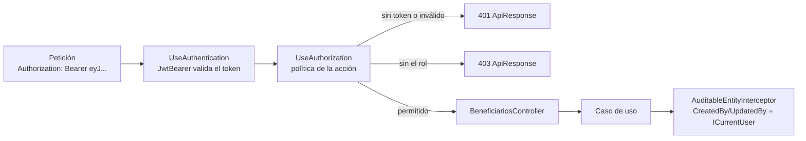

# Sesión 04: JWT y fundamentos de microservicios

**Objetivo:** proteger la API de Beneficiarios con tokens JWT y roles (bloque A) y diseñar la separación
Beneficiarios/Solicitudes como microservicios: contextos, contratos y propiedad de datos (bloque B).

| | |
|---|---|
| **Punto de partida** | Sesión 03 (CRUD `/api/v1/beneficiarios` con EF Core y SQL Server, sin autenticación) |
| **Resultado** | API de Beneficiarios con JWT, roles `Administrador`/`Operador`, políticas explícitas, Swagger con **Authorize**, auditoría con el usuario del token y pruebas de acceso; documento [Diseño de microservicios](../microservices-design.md) |
| **Fuera de alcance** | *Refresh tokens*, proveedor de identidad de producción, login en Angular, JWT en Solicitudes, lógica de Solicitudes, mensajería |

Referencia permanente de la seguridad: [docs/security.md](../security.md).

---

# Bloque A: Seguridad en .NET

## 1. Autenticación, autorización, 401 y 403

| Pregunta | Concepto | Si falla |
|----------|----------|----------|
| ¿**Quién** eres? | **Autenticación**: el token es auténtico (firma), es para esta API (audiencia), lo emitió quien esperamos (emisor) y no expiró | **401 Unauthorized** + `WWW-Authenticate: Bearer` |
| ¿**Qué** puedes hacer? | **Autorización**: el usuario tiene un rol que permite la política de la operación | **403 Forbidden** |

El nombre "401 Unauthorized" es histórico y confunde: en realidad significa *no autenticado*.

### Anatomía de un JWT

Un JWT (RFC 7519) son tres partes en Base64Url separadas por puntos: `header.payload.firma`.

```text
eyJhbGciOiJIUzI1NiIsInR5cCI6IkpXVCJ9 . eyJzdWIiOiJhZG1pbi5kZW1vIiwicm9sZSI6WyJBZG1pbmlzdHJhZG9yIl0sLi4ufQ . 3q0x...firma
  {"alg":"HS256","typ":"JWT"}             {"sub":"admin.demo","role":["Administrador"],...}                    HMAC-SHA256(header.payload, clave)
```

Payload real de un token emitido en esta sesión:

```json
{"aud":"social-management-api","iss":"social-management-dev","exp":1794885787,"iat":1794882187,"nbf":1794882187,
 "sub":"admin.demo","name":"admin.demo","role":["Administrador"]}
```

- La **firma** garantiza que nadie cambió el contenido: si alguien edita `role` para hacerse administrador, la firma
  deja de coincidir y la API responde 401.
- El contenido **no está cifrado**: cualquiera puede leerlo (pégalo en un decodificador Base64Url). Nunca pongas
  claves ni datos personales sensibles en un token.

---

## 2. Implementación



| Pieza | Archivo | Qué hace |
|-------|---------|----------|
| Autenticación JWT | `Api/Extensions/SecurityExtensions.cs` | `AddAuthentication().AddJwtBearer()`: valida firma HS256, emisor, audiencia y expiración (tolerancia de 30 s); claims con nombres cortos (`MapInboundClaims = false`) |
| Configuración | `Api/Security/JwtOptions.cs` | `Jwt:Issuer`, `Audience`, `ExpirationMinutes` en appsettings; `Jwt:SigningKey` solo como secreto (mínimo 32 bytes, validado al iniciar) |
| Roles | `Api/Security/Roles.cs` | `Administrador` y `Operador` |
| Políticas | `Api/Security/AuthorizationPolicies.cs` | `Beneficiarios.Lectura`, `Beneficiarios.Escritura`, `Beneficiarios.Desactivacion` |
| Controller | `Api/Controllers/BeneficiariosController.cs` | `[Authorize(Policy = ...)]` en **cada** acción, también en las de lectura |
| 401/403 | `Api/Security/ApiResponseAuthorizationResultHandler.cs` | Cuerpo `ApiResponse` en los controllers, igual que el resto de errores |
| Pipeline | `Api/Extensions/WebApplicationExtensions.cs` | `UseAuthentication()` y `UseAuthorization()` antes de `MapControllers()` |
| Usuario actual | `Application/Interfaces/ICurrentUser.cs`, `Api/Security/HttpContextCurrentUser.cs` | La auditoría guarda el usuario del token en `CreatedBy`/`UpdatedBy` |

### Roles y políticas

| Operación | Política | Administrador | Operador | Sin token |
|-----------|----------|:-------------:|:--------:|:---------:|
| `GET /api/v1/beneficiarios` y `/{id}` | Lectura | ✅ | ✅ | 401 |
| `POST /api/v1/beneficiarios` | Escritura | ✅ | ✅ | 401 |
| `PUT /api/v1/beneficiarios/{id}` | Escritura | ✅ | ✅ | 401 |
| `PATCH /api/v1/beneficiarios/{id}/desactivar` | Desactivación | ✅ | 403 | 401 |
| `/health`, `/version`, `/api/demo/status` | Pública | ✅ | ✅ | ✅ |

¿Por qué políticas y no `[Authorize(Roles = "Administrador")]` en cada acción? Porque la regla "quién puede hacer qué"
queda en **un solo lugar** (`AuthorizationPolicies.cs`). Si mañana el Operador también puede desactivar, se cambia una
línea y ningún controller.

¿Por qué declarar también la lectura? Los datos de beneficiarios son **datos personales**: leerlos también exige un
usuario identificado. Una prueba recorre todas las rutas `/api/v{n}/...` y falla si alguna no declara su política, así
que un endpoint nuevo no puede quedar público por olvido.

---

## 3. Emisión de tokens solo para desarrollo

`POST /api/auth/dev-token` cambia el usuario y la clave de un **usuario demo** por un token JWT. Sirve para probar la
API sin un proveedor de identidad.

```json
// Petición
{ "userName": "admin.demo", "password": "..." }

// Respuesta 200
{ "accessToken": "eyJ...", "tokenType": "Bearer", "expiresIn": 3600,
  "expiresAtUtc": "2026-11-16T22:23:07+00:00", "userName": "admin.demo", "roles": ["Administrador"] }
```

| Protección | Cómo |
|------------|------|
| **Solo en Development** | La ruta se registra únicamente si el ambiente es Development y `DevelopmentTokens:Enabled = true` (en `appsettings.Development.json`). Si alguien lo activa en Staging o Production, **la API no arranca**. |
| **Credenciales fuera del código** | Los usuarios demo (nombre, clave y roles) llegan por **user-secrets** (`scripts/setup.ps1` los copia de `.env`) o por variables de entorno en Docker. Ni el código ni `appsettings` los contienen. |
| **Sin pistas para un atacante** | Mismo 401 para usuario inexistente o clave incorrecta; comparación en tiempo constante; la clave nunca va al log. |
| **Configuración validada** | Al iniciar se comprueba que haya usuarios, claves de 12 o más caracteres, roles válidos y nombres sin repetir. |

**No es un proveedor de identidad:** no hay registro de usuarios, *refresh tokens*, revocación ni MFA. Eso queda
fuera del alcance de esta sesión, como pide el enunciado.

---

## 4. Swagger con Bearer

1. Abre `http://localhost:8081/swagger` y ejecuta `POST /api/auth/dev-token` con un usuario demo.
2. Copia `accessToken`, pulsa **Authorize** y pega **solo el token** (sin la palabra `Bearer`).
3. Las operaciones con candado envían el token. Swagger conserva la autorización al recargar la página.

Lo que se ve en Swagger lo genera el documento OpenAPI, sin configuración manual por endpoint:
- el esquema de seguridad `Bearer` (`http`, `bearer`, `JWT`) en `components.securitySchemes`;
- el candado, las respuestas **401 y 403** y el texto **"Roles permitidos: ..."** en cada operación protegida (los
  roles se leen de la política de la acción);
- los endpoints públicos sin candado. Fuera de Development, `/api/auth/dev-token` ni siquiera aparece en el documento.

---

## 5. Probar paso a paso

Primero prepara el equipo: `.\scripts\setup.ps1` agrega a `.env` las variables nuevas (`JWT_SIGNING_KEY`,
`DEMO_ADMIN_*`, `DEMO_OPERADOR_*`) y las guarda en user-secrets. Luego levanta los servicios (ver
[local-development.md](../local-development.md)) y usa los ejemplos de [security.md](../security.md#obtener-y-usar-un-token).

Recorrido real de esta sesión **a través del Gateway** (`:8080`), con la API contra LocalDB:

```text
Credenciales incorrectas     POST   /api/beneficiarios/api/auth/dev-token     -> 401  "Credenciales no válidas."
Sin token                    GET    /api/v1/beneficiarios/1                   -> 401  WWW-Authenticate: Bearer
Token alterado               GET    /api/v1/beneficiarios/1                   -> 401  WWW-Authenticate: Bearer error="invalid_token", error_description="The signature key was not found"
Operador consulta            GET    /api/v1/beneficiarios/1                   -> 200
Operador lista               GET    /api/v1/beneficiarios?pagina=1&tamanoPagina=5 -> 200
Operador registra            POST   /api/v1/beneficiarios                     -> 201  (Rosa Vargas Ñahui, Id 3)
Operador desactiva           PATCH  /api/v1/beneficiarios/3/desactivar        -> 403  "No tienes permisos para realizar esta operación."
Administrador desactiva      PATCH  /api/v1/beneficiarios/3/desactivar        -> 200
Público: versión             GET    /api/beneficiarios/version                -> 200  (sin token)
Solicitudes (base): versión  GET    /api/solicitudes/version                  -> 200

beneficiarios.Beneficiarios (LocalDB):
Id 3 | Rosa Vargas Ñahui | Inactivo | CreatedBy=operador.demo | UpdatedBy=admin.demo
```

La auditoría ya no es `null`: registra **quién** creó y **quién** modificó, tomado del token.

---

## 6. Pruebas

| Proyecto | Nuevas o cambiadas en esta sesión |
|----------|-----------------------------------|
| `Beneficiarios.Api.IntegrationTests` | **`AuthorizationTests`** (27): 401 sin token en las 5 operaciones; 401 con token expirado, firmado con otra clave, de otro emisor, para otra audiencia, alterado o mal formado; 403 del Operador al desactivar y de usuarios sin rol válido; acceso autorizado del Administrador (5 operaciones) y del Operador (4); endpoints técnicos públicos; **toda ruta `/api/v{n}` declara su política** |
| | **`DevelopmentTokenEndpointTests`** (10): token con emisor, audiencia, `sub`, `role` y 60 min de validez; 401 sin revelar qué falló; 400 por campos vacíos; el token emitido da acceso según el rol; ruta inexistente en Staging y Production; activarla fuera de Development impide el arranque |
| | `ConfigurationValidationTests`: sin `Jwt:SigningKey`, clave de menos de 32 bytes y usuarios demo mal configurados (sin nombre, clave corta, rol inexistente, repetidos) impiden el arranque |
| | `ApiDocumentationTests`: esquema Bearer; candado y roles en las operaciones protegidas; 401/403 documentados en el CRUD; endpoints públicos sin candado; sin `/api/auth/dev-token` en Staging |
| `Beneficiarios.SqlServer.IntegrationTests` | **`BeneficiariosAutorizacionTests`** (4) con tokens reales y SQL Server: 401 no guarda nada; el Operador registra y queda como autor; 403 deja el registro intacto y el Administrador desactiva y queda como autor de la modificación; credenciales incorrectas. El CRUD existente usa ahora un cliente autenticado y verifica `CreatedBy`/`UpdatedBy` |
| `Beneficiarios.Infrastructure.UnitTests` | El interceptor registra el usuario autenticado al crear y al modificar, y conserva el autor de la creación |
| `Gateway.IntegrationTests` | El Gateway reenvía la cabecera `Authorization` sin modificarla (rutas versionadas y con prefijo) |
| `LocalEnvironment.Tests` | El compose pasa la clave JWT y los usuarios demo por variables (`${...}`); `.env.example` trae una clave de 32 o más caracteres y claves demo de 12 o más |

**Truco de las pruebas sin base de datos:** las peticiones autorizadas usan datos inválidos (Id 0, página 0, cuerpo
vacío). El validador responde **400** antes de llegar a SQL Server, y ese 400 demuestra que la petición **pasó** la
autenticación y la autorización (si no, habría sido 401 o 403). El flujo con datos reales está en las pruebas de SQL
Server.

```powershell
$env:SM_SQLSERVER_TESTS = "Server=(localdb)\MSSQLLocalDB;Integrated Security=True;TrustServerCertificate=True"
dotnet test --solution SocialManagement.slnx
```

**Resultado:** 406 pruebas: **392 correctas, 0 con errores, 14 omitidas** (pruebas en vivo del entorno Docker, que
requieren `SM_ENVIRONMENT_TESTS`). Antes de la sesión eran 347. Compilación en modo CI (`-warnaserror`) sin
advertencias.

---

## 7. Desarrollo asistido por IA

Prompt 1: configuración de JWT:

```text
Contexto: ASP.NET Core 10, Clean Architecture, controllers que heredan de BaseApiController y responden ApiResponse<T>.
Tarea: configura JwtBearer con clave simétrica HS256 leída de IOptions<JwtOptions> (Issuer, Audience, SigningKey,
ExpirationMinutes), validando emisor, audiencia, firma y expiración, con claims cortos (sub, name, role).
Restricciones: la clave nunca en appsettings ni en el código; validar al iniciar que tenga al menos 32 bytes;
solo HS256; sin refresh tokens; explica cada parámetro de TokenValidationParameters en un comentario.
```

Prompt 2: pruebas de acceso:

```text
Contexto: WebApplicationFactory, xUnit v3, endpoints protegidos con políticas por rol (Administrador, Operador).
Tarea: escribe pruebas que cubran 401 (sin token, expirado, otra clave, otro emisor, otra audiencia, alterado),
403 (rol insuficiente) y acceso autorizado. La API no tiene base de datos en estas pruebas: usa entradas inválidas
para que el validador responda 400 y demostrar que la petición superó la autorización.
Restricciones: tokens creados con JsonWebTokenHandler y una clave exclusiva de prueba; nada de secretos reales.
```

Prompt 3: revisión de seguridad:

```text
Pego SecurityExtensions.cs, el endpoint de tokens de desarrollo y appsettings*.json.
Revisa: ¿se puede activar la emisión de tokens fuera de Development? ¿hay secretos en archivos versionados?
¿la respuesta o el tiempo revelan si un usuario existe? ¿qué pasa con un token con alg "none" o firmado con otra
clave? ¿se registra alguna clave en los logs? Responde con hallazgos concretos y la línea afectada.
```

Revisa siempre lo que genera la IA: es frecuente que proponga la clave de firma en `appsettings.json`,
`ValidateLifetime = false` "para probar", `[AllowAnonymous]` para que una prueba pase o un endpoint de login sin
restricción de ambiente. Las cuatro cosas rompen la seguridad de esta sesión.

---

## 8. Pendientes y decisiones conscientes

| Tema | Estado |
|------|--------|
| *Refresh tokens* y proveedor de identidad | Fuera de alcance por enunciado. Camino a producción en [security.md](../security.md#camino-a-producción-fuera-del-alcance-actual). |
| JWT en Solicitudes | Se agregará cuando Solicitudes tenga endpoints de negocio (mismos roles; ver la API propuesta en el documento de diseño). |
| Validación de tokens en el Gateway | Hoy solo valida cada servicio; el Gateway reenvía el token. Decisión abierta del módulo 4. |
| `UpdatedBy` al crear | `AuditableEntity.MarkCreated` asigna el creador también a `UpdatedBy` (con `UpdatedAtUtc` nulo). Se respetó ese diseño existente. |
| Carrera de registros duplicados (500 en vez de 409) y concurrencia optimista | Siguen pendientes desde la [sesión 03](session-03.md#9-pendientes-y-decisiones-conscientes). |

---

## 9. JWT no es OAuth 2.0

Es la confusión más común del tema. **JWT es un formato de token; OAuth 2.0 es un protocolo de autorización.** Se
pueden usar juntos, pero responden a preguntas distintas.

| | **JWT** (RFC 7519) | **OAuth 2.0** (RFC 6749) |
|---|-------------------|--------------------------|
| **Qué es** | Un **formato**: un JSON con *claims*, firmado (JWS) o cifrado (JWE) | Un **marco de autorización**: roles, flujos (*grants*) y endpoints para **obtener** tokens |
| **Qué resuelve** | Transportar afirmaciones verificables ("soy admin.demo, rol Administrador, válido hasta las 15:00") | Que una aplicación obtenga acceso **delegado** a un recurso **sin conocer la contraseña** del usuario |
| **Actores** | Emisor y receptor del token | Propietario del recurso (usuario), cliente (app), servidor de autorización, servidor de recursos (API) |
| **Flujos** | No define ninguno | *Authorization Code* + PKCE (apps web y móviles), *Client Credentials* (servicio a servicio), *Refresh Token*... |
| **Formato del token** | Es el formato | No lo impone: el *access token* puede ser un JWT o un valor opaco |
| **Identidad del usuario** | Puede llevarla en los claims | **No** trata la identidad. Para eso existe **OpenID Connect** (OIDC), una capa sobre OAuth 2.0 que agrega el *ID token* (que sí es un JWT) |

### Lo que hace este proyecto y lo que haría con OAuth 2.0

| | Sesión 04 (desarrollo) | Con OAuth 2.0 + OpenID Connect |
|---|------------------------|--------------------------------|
| Quién emite el token | La propia API (`/api/auth/dev-token`) | Un servidor de autorización independiente (Entra ID, Keycloak, Auth0...) |
| Cómo lo obtiene el usuario | Envía usuario y clave a la API | El navegador se redirige al proveedor, el usuario inicia sesión **allí** y la app recibe un código que cambia por tokens (*Authorization Code* + PKCE) |
| ¿La API ve la contraseña? | Sí (solo usuarios demo) | **Nunca** |
| Firma | Clave simétrica compartida (HS256) | Clave privada del proveedor; la API valida con la pública (RS256, JWKS) |
| Renovación | No hay: al expirar se pide otro | *Refresh tokens* |
| Lo que **no** cambia | La API sigue recibiendo `Authorization: Bearer <JWT>` y validando emisor, audiencia, firma y expiración con `AddJwtBearer`. Las políticas y los roles son los mismos. | |

En resumen: en esta sesión usamos **tokens JWT con autenticación Bearer**, pero **no** implementamos OAuth 2.0 (no hay
servidor de autorización, ni *grants*, ni consentimiento). Por eso migrar a un proveedor real cambia **quién emite** el
token, no cómo la API lo valida.

---

# Bloque B: Microservicios

El entregable completo es [docs/microservices-design.md](../microservices-design.md). Resumen:

| Punto del enunciado | Sección del documento |
|---------------------|-----------------------|
| 1. Analizar la aplicación como caso de estudio | 1: inventario y evaluación honesta "¿monolito modular o microservicios?" |
| 2. Ventajas, desventajas y costos de dividir un monolito | 2: tabla comparativa y costos que suelen olvidarse |
| 3. Contextos Beneficiarios y Solicitudes | 3: responsabilidades, lenguaje ubicuo, invariantes y mapa de contextos (cliente-proveedor con capa anticorrupción) |
| 4. Contratos iniciales entre servicios | 4: eventos v1 con `eventId` `long`, consulta HTTP de respaldo con *token relay* y API propuesta de Solicitudes |
| 5. Principios de propiedad de datos | 5: nueve principios (un dueño por dato, sin FK entre servicios, copias de solo lectura, mínimo dato personal...) |
| 6. Diagrama Mermaid del sistema | 6: lo que existe y lo diseñado (líneas discontinuas); 4.5: secuencia "registrar solicitud" |
| 7. Verificar los proyectos base de Solicitudes | 1: los 4 proyectos compilan, 48 pruebas en verde, `/health` y `/version` responden 200 directo y por el Gateway |
| 8. Sin lógica de solicitudes | Cumplido: Solicitudes no cambió en esta sesión |

---

## 10. Ejercicios propuestos

1. Crea un tercer usuario demo con los dos roles (`Roles:0` y `Roles:1`) en user-secrets. ¿Qué devuelve `roles` en el
   token? ¿Qué operaciones puede hacer?
2. Cambia la política `Beneficiarios.Desactivacion` para permitir también al Operador. ¿Cuántos archivos tocaste? ¿Qué
   prueba falla y por qué es correcto que falle?
3. Decodifica un token en Base64Url, cambia `"Operador"` por `"Administrador"`, vuelve a codificarlo y úsalo. Explica
   el 401 que recibes.
4. Del documento de diseño: escribe el JSON del evento `beneficiario-desactivado` v1 completo (sobre + `data`) y
   explica cómo detectaría Solicitudes que lo recibió dos veces.

---

## 11. Cambios de esta sesión

| Archivo | Cambio |
|---------|--------|
| `Directory.Packages.props`, `Beneficiarios.Api.csproj` | **Nuevo** paquete `Microsoft.AspNetCore.Authentication.JwtBearer` 10.0.15 |
| `Api/Extensions/SecurityExtensions.cs` | **Nuevo**: JWT Bearer, políticas, validación de configuración, `ICurrentUser`, emisor de tokens de desarrollo |
| `Api/Security/*` | **Nuevos**: `Roles`, `AuthorizationPolicies`, `JwtOptions`, `JwtClaimTypes`, `DevelopmentTokenOptions`, `DevelopmentUserOptions`, `DevelopmentTokenIssuer`, `ApiResponseAuthorizationResultHandler`, `HttpContextCurrentUser`, `SecretComparer` |
| `Api/Endpoints/IssueDevelopmentTokenEndpoint.cs`, `Api/Contracts/DevToken*.cs` | **Nuevos**: `POST /api/auth/dev-token` (solo Development) |
| `Api/Extensions/ApiResponseFormatExtensions.cs` | **Nuevo**: `UsesApiResponseFormat()` compartido por excepciones y 401/403 (antes privado en `GlobalExceptionHandler`) |
| `Api/Controllers/BeneficiariosController.cs` | `[Authorize(Policy = ...)]` en cada acción |
| `Api/Program.cs`, `Extensions/ApiServiceCollectionExtensions.cs`, `Extensions/WebApplicationExtensions.cs` | Registro de la seguridad, `UseAuthentication`/`UseAuthorization`, ruta de tokens condicionada al ambiente |
| `Api/Configuration/OpenApi/BearerSecurityRequirementTransformer.cs` | 403 y "Roles permitidos" a partir de la política |
| `Api/Extensions/ApiDocumentationExtensions.cs` | Swagger UI conserva la autorización (`EnablePersistAuthorization`) |
| `Api/Middleware/ApiDocumentationAccessMiddleware.cs` | Usa `SecretComparer` (misma comparación en tiempo constante) |
| `Api/appsettings.json`, `appsettings.Development.json` | Secciones `Jwt` y `DevelopmentTokens` (sin secretos) |
| `Application/Interfaces/ICurrentUser.cs` | **Nuevo**: usuario actual para la auditoría |
| `Infrastructure/Persistence/Interceptors/AuditableEntityInterceptor.cs`, `AnonymousCurrentUser.cs` | `CreatedBy`/`UpdatedBy` desde `ICurrentUser`; "sin usuario" por defecto fuera de la API |
| `Infrastructure/Configurations/ConfigurationMessages.cs` | Público, para que la API reutilice los mensajes de configuración |
| `.env.example`, `infra/docker/docker-compose.yml` | `JWT_SIGNING_KEY`, `DEMO_ADMIN_*`, `DEMO_OPERADOR_*` → variables de `beneficiarios-api` |
| `scripts/setup.ps1` | Agrega a un `.env` existente las variables nuevas de `.env.example`; valida la clave JWT y las claves demo; guarda los secretos JWT en user-secrets |
| `docs/microservices-design.md`, `docs/security.md` | **Nuevos** |
| `docs/api-documentation.md`, `architecture.md`, `local-development.md`, `troubleshooting.md`, `roadmap.md`, `README.md` | Actualizados |
| `tests/...` | Pruebas descritas en la sección 6; se eliminaron `TestBearerHandler` y `ProtectedTestController` de Beneficiarios (ya hay un esquema Bearer real) |

### Criterios de aceptación

| Criterio | Verificación |
|----------|--------------|
| JWT configurado en BeneficiariosService | `AuthorizationTests` (401 con 6 tipos de token inválido); recorrido manual |
| Emisión de tokens solo para desarrollo, credenciales fuera del código | `DevelopmentTokenEndpointTests` (404 en Staging/Production, no arranca si se activa); usuarios en user-secrets y variables de entorno |
| Claims y roles `Administrador` y `Operador` | Payload del token (sección 1); `role` verificado en las pruebas |
| Escritura protegida y lectura explícita | Política en cada acción; `Toda_ruta_de_negocio_declara_explicitamente_su_politica_de_autorizacion` |
| OpenAPI y Swagger con Bearer | Botón Authorize, candado, 401/403 y roles; `ApiDocumentationTests` |
| Pruebas de acceso autorizado y no autorizado | `AuthorizationTests`, `DevelopmentTokenEndpointTests` y `BeneficiariosAutorizacionTests` (SQL Server); 406 pruebas en total (59 más que en la sesión 03), 0 errores |
| Diferencia JWT y OAuth 2.0 documentada | Sección 9 |
| Documento de diseño de microservicios | [microservices-design.md](../microservices-design.md) con diagrama Mermaid |
| Proyectos base de Solicitudes disponibles, sin lógica | Sección 1 del documento de diseño |
